> *Zuletzt aktualisiert: 28. März 2026, 19:45 Uhr — Workflow: MySuricates Docs aktualisieren | Run: 01102949-3825-4cd9-b4b9-8aa84917c4c2*

# Datenmodell

## ER-Diagramm (Kern)

```mermaid
erDiagram
    projects ||--o| containers : "hat"
    projects ||--o{ workflows : "enthält"
    workflows ||--o{ workflow_runs : "hat"
    workflows }o--o{ skills : "aktiviert"
    workflow_runs ||--o{ step_results : "enthält"
    skills ||--o{ capabilities : "hat"
    workflows ||--o{ scheduled_workflows : "geplant"
    workflows ||--o{ webhook_triggers : "getriggert"
    workflows ||--o{ workflow_memory : "hat"
    workflow_templates ||--o{ workflows : "instanziiert"
    workflow_chains ||--o{ chain_runs : "hat"
    projects ||--o{ todos : "hat"
    projects ||--o{ wishes : "hat"
    workflows ||--o{ completion_triggers_source : "löst aus"
    workflows ||--o{ completion_triggers_target : "wird ausgelöst"
    workflows ||--o{ notification_configs : "benachrichtigt"

    projects {
        TEXT id PK
        TEXT name "NOT NULL"
        TEXT subtitle
        TEXT description
        TEXT type "NOT NULL"
        TEXT path "NOT NULL"
        TEXT config "JSON"
        TEXT status "NOT NULL, DEFAULT STOPPED"
        TEXT ai_context
        TEXT archived_at
        TEXT created_at
        TEXT updated_at
    }

    workflows {
        TEXT id PK
        TEXT project_id FK "NOT NULL"
        TEXT name "NOT NULL"
        TEXT description
        TEXT icon
        TEXT blocks "JSON"
        TEXT instructions
        TEXT model
        TEXT provider
        TEXT default_context "JSON"
        TEXT template_id FK
        TEXT test_status "DEFAULT UNTESTED"
        TEXT last_tested_at
        TEXT block_types
        TEXT version "DEFAULT 1.0.0"
        TEXT metadata "JSON"
        TEXT deleted_at
        TEXT stable_synced_at
        TEXT created_at
        TEXT updated_at
    }

    workflow_runs {
        TEXT id PK
        TEXT workflow_id FK "NOT NULL"
        TEXT status "NOT NULL, DEFAULT PENDING"
        TEXT input_context "JSON"
        TEXT started_at
        TEXT completed_at
        INTEGER duration_ms
        INTEGER user_rating
        TEXT error "JSON"
        TEXT metadata "JSON"
        TEXT triggered_by_schedule_id
    }

    step_results {
        TEXT id PK
        TEXT workflow_run_id FK "NOT NULL"
        INTEGER step_index "NOT NULL"
        TEXT input
        TEXT output
        TEXT status "NOT NULL, DEFAULT PENDING"
        TEXT started_at
        TEXT completed_at
        INTEGER duration_ms
        TEXT metadata "JSON"
        TEXT context_delta "JSON"
    }

    workflow_templates {
        TEXT id PK
        TEXT name "JSON i18n map"
        TEXT description "JSON i18n map"
        TEXT icon
        TEXT category
        TEXT blocks "JSON"
        TEXT instructions
        TEXT model
        INTEGER built_in "DEFAULT 0"
        INTEGER sort_order "DEFAULT 0"
        TEXT quality_status "DEFAULT UNTESTED"
        TEXT version "DEFAULT 1.0.0"
        TEXT created_at
        TEXT updated_at
    }

    template_verifications {
        TEXT id PK
        TEXT template_id FK "NOT NULL"
        TEXT project_id FK "NOT NULL"
        TEXT last_run_id FK
        TIMESTAMP verified_at "NOT NULL"
    }

    workflow_memory {
        TEXT id PK
        TEXT workflow_id FK "NOT NULL"
        TEXT title
        TEXT content "NOT NULL"
        TEXT tags
        TEXT source_run_ids
        TEXT provider "NOT NULL"
        INTEGER active "DEFAULT 0"
        TEXT created_at "NOT NULL"
    }

    workflow_chains {
        TEXT id PK
        TEXT name "NOT NULL"
        TEXT description
        TEXT icon
        TEXT entries "JSON"
        INTEGER stop_on_failure "DEFAULT 1"
        TEXT metadata "JSON"
        TEXT created_at
        TEXT updated_at
    }

    chain_runs {
        TEXT id PK
        TEXT chain_id FK "NOT NULL"
        TEXT status "DEFAULT PENDING"
        TEXT entry_runs "JSON"
        TEXT input_context "JSON"
        TEXT started_at
        TEXT completed_at
        INTEGER duration_ms
        TEXT error
        TEXT metadata
        TEXT triggered_by_schedule_id
    }

    scheduled_workflows {
        TEXT id PK
        TEXT workflow_id FK
        TEXT chain_id FK
        TEXT target_type "DEFAULT WORKFLOW"
        TEXT schedule_type "DEFAULT CRON"
        TEXT cron_expression "NOT NULL"
        TEXT scheduled_at
        TEXT delay_expression
        INTEGER enabled "DEFAULT 1"
        TEXT description
        TEXT input_context "JSON"
        TEXT last_run_at
        TEXT next_run_at
        TEXT end_date
        INTEGER max_runs "DEFAULT 0"
        INTEGER run_count "DEFAULT 0"
        TEXT conflict_behavior "DEFAULT SKIP"
        TEXT created_at
        TEXT updated_at
    }

    todos {
        TEXT id PK
        TEXT title "NOT NULL"
        TEXT description
        TEXT status "DEFAULT OPEN"
        TEXT priority "DEFAULT MEDIUM"
        TEXT tags
        TEXT project_id FK
        TEXT source "DEFAULT USER"
        TEXT source_agent
        TEXT session_id
        TEXT workflow_run_id
        TEXT reference_type
        TEXT reference_id
        TEXT created_at
        TEXT updated_at
    }

    activity_log {
        TEXT id PK
        TEXT timestamp "NOT NULL"
        TEXT level "NOT NULL"
        TEXT category "NOT NULL"
        TEXT message "NOT NULL"
        TEXT source
        TEXT reference_id
        TEXT workflow_id
        TEXT metadata
        TEXT created_at "NOT NULL"
    }

    wishes {
        TEXT id PK
        TEXT original_text "NOT NULL"
        TEXT status "DEFAULT RECEIVED"
        TEXT project_id FK
        TEXT decomposition
        TEXT generated_workflow_ids
        TEXT generated_chain_id
        TEXT reference_workflow_ids
        INTEGER iteration_count "DEFAULT 0"
        INTEGER max_iterations "DEFAULT 5"
        TEXT current_run_id
        TEXT result_summary
        TEXT iteration_history
        TEXT error
        TEXT metadata
        TEXT created_at
        TEXT updated_at
    }

    completion_triggers {
        TEXT id PK
        TEXT source_workflow_id FK "NOT NULL"
        TEXT target_workflow_id FK "NOT NULL"
        INTEGER enabled "DEFAULT 1"
        INTEGER trigger_on_success "DEFAULT 1"
        INTEGER trigger_on_failure "DEFAULT 0"
        INTEGER trigger_always "DEFAULT 0"
        TEXT description
        TEXT context_variables "JSON"
        TEXT last_triggered_at
        INTEGER trigger_count "DEFAULT 0"
        TEXT created_at
        TEXT updated_at
    }

    notification_configs {
        TEXT id PK
        TEXT name "NOT NULL"
        INTEGER enabled "DEFAULT 1"
        TEXT channel_type "DEFAULT WEBHOOK"
        TEXT webhook_url
        TEXT workflow_id FK
        INTEGER trigger_on_success "DEFAULT 1"
        INTEGER trigger_on_failure "DEFAULT 1"
        INTEGER trigger_always "DEFAULT 0"
        TEXT message_template
        TEXT created_at
        TEXT updated_at
    }

    assistant_sessions {
        TEXT id PK
        TEXT page "NOT NULL"
        TEXT entity_id
        TEXT messages "NOT NULL, DEFAULT []"
        INTEGER message_count "DEFAULT 0"
        TEXT started_at "NOT NULL"
        TEXT ended_at
    }

    page_suggestions {
        TEXT id PK
        TEXT page "NOT NULL, UNIQUE"
        TEXT suggestions "NOT NULL, DEFAULT []"
        TEXT generated_by "DEFAULT CLAUDE"
        TEXT generated_at "NOT NULL"
        INTEGER based_on_sessions "DEFAULT 0"
    }

    app_settings {
        TEXT key PK
        TEXT value "NOT NULL"
        TEXT created_at
    }
```



## Tabellen

### `projects`

| Spalte | Typ | Constraints | Beschreibung |
|---|---|---|---|
| `id` | TEXT | PK | UUID |
| `name` | TEXT | NOT NULL | Projektname |
| `subtitle` | TEXT | | Kurzbeschreibung (V18) |
| `description` | TEXT | | Ausführliche Beschreibung (V18) |
| `type` | TEXT | NOT NULL | Enum: ProjectType |
| `path` | TEXT | NOT NULL | Arbeitsverzeichnis (Host-Pfad) |
| `config` | TEXT | | JSON-Konfiguration |
| `status` | TEXT | NOT NULL, DEFAULT 'STOPPED' | Enum: ProjectStatus |
| `ai_context` | TEXT | | Zusätzlicher AI-Kontext für das Projekt (V30) |
| `archived_at` | TEXT | | Archivierungszeitpunkt, NULL = aktiv (V35) |
| `created_at` | TEXT | | ISO-8601 Timestamp |
| `updated_at` | TEXT | | ISO-8601 Timestamp |

**Hinweis:** Projekte werden nicht hart gelöscht, sondern archiviert (`archived_at IS NOT NULL`). Archivierte Projekte behalten alle Workflows, Runs und Daten.

### `containers`

| Spalte | Typ | Constraints | Beschreibung |
|---|---|---|---|
| `id` | TEXT | PK | UUID |
| `project_id` | TEXT | FK → projects, UNIQUE, NOT NULL | 1:1-Beziehung |
| `docker_container_id` | TEXT | NOT NULL | Docker Container ID |
| `image_name` | TEXT | NOT NULL | Docker Image Name |
| `status` | TEXT | NOT NULL, DEFAULT 'CREATED' | Enum: ContainerStatus |
| `mounts` | TEXT | | JSON: gemountete Volumes |
| `started_at` | TEXT | | Startzeitpunkt |
| `stopped_at` | TEXT | | Stoppzeitpunkt |
| `last_activity_at` | TEXT | | Letzte Aktivität (V11, Auto-Stop-Timeout) |

### `skills`

| Spalte | Typ | Constraints | Beschreibung |
|---|---|---|---|
| `id` | TEXT | PK | UUID (bei built-ins stabile ID) |
| `name` | TEXT | NOT NULL | Skill-Name |
| `description` | TEXT | | Beschreibung |
| `icon` | TEXT | | Emoji oder Icon-Name |
| `category` | TEXT | NOT NULL | Enum: SkillCategory |
| `ai_context` | TEXT | | System-Prompt für AI |
| `config_schema` | TEXT | | JSON-Schema |
| `builtin` | INTEGER | NOT NULL, DEFAULT 0 | 0=custom, 1=builtin |
| `version` | TEXT | DEFAULT '1.0.0' | Versionsnummer |
| `created_at` | TEXT | | Erstellzeitpunkt |
| `updated_at` | TEXT | | Aktualisierungszeitpunkt |

16 eingebaute Skills werden durch `SkillSeeder` beim Start angelegt (idempotent). Built-in Skills haben stabile IDs (z.B. `builtin-code-review`).

### `capabilities`

| Spalte | Typ | Constraints | Beschreibung |
|---|---|---|---|
| `id` | TEXT | PK | UUID |
| `skill_id` | TEXT | FK → skills, NOT NULL | Gehört zu Skill |
| `name` | TEXT | NOT NULL | Fähigkeitsname |
| `description` | TEXT | | Beschreibung |
| `handler_class` | TEXT | | Java-Handler-Klasse |
| `input_schema` | TEXT | | JSON-Schema für Eingabe |
| `output_schema` | TEXT | | JSON-Schema für Ausgabe |
| `async` | INTEGER | NOT NULL, DEFAULT 0 | Asynchrone Ausführung |

### `workflows`

| Spalte | Typ | Constraints | Beschreibung |
|---|---|---|---|
| `id` | TEXT | PK | UUID |
| `project_id` | TEXT | FK → projects, NOT NULL | Gehört zu Projekt |
| `name` | TEXT | NOT NULL | Workflow-Name |
| `description` | TEXT | | Beschreibung |
| `icon` | TEXT | | Emoji |
| `blocks` | TEXT | | JSON: Liste von BlockDefinitions |
| `instructions` | TEXT | | Workflow-spezifische Agent-Instructions (V13) |
| `model` | TEXT | | Claude-Modell-Override (V13), z.B. `claude-opus-4-6` |
| `provider` | TEXT | | AI-Provider-Override (V34), z.B. `CLAUDE`, `CODEX` |
| `default_context` | TEXT | DEFAULT '{}' | JSON: Standard-Kontext-Variablen (V23) |
| `template_id` | TEXT | FK → workflow_templates, ON DELETE SET NULL | Quell-Template (V19) |
| `test_status` | TEXT | DEFAULT 'UNTESTED' | Teststatus: UNTESTED, PASSED, FAILED (V25) |
| `last_tested_at` | TEXT | | Letzter Testzeitpunkt (V25) |
| `block_types` | TEXT | DEFAULT '' | Denormalisierte Block-Typen, kommagetrennt (V26) |
| `version` | TEXT | DEFAULT '1.0.0' | Versionsnummer |
| `metadata` | TEXT | | JSON: Zusätzliche Metadaten |
| `deleted_at` | TEXT | | Soft-Delete-Zeitpunkt (V32). `@SQLRestriction("deleted_at IS NULL")` |
| `stable_synced_at` | TEXT | | Zeitpunkt der letzten Synchronisierung nach Stable (V46) |
| `created_at` | TEXT | | Erstellzeitpunkt |
| `updated_at` | TEXT | | Aktualisierungszeitpunkt |

**Soft-Delete:** Die Entity-Klasse trägt `@SQLRestriction("deleted_at IS NULL")`. Gelöschte Workflows sind dauerhaft aus allen Abfragen ausgeblendet.

### `workflow_skills` (Join-Tabelle)

| Spalte | Typ | Constraints | Beschreibung |
|---|---|---|---|
| `workflow_id` | TEXT | PK, FK → workflows | Workflow |
| `skill_id` | TEXT | PK, FK → skills | Aktivierter Skill |

M:N-Beziehung zwischen Workflows und Skills.

### `workflow_runs`

| Spalte | Typ | Constraints | Beschreibung |
|---|---|---|---|
| `id` | TEXT | PK | UUID |
| `workflow_id` | TEXT | FK → workflows, NOT NULL | Zugehöriger Workflow |
| `status` | TEXT | NOT NULL, DEFAULT 'PENDING' | Enum: RunStatus |
| `input_context` | TEXT | | JSON: Eingabe-Kontext beim Start (V20) |
| `started_at` | TEXT | | Startzeitpunkt |
| `completed_at` | TEXT | | Endzeitpunkt |
| `duration_ms` | INTEGER | | Laufzeit in Millisekunden |
| `user_rating` | INTEGER | | Bewertung 1-5 |
| `error` | TEXT | | JSON: Fehlerbeschreibung |
| `metadata` | TEXT | | JSON: Gate-Status, Zusatzinfos (`gate_status`, `gate_category`, `gate_description`) |
| `triggered_by_schedule_id` | TEXT | | ID des auslösenden Schedules (V43) |

### `step_results`

| Spalte | Typ | Constraints | Beschreibung |
|---|---|---|---|
| `id` | TEXT | PK | UUID |
| `workflow_run_id` | TEXT | FK → workflow_runs, NOT NULL | Zugehöriger Run |
| `step_index` | INTEGER | NOT NULL | Reihenfolge (0-basiert) |
| `input` | TEXT | | Eingabe/Prompt des Schritts |
| `output` | TEXT | | Ausgabe des Schritts |
| `status` | TEXT | NOT NULL, DEFAULT 'PENDING' | Enum: StepStatus |
| `started_at` | TEXT | | Startzeitpunkt |
| `completed_at` | TEXT | | Endzeitpunkt |
| `duration_ms` | INTEGER | | Laufzeit in Millisekunden |
| `metadata` | TEXT | | JSON: Zusätzliche Metadaten |
| `context_delta` | TEXT | | JSON: Kumulativer Snapshot der Kontext-Variablen am Ende des Schritts (V47). Wird zur Wiederherstellung des Kontexts bei INTERRUPTED Runs verwendet |

### `scheduled_workflows`

| Spalte | Typ | Constraints | Beschreibung |
|---|---|---|---|
| `id` | TEXT | PK | UUID |
| `workflow_id` | TEXT | FK → workflows | Workflow (oder NULL bei Chain-Target) (V38) |
| `chain_id` | TEXT | FK → workflow_chains | Chain (V27, wenn `target_type = CHAIN`) |
| `target_type` | TEXT | NOT NULL, DEFAULT 'WORKFLOW' | `WORKFLOW` oder `CHAIN` (V27) |
| `schedule_type` | TEXT | NOT NULL, DEFAULT 'CRON' | `CRON`, `ONCE` (V14) oder `DELAYED` (V37) |
| `cron_expression` | TEXT | NOT NULL | Spring Cron (6 Felder) |
| `scheduled_at` | TEXT | | Einmaliger Ausführungszeitpunkt (V14, bei `ONCE`) |
| `delay_expression` | TEXT | | Menschenlesbare Verzögerung bei `DELAYED`, z.B. `"2h"`, `"30m"`, `"1d"` (V37) |
| `enabled` | INTEGER | NOT NULL, DEFAULT 1 | Aktiv/Inaktiv |
| `description` | TEXT | | Beschreibung |
| `input_context` | TEXT | DEFAULT '{}' | JSON: Kontext-Variablen |
| `last_run_at` | TEXT | | Letzte Ausführung |
| `next_run_at` | TEXT | | Nächste geplante Ausführung |
| `end_date` | TEXT | | Optionales Enddatum für CRON-Schedules — Schedule wird deaktiviert wenn `now >= endDate` (V44) |
| `max_runs` | INTEGER | DEFAULT 0 | Maximale Anzahl Ausführungen (0 = unbegrenzt) (V44) |
| `run_count` | INTEGER | DEFAULT 0 | Zähler, wird nach jeder Ausführung inkrementiert (V44) |
| `conflict_behavior` | TEXT | DEFAULT 'SKIP' | Verhalten bei bereits laufender Ausführung: `SKIP` oder `OVERLAP` (V45) |
| `created_at` | TEXT | | Erstellzeitpunkt |
| `updated_at` | TEXT | | Aktualisierungszeitpunkt |

### `webhook_triggers`

| Spalte | Typ | Constraints | Beschreibung |
|---|---|---|---|
| `id` | TEXT | PK | UUID |
| `workflow_id` | TEXT | FK → workflows, NOT NULL | Workflow |
| `secret_token` | TEXT | NOT NULL, UNIQUE | Trigger-Token |
| `enabled` | INTEGER | NOT NULL, DEFAULT 1 | Aktiv/Inaktiv |
| `description` | TEXT | | Beschreibung |
| `default_context` | TEXT | DEFAULT '{}' | JSON: Standard-Kontext |
| `last_triggered_at` | TEXT | | Letzte Auslösung |
| `trigger_count` | INTEGER | NOT NULL, DEFAULT 0 | Anzahl Auslösungen |
| `created_at` | TEXT | | Erstellzeitpunkt |
| `updated_at` | TEXT | | Aktualisierungszeitpunkt |

**Index:** `idx_webhook_triggers_token` auf `secret_token` (UNIQUE)

### `workflow_templates`

| Spalte | Typ | Constraints | Beschreibung |
|---|---|---|---|
| `id` | TEXT | PK | UUID |
| `name` | TEXT | NOT NULL | JSON i18n-Map: `{"de":"...","en":"..."}` |
| `description` | TEXT | | JSON i18n-Map |
| `icon` | TEXT | | Emoji |
| `category` | TEXT | | Kategorie-Label |
| `blocks` | TEXT | NOT NULL | JSON: BlockDefinition-Liste |
| `instructions` | TEXT | | Agent-Instructions |
| `model` | TEXT | | Modell-Override |
| `built_in` | INTEGER | DEFAULT 0 | 1 = Built-in (unveränderlich) |
| `sort_order` | INTEGER | DEFAULT 0 | Sortierreihenfolge |
| `quality_status` | TEXT | NOT NULL, DEFAULT 'UNTESTED' | Qualitätsstatus (V22) |
| `version` | TEXT | DEFAULT '1.0.0' | Template-Version |
| `created_at` | TEXT | | |
| `updated_at` | TEXT | | |

44 Built-in-Templates werden durch `WorkflowTemplateSeeder` beim Start angelegt. Template-Definitionen liegen als JSON unter `src/main/resources/templates/builtin/`.

### `template_verifications`

| Spalte | Typ | Constraints | Beschreibung |
|---|---|---|---|
| `id` | TEXT | PK | UUID |
| `template_id` | TEXT | FK → workflow_templates, NOT NULL | Template |
| `project_id` | TEXT | FK → projects, NOT NULL | Projekt |
| `last_run_id` | TEXT | FK → workflow_runs, ON DELETE SET NULL | Letzter Test-Run |
| `verified_at` | TIMESTAMP | NOT NULL | Verifizierungszeitpunkt |

**Unique Constraint:** `(template_id, project_id)` — ein Eintrag pro Template+Projekt-Kombination.

### `workflow_memory`

| Spalte | Typ | Constraints | Beschreibung |
|---|---|---|---|
| `id` | TEXT | PK | UUID |
| `workflow_id` | TEXT | FK → workflows, NOT NULL, ON DELETE CASCADE | Zugehöriger Workflow |
| `title` | TEXT | | Kurztitel des Wissenseintrags |
| `content` | TEXT | NOT NULL | Extrahiertes Wissen (Markdown) |
| `tags` | TEXT | | Kommagetrennte Tags (JSON-Array als Text) |
| `source_run_ids` | TEXT | | JSON-Array von Run-IDs, aus denen extrahiert wurde |
| `provider` | TEXT | NOT NULL | `CLAUDE` oder `CODEX` |
| `active` | INTEGER | NOT NULL, DEFAULT 0 | 1 = in nachfolgende Runs injizieren |
| `created_at` | TEXT | NOT NULL | |

**Indizes:** `idx_workflow_memory_workflow`, `idx_workflow_memory_active`

### `workflow_chains`

| Spalte | Typ | Constraints | Beschreibung |
|---|---|---|---|
| `id` | TEXT | PK | UUID |
| `name` | TEXT | NOT NULL | Chain-Name |
| `description` | TEXT | | Beschreibung |
| `icon` | TEXT | | Emoji |
| `entries` | TEXT | | JSON: Liste von `ChainEntry`-Objekten (sortiert nach `sortOrder`) |
| `stop_on_failure` | INTEGER | NOT NULL, DEFAULT 1 | Chain-Level Stop-on-Failure-Flag |
| `metadata` | TEXT | | JSON: Zusätzliche Metadaten |
| `created_at` | TEXT | NOT NULL | |
| `updated_at` | TEXT | NOT NULL | |

Eine Chain gehört zu keinem Projekt und kann Workflows aus verschiedenen Projekten referenzieren.

**ChainEntry (JSON-Struktur innerhalb `entries`):**
```json
{
  "workflowId": "uuid",
  "label": "optionaler Anzeigename",
  "sortOrder": 0,
  "inputContext": {},
  "stopOnFailure": true
}
```

### `chain_runs`

| Spalte | Typ | Constraints | Beschreibung |
|---|---|---|---|
| `id` | TEXT | PK | UUID |
| `chain_id` | TEXT | FK → workflow_chains, NOT NULL, ON DELETE CASCADE | Zugehörige Chain |
| `status` | TEXT | NOT NULL, DEFAULT 'PENDING' | Enum: RunStatus |
| `entry_runs` | TEXT | | JSON: Liste von `ChainRunEntry`-Objekten (Run-IDs pro Entry) |
| `input_context` | TEXT | | JSON: Eingabe-Kontext |
| `started_at` | TEXT | | |
| `completed_at` | TEXT | | |
| `duration_ms` | INTEGER | | |
| `error` | TEXT | | Fehlermeldung |
| `metadata` | TEXT | | JSON: Zusätzliche Metadaten |
| `triggered_by_schedule_id` | TEXT | | ID des auslösenden Schedules (V43) |

**ChainRunEntry (JSON-Struktur innerhalb `entry_runs`):**
```json
{
  "entryIndex": 0,
  "workflowId": "uuid",
  "workflowName": "Name",
  "projectName": "Projekt",
  "workflowRunId": "uuid",
  "status": "PENDING",
  "startedAt": null,
  "completedAt": null,
  "durationMs": null
}
```

**Indizes:** `idx_chain_runs_chain_id`, `idx_chain_runs_status`

### `todos`

| Spalte | Typ | Constraints | Beschreibung |
|---|---|---|---|
| `id` | TEXT | PK | UUID |
| `title` | TEXT | NOT NULL | Kurztitel im Imperativ |
| `description` | TEXT | | Markdown-Beschreibung |
| `status` | TEXT | NOT NULL, DEFAULT 'OPEN' | `OPEN`, `IN_PROGRESS`, `DONE`, `BACKLOG` |
| `priority` | TEXT | NOT NULL, DEFAULT 'MEDIUM' | `HIGH`, `MEDIUM`, `LOW` |
| `tags` | TEXT | | JSON-Array als Text |
| `project_id` | TEXT | FK → projects, ON DELETE SET NULL | Optionale Projektzuordnung |
| `source` | TEXT | NOT NULL, DEFAULT 'USER' | `USER`, `AI`, `WORKFLOW` |
| `source_agent` | TEXT | | z.B. `claude-code` |
| `session_id` | TEXT | | Shell-Session-ID des Erstellers (V36) |
| `workflow_run_id` | TEXT | | Verknüpfter Workflow-Run (bei automatisch erstellt) |
| `reference_type` | TEXT | | Typ des Referenz-Objekts |
| `reference_id` | TEXT | | ID des Referenz-Objekts |
| `created_at` | TEXT | NOT NULL | |
| `updated_at` | TEXT | NOT NULL | |

**Indizes:** `idx_todos_status`, `idx_todos_project`, `idx_todos_source`, `idx_todos_created`

TODOs werden von `AutoTodoService` automatisch bei RED/YELLOW Gate-Status erstellt (RED → HIGH, YELLOW → MEDIUM).

### `activity_log`

| Spalte | Typ | Constraints | Beschreibung |
|---|---|---|---|
| `id` | TEXT | PK | UUID |
| `timestamp` | TEXT | NOT NULL | ISO-8601 Ereigniszeitpunkt |
| `level` | TEXT | NOT NULL | `DEBUG`, `INFO`, `WARN`, `ERROR` |
| `category` | TEXT | NOT NULL | `SYSTEM`, `EXECUTION`, `SCHEDULE`, `WEBHOOK`, `SECURITY`, `CONTAINER` |
| `message` | TEXT | NOT NULL | Log-Nachricht |
| `source` | TEXT | | Quelle (Service-Name, etc.) |
| `reference_id` | TEXT | | ID des betroffenen Objekts |
| `workflow_id` | TEXT | | Verknüpfter Workflow (V31) |
| `metadata` | TEXT | | JSON: Zusatzinfos |
| `created_at` | TEXT | NOT NULL | DB-Einfügezeitpunkt |

**Indizes:** `idx_activity_log_timestamp`, `idx_activity_log_level`, `idx_activity_log_category`, `idx_activity_log_level_created`, `idx_activity_log_workflow_id` (V31)

### `wishes`

| Spalte | Typ | Constraints | Beschreibung |
|---|---|---|---|
| `id` | TEXT | PK | UUID |
| `original_text` | TEXT | NOT NULL | Natürlichsprachiger Wunsch |
| `status` | TEXT | NOT NULL, DEFAULT 'RECEIVED' | Enum: WishStatus |
| `project_id` | TEXT | FK → projects | Optionale Projektzuordnung |
| `decomposition` | TEXT | | JSON: Analyse und Aufgabenzerlegung |
| `generated_workflow_ids` | TEXT | | JSON-Array generierter Workflow-IDs |
| `generated_chain_id` | TEXT | | ID der generierten Chain |
| `reference_workflow_ids` | TEXT | | JSON-Array von Referenz-Workflows für den Wunsch (V29) |
| `iteration_count` | INTEGER | NOT NULL, DEFAULT 0 | Aktuelle Iterations-Zahl |
| `max_iterations` | INTEGER | NOT NULL, DEFAULT 5 | Maximale Iterations-Zahl |
| `current_run_id` | TEXT | | Aktuell laufender Run |
| `result_summary` | TEXT | | Zusammenfassung des Ergebnisses |
| `iteration_history` | TEXT | | JSON: Verlauf aller Iterationen (V33) |
| `error` | TEXT | | Fehlermeldung |
| `metadata` | TEXT | | JSON: Zusatzinfos |
| `created_at` | TEXT | NOT NULL | |
| `updated_at` | TEXT | NOT NULL | |

**Indizes:** `idx_wishes_status`, `idx_wishes_project_id`

### `completion_triggers`

| Spalte | Typ | Constraints | Beschreibung |
|---|---|---|---|
| `id` | TEXT | PK | UUID |
| `source_workflow_id` | TEXT | FK → workflows, NOT NULL | Workflow, der den Trigger auslöst |
| `target_workflow_id` | TEXT | FK → workflows, NOT NULL | Workflow, der gestartet wird |
| `enabled` | INTEGER | NOT NULL, DEFAULT 1 | Aktiv/Inaktiv |
| `trigger_on_success` | INTEGER | NOT NULL, DEFAULT 1 | Auslösen bei erfolgreichem Abschluss |
| `trigger_on_failure` | INTEGER | NOT NULL, DEFAULT 0 | Auslösen bei Fehler |
| `trigger_always` | INTEGER | NOT NULL, DEFAULT 0 | Immer auslösen, unabhängig vom Status |
| `description` | TEXT | | Beschreibung |
| `context_variables` | TEXT | | JSON: Kontext-Variablen für den Ziel-Workflow |
| `last_triggered_at` | TEXT | | Letzte Auslösung |
| `trigger_count` | INTEGER | NOT NULL, DEFAULT 0 | Anzahl Auslösungen |
| `created_at` | TEXT | | Erstellzeitpunkt |
| `updated_at` | TEXT | | Aktualisierungszeitpunkt |

Startet automatisch einen Ziel-Workflow, wenn ein Quell-Workflow abgeschlossen wird. Die Trigger-Bedingung (Erfolg, Fehler, immer) ist konfigurierbar (V39).

### `notification_configs`

| Spalte | Typ | Constraints | Beschreibung |
|---|---|---|---|
| `id` | TEXT | PK | UUID |
| `name` | TEXT | NOT NULL | Name der Benachrichtigungskonfiguration |
| `enabled` | INTEGER | NOT NULL, DEFAULT 1 | Aktiv/Inaktiv |
| `channel_type` | TEXT | NOT NULL, DEFAULT 'WEBHOOK' | `WEBHOOK` oder `DESKTOP` |
| `webhook_url` | TEXT | | URL für WEBHOOK-Kanal (Slack/Discord/Teams Incoming-Webhook) |
| `workflow_id` | TEXT | FK → workflows | Optionaler Workflow-Filter (NULL = global für alle Workflows) |
| `trigger_on_success` | INTEGER | NOT NULL, DEFAULT 1 | Benachrichtigung bei Erfolg |
| `trigger_on_failure` | INTEGER | NOT NULL, DEFAULT 1 | Benachrichtigung bei Fehler |
| `trigger_always` | INTEGER | NOT NULL, DEFAULT 0 | Immer benachrichtigen |
| `message_template` | TEXT | | Optionales Nachrichten-Template mit Variablen: `{{workflow_name}}`, `{{status}}`, `{{duration}}`, `{{error_message}}` |
| `created_at` | TEXT | | Erstellzeitpunkt |
| `updated_at` | TEXT | | Aktualisierungszeitpunkt |

Konfigurierbare Benachrichtigungen über Webhook oder Desktop bei Workflow-Abschluss (V40).

### `assistant_sessions`

| Spalte | Typ | Constraints | Beschreibung |
|---|---|---|---|
| `id` | TEXT | PK | UUID |
| `page` | TEXT | NOT NULL | Seite/Kontext der Assistenten-Session |
| `entity_id` | TEXT | | Optionale Entity-ID für kontextbezogene Sessions |
| `messages` | TEXT | NOT NULL, DEFAULT '[]' | JSON-Array der Chat-Nachrichten |
| `message_count` | INTEGER | NOT NULL, DEFAULT 0 | Anzahl Nachrichten |
| `started_at` | TEXT | NOT NULL | Session-Start |
| `ended_at` | TEXT | | Session-Ende |

Speichert Assistenten-Chat-Sessions für das Floating-Chat-Panel (V41).

### `page_suggestions`

| Spalte | Typ | Constraints | Beschreibung |
|---|---|---|---|
| `id` | TEXT | PK | UUID |
| `page` | TEXT | NOT NULL, UNIQUE | Seiten-Identifier |
| `suggestions` | TEXT | NOT NULL, DEFAULT '[]' | JSON-Array der Vorschläge |
| `generated_by` | TEXT | NOT NULL, DEFAULT 'CLAUDE' | Generator (z.B. `CLAUDE`) |
| `generated_at` | TEXT | NOT NULL | Generierungszeitpunkt |
| `based_on_sessions` | INTEGER | NOT NULL, DEFAULT 0 | Anzahl zugrunde liegender Sessions |

KI-generierte Aktionsvorschläge pro Seite, basierend auf Assistenten-Sessions (V42).

### `app_settings`

| Spalte | Typ | Constraints | Beschreibung |
|---|---|---|---|
| `key` | TEXT | PK | Einstellungsschlüssel, z.B. `api-key` |
| `value` | TEXT | NOT NULL | Einstellungswert |
| `created_at` | TEXT | NOT NULL, DEFAULT `datetime('now')` | |

Einzige persistente Systemkonfiguration außerhalb der `application.yml`.

## Enums

### ProjectType

| Wert | Beschreibung |
|---|---|
| `CODE` | Software-Projekt |
| `CONTENT` | Content-Erstellung |
| `RESEARCH` | Recherche-Projekt |
| `BUSINESS` | Business-Projekt |
| `PERSONAL` | Persönliches Projekt |

### ProjectStatus

| Wert | Beschreibung |
|---|---|
| `STOPPED` | Container gestoppt |
| `STARTING` | Container wird gestartet |
| `RUNNING` | Container läuft |
| `ERROR` | Fehler beim Container-Start |

### ContainerStatus

| Wert | Beschreibung |
|---|---|
| `CREATED` | Container erstellt, noch nicht gestartet |
| `RUNNING` | Container läuft |
| `STOPPED` | Container gestoppt |
| `ERROR` | Container-Fehler |

### RunStatus

| Wert | Beschreibung |
|---|---|
| `PENDING` | Wartet auf Ausführung |
| `RUNNING` | Wird ausgeführt |
| `PAUSED` | Pausiert (Approval/HumanInput-Block wartet) |
| `COMPLETED` | Erfolgreich abgeschlossen |
| `COMPLETED_WITH_ERRORS` | Abgeschlossen, aber YELLOW Gate-Status |
| `FAILED` | Fehlgeschlagen |
| `CANCELLED` | Abgebrochen |
| `INTERRUPTED` | Unterbrochen (z.B. durch Server-Neustart), kann fortgesetzt werden |

### StepStatus

| Wert | Beschreibung |
|---|---|
| `PENDING` | Noch nicht gestartet |
| `RUNNING` | Wird ausgeführt |
| `COMPLETED` | Erfolgreich |
| `FAILED` | Fehlgeschlagen |
| `SKIPPED` | Übersprungen (z.B. bei Conditional) |
| `WAITING_APPROVAL` | Wartet auf Genehmigung (Approval/HumanInput-Block) |

### SkillCategory

| Wert | Beschreibung |
|---|---|
| `DOCUMENT` | Dokumentenverarbeitung |
| `CODE` | Code-Analyse und -Erstellung |
| `DATA` | Datenanalyse |
| `CONTENT` | Content-Erstellung |
| `RESEARCH` | Recherche |
| `BUSINESS` | Business-Operationen |
| `PRODUCTIVITY` | Produktivität |

### GateStatus

| Wert | Beschreibung |
|---|---|
| `GREEN` | Qualitäts-Gate bestanden |
| `YELLOW` | Gate bestanden mit Warnungen (Run-Status wird zu `COMPLETED_WITH_ERRORS`) |
| `RED` | Gate nicht bestanden (AutoTodoService erstellt HIGH-Priority-TODO) |

### WishStatus

| Wert | Beschreibung |
|---|---|
| `RECEIVED` | Wunsch empfangen, noch nicht verarbeitet |
| `DECOMPOSING` | Wunsch wird in Aufgaben zerlegt |
| `AWAITING_DECOMPOSE_APPROVAL` | Wartet auf Bestätigung der Zerlegung |
| `EXECUTING` | Generierte Workflows werden ausgeführt |
| `EVALUATING` | Ergebnisse werden ausgewertet |
| `REFINING` | Workflows werden verfeinert (Iteration) |
| `AWAITING_CLARIFICATION` | Wartet auf Klärung durch den User |
| `AWAITING_APPROVAL` | Wartet auf finale Genehmigung |
| `COMPLETED` | Wunsch erfolgreich umgesetzt |
| `FAILED` | Umsetzung fehlgeschlagen |
| `CANCELLED` | Wunsch abgebrochen |

### Todo.Status

| Wert | Beschreibung |
|---|---|
| `OPEN` | Offen, bereit zur Bearbeitung |
| `IN_PROGRESS` | In Bearbeitung |
| `DONE` | Erledigt |
| `BACKLOG` | Zurückgestellt |

### Todo.Priority

| Wert | Beschreibung |
|---|---|
| `LOW` | Nice-to-have |
| `MEDIUM` | Bald erledigen |
| `HIGH` | Blockierend, sofort erledigen |

### Todo.Source

| Wert | Beschreibung |
|---|---|
| `USER` | Manuell erstellt |
| `AI` | Von AI-Agent erstellt (z.B. Claude Code) |
| `WORKFLOW` | Automatisch durch Workflow erstellt (z.B. AutoTodoService) |

### LogLevel (ActivityLog)

| Wert | Beschreibung |
|---|---|
| `DEBUG` | Debug-Information |
| `INFO` | Information |
| `WARN` | Warnung |
| `ERROR` | Fehler |

### LogCategory (ActivityLog)

| Wert | Beschreibung |
|---|---|
| `SYSTEM` | System-Ereignisse |
| `EXECUTION` | Workflow-Ausführungen |
| `SCHEDULE` | Schedule-Ereignisse |
| `WEBHOOK` | Webhook-Ereignisse |
| `SECURITY` | Sicherheits-Ereignisse |
| `CONTAINER` | Container-Ereignisse |

### ScheduleType (ScheduledWorkflow)

| Wert | Beschreibung |
|---|---|
| `CRON` | Wiederkehrend nach Cron-Ausdruck |
| `ONCE` | Einmalige Ausführung zu einem Zeitpunkt |
| `DELAYED` | Verzögerte Ausführung (z.B. `"2h"`, `"30m"`) |

### ConflictBehavior (ScheduledWorkflow)

| Wert | Beschreibung |
|---|---|
| `SKIP` | Überspringen, wenn das Ziel bereits läuft |
| `OVERLAP` | Trotzdem starten, auch wenn das Ziel bereits läuft |

### ChannelType (NotificationConfig)

| Wert | Beschreibung |
|---|---|
| `WEBHOOK` | Benachrichtigung über Webhook (Slack/Discord/Teams) |
| `DESKTOP` | Desktop-Benachrichtigung |

## BlockDefinition (JSON-Struktur)

Blöcke werden als JSON-Array in der `blocks`-Spalte der `workflows`-Tabelle gespeichert.

```json
{
  "type": "simple | shell | retry | conditional | forEach | while | switch | agentic | approval | sub-workflow | skill-capability | human-input",
  "config": {
    "prompt": "Anweisung oder Befehl",
    "timeout_seconds": 300,
    "on_failure": "stop | continue"
  },
  "requiredCapabilities": [],
  "skillIds": ["builtin-code-review"]
}
```

| Feld | Typ | Beschreibung |
|---|---|---|
| `type` | string | Block-Typ (siehe unten) |
| `config` | object | Typ-spezifische Konfiguration |
| `requiredCapabilities` | string[] | Optional. Benötigte Capabilities |
| `skillIds` | string[] | Optional. Skill-IDs die zusätzlich zu Workflow-Skills für diesen Block aktiviert werden (additiv) |

**Typ-spezifische Config-Felder:**

| Typ | Wichtigste Config-Felder |
|---|---|
| `simple` | `prompt`, `on_failure`, `timeout_seconds` |
| `shell` | `command` (Shell-Skript), `on_failure`, `timeout_seconds` |
| `retry` | `prompt`, `maxRetries`, `on_failure`, `timeout_seconds` |
| `conditional` | `condition`, `thenPrompt`, `elsePrompt` |
| `forEach` | `items`, `prompt`, `on_failure` |
| `while` | `condition`, `prompt`, `maxIterations` |
| `switch` | `expression`, `cases` (Liste mit `value`, `blocks`) |
| `agentic` | `goal`, `max_iterations` (10), `iteration_timeout_seconds` (300), `total_timeout_seconds` (1800), `max_total_tokens` (200000), `max_repeated_actions` (3), `require_approval` (false) |
| `approval` | `message`, `timeout_minutes` |
| `sub-workflow` | `workflowId`, `inputContext` |
| `skill-capability` | `skillId`, `capabilityName`, `input` |
| `human-input` | `prompt`, `input_type` (text/select), `variable_name`, `options`, `default_value`, `required`, `timeout_minutes` (30), `use_default_on_timeout` |

**Gemeinsames optionales Feld** `timeout_seconds` übersteuert für alle Block-Typen den globalen Claude-CLI-Timeout (`automation.host-claude.timeout-seconds`, Standard 300s).

## Flyway-Migrationen

| Version | Datei | Beschreibung |
|---|---|---|
| V1 | `V1__create_projects_table.sql` | Projekte-Tabelle |
| V2 | `V2__create_containers_table.sql` | Container-Tabelle (FK → projects) |
| V3 | `V3__create_skills_table.sql` | Skills-Tabelle |
| V4 | `V4__create_capabilities_table.sql` | Capabilities-Tabelle (FK → skills) |
| V5 | `V5__create_workflows_table.sql` | Workflows + workflow_skills Join-Tabelle |
| V6 | `V6__create_workflow_runs_table.sql` | workflow_runs + step_results |
| V7 | `V7__create_scheduled_workflows_table.sql` | Geplante Workflows |
| V8 | `V8__create_webhook_triggers_table.sql` | Webhook-Trigger + Index |
| V9 | `V9__add_updated_at_columns.sql` | `updated_at` für scheduled_workflows, webhook_triggers, skills |
| V10 | `V10__add_performance_indexes.sql` | Performance-Indizes |
| V11 | `V11__add_container_last_activity.sql` | `last_activity_at` für Container (Auto-Stop) |
| V12 | `V12__create_app_settings.sql` | App-Einstellungen (API-Key) |
| V13 | `V13__add_workflow_model_and_instructions.sql` | `instructions`, `model` für Workflows |
| V14 | `V14__add_schedule_type_and_scheduled_at.sql` | `schedule_type`, `scheduled_at` für Einmal-Schedules |
| V15 | `V15__create_activity_log_table.sql` | Activity-Log-Tabelle + Indizes |
| V16 | `V16__create_workflow_memory_table.sql` | Workflow-Memory-Tabelle |
| V17 | `V17__create_todos_table.sql` | TODOs-Tabelle |
| V18 | `V18__add_project_subtitle_description.sql` | `subtitle`, `description` für Projekte |
| V19 | `V19__create_workflow_templates_table.sql` | Workflow-Templates + `template_id` in workflows |
| V20 | `V20__add_input_context_to_workflow_runs.sql` | `input_context` in workflow_runs |
| V21 | `V21__create_workflow_chains.sql` | workflow_chains + chain_runs |
| V22 | `V22__add_template_quality_status.sql` | `quality_status` + template_verifications-Tabelle |
| V23 | `V23__add_default_context_to_workflows.sql` | `default_context` in workflows |
| V24 | `V24__add_activity_log_composite_index.sql` | Composite-Index auf activity_log |
| V25 | `V25__add_workflow_test_status.sql` | `test_status`, `last_tested_at` in workflows |
| V26 | `V26__add_block_types_column.sql` | `block_types` (denormalisiert) in workflows |
| V27 | `V27__add_chain_support_to_schedules.sql` | `chain_id`, `target_type` in scheduled_workflows |
| V28 | `V28__create_wishes.sql` | Wishes-Tabelle |
| V29 | `V29__add_wish_reference_workflow_ids.sql` | `reference_workflow_ids` in wishes |
| V30 | `V30__add_project_ai_context.sql` | `ai_context` in projects |
| V31 | `V31__add_workflow_id_to_activity_log.sql` | `workflow_id` + Index in activity_log |
| V32 | `V32__add_workflow_deleted_at.sql` | `deleted_at` (Soft-Delete) in workflows |
| V33 | `V33__add_wish_iteration_history.sql` | `iteration_history` in wishes |
| V34 | `V34__add_workflow_provider.sql` | `provider` (AI-Provider-Override) in workflows |
| V35 | `V35__add_project_archived_at.sql` | `archived_at` (Soft-Archive) in projects |
| V36 | `V36__add_todo_session_id.sql` | `session_id` in todos |
| V37 | `V37__add_delayed_schedule_type.sql` | `DELAYED`-Schedule-Typ + `delay_expression` in scheduled_workflows |
| V38 | `V38__make_scheduled_workflow_id_nullable.sql` | `workflow_id` in scheduled_workflows optional (für Chain-Targets) |
| V39 | `V39__create_completion_triggers.sql` | completion_triggers-Tabelle |
| V40 | `V40__create_notification_configs.sql` | notification_configs-Tabelle |
| V41 | `V41__create_assistant_sessions.sql` | assistant_sessions-Tabelle |
| V42 | `V42__create_page_suggestions.sql` | page_suggestions-Tabelle |
| V43 | `V43__add_triggered_by_schedule_id.sql` | `triggered_by_schedule_id` in workflow_runs und chain_runs |
| V44 | `V44__add_schedule_end_conditions.sql` | `end_date`, `max_runs`, `run_count` in scheduled_workflows |
| V45 | `V45__add_schedule_conflict_behavior.sql` | `conflict_behavior` in scheduled_workflows |
| V46 | `V46__add_stable_synced_at.sql` | `stable_synced_at` in workflows |
| V47 | `V47__add_context_delta_to_step_results.sql` | `context_delta` in step_results |

## SQLite-Besonderheiten

- **Kein nativer TIMESTAMP-Typ:** Alle Zeitstempel werden als `TEXT` im ISO-8601-Format gespeichert (`Instant.toString()`)
- **Kein nativer BOOLEAN-Typ:** Booleans werden als `INTEGER` gespeichert (`0` = false, `1` = true)
- **JSON als TEXT:** Alle JSON-Felder werden als `TEXT` gespeichert und über JPA-`@Convert`-Annotationen gemappt (`JsonMapConverter`, `BlockDefinitionListConverter`, `JsonStringMapConverter`, `ChainEntryListConverter`, `ChainRunEntryListConverter`, `StringListConverter`, `JsonListConverter`)
- **UUID als TEXT:** IDs werden als `TEXT` gespeichert
- **WAL-Modus:** Aktiviert für bessere Concurrent-Read-Performance (`?journal_mode=WAL`)
- **Busy Timeout:** 10 Sekunden (`?busy_timeout=10000`)
- **Connection Pool:** HikariCP mit max. 1 Verbindung (SQLite erlaubt nur einen gleichzeitigen Schreibzugriff; Pool-Size=1 serialisiert alle DB-Operationen)
- **Dialect:** `org.hibernate.community.dialect.SQLiteDialect`
- **NIEMALS direkt in die DB schreiben** (via `sqlite3` CLI oder SQL). Immer REST-API oder Service/Repository-Layer verwenden — direkte Schreibzugriffe umgehen den Hibernate-Cache und verursachen inkonsistenten Zustand.
