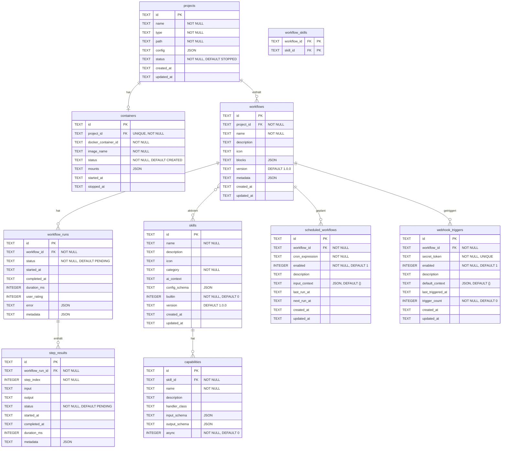

# Datenmodell

## ER-Diagramm



## Tabellen

### `projects`

| Spalte | Typ | Constraints | Beschreibung |
|---|---|---|---|
| `id` | TEXT | PK | UUID |
| `name` | TEXT | NOT NULL | Projektname |
| `type` | TEXT | NOT NULL | Enum: ProjectType |
| `path` | TEXT | NOT NULL | Arbeitsverzeichnis im Container |
| `config` | TEXT | | JSON-Konfiguration |
| `status` | TEXT | NOT NULL, DEFAULT 'STOPPED' | Enum: ProjectStatus |
| `created_at` | TEXT | | ISO-8601 Timestamp |
| `updated_at` | TEXT | | ISO-8601 Timestamp |

### `containers`

| Spalte | Typ | Constraints | Beschreibung |
|---|---|---|---|
| `id` | TEXT | PK | UUID |
| `project_id` | TEXT | FK → projects, UNIQUE, NOT NULL | 1:1-Beziehung |
| `docker_container_id` | TEXT | NOT NULL | Docker Container ID |
| `image_name` | TEXT | NOT NULL | Docker Image Name |
| `status` | TEXT | NOT NULL, DEFAULT 'CREATED' | Enum: ContainerStatus |
| `mounts` | TEXT | | JSON: gemountete Volumes |
| `started_at` | TEXT | | Startzeitpunkt |
| `stopped_at` | TEXT | | Stoppzeitpunkt |

### `skills`

| Spalte | Typ | Constraints | Beschreibung |
|---|---|---|---|
| `id` | TEXT | PK | UUID |
| `name` | TEXT | NOT NULL | Skill-Name |
| `description` | TEXT | | Beschreibung |
| `icon` | TEXT | | Emoji oder Icon-Name |
| `category` | TEXT | NOT NULL | Enum: SkillCategory |
| `ai_context` | TEXT | | System-Prompt für AI |
| `config_schema` | TEXT | | JSON-Schema |
| `builtin` | INTEGER | NOT NULL, DEFAULT 0 | 0=custom, 1=builtin |
| `version` | TEXT | DEFAULT '1.0.0' | Versionsnummer |
| `created_at` | TEXT | | Erstellzeitpunkt |
| `updated_at` | TEXT | | Aktualisierungszeitpunkt |

### `capabilities`

| Spalte | Typ | Constraints | Beschreibung |
|---|---|---|---|
| `id` | TEXT | PK | UUID |
| `skill_id` | TEXT | FK → skills, NOT NULL | Gehört zu Skill |
| `name` | TEXT | NOT NULL | Fähigkeitsname |
| `description` | TEXT | | Beschreibung |
| `handler_class` | TEXT | | Java-Handler-Klasse |
| `input_schema` | TEXT | | JSON-Schema für Eingabe |
| `output_schema` | TEXT | | JSON-Schema für Ausgabe |
| `async` | INTEGER | NOT NULL, DEFAULT 0 | Asynchrone Ausführung |

### `workflows`

| Spalte | Typ | Constraints | Beschreibung |
|---|---|---|---|
| `id` | TEXT | PK | UUID |
| `project_id` | TEXT | FK → projects, NOT NULL | Gehört zu Projekt |
| `name` | TEXT | NOT NULL | Workflow-Name |
| `description` | TEXT | | Beschreibung |
| `icon` | TEXT | | Emoji |
| `blocks` | TEXT | | JSON: Liste von BlockDefinitions |
| `version` | TEXT | DEFAULT '1.0.0' | Versionsnummer |
| `metadata` | TEXT | | JSON: Zusätzliche Metadaten |
| `created_at` | TEXT | | Erstellzeitpunkt |
| `updated_at` | TEXT | | Aktualisierungszeitpunkt |

### `workflow_skills` (Join-Tabelle)

| Spalte | Typ | Constraints | Beschreibung |
|---|---|---|---|
| `workflow_id` | TEXT | PK, FK → workflows | Workflow |
| `skill_id` | TEXT | PK, FK → skills | Aktivierter Skill |

M:N-Beziehung zwischen Workflows und Skills.

### `workflow_runs`

| Spalte | Typ | Constraints | Beschreibung |
|---|---|---|---|
| `id` | TEXT | PK | UUID |
| `workflow_id` | TEXT | FK → workflows, NOT NULL | Zugehöriger Workflow |
| `status` | TEXT | NOT NULL, DEFAULT 'PENDING' | Enum: RunStatus |
| `started_at` | TEXT | | Startzeitpunkt |
| `completed_at` | TEXT | | Endzeitpunkt |
| `duration_ms` | INTEGER | | Laufzeit in Millisekunden |
| `user_rating` | INTEGER | | Bewertung 1-5 |
| `error` | TEXT | | JSON: Fehlerbeschreibung |
| `metadata` | TEXT | | JSON: Zusätzliche Metadaten |

### `step_results`

| Spalte | Typ | Constraints | Beschreibung |
|---|---|---|---|
| `id` | TEXT | PK | UUID |
| `workflow_run_id` | TEXT | FK → workflow_runs, NOT NULL | Zugehöriger Run |
| `step_index` | INTEGER | NOT NULL | Reihenfolge (0-basiert) |
| `input` | TEXT | | Eingabe/Prompt des Schritts |
| `output` | TEXT | | Ausgabe des Schritts |
| `status` | TEXT | NOT NULL, DEFAULT 'PENDING' | Enum: StepStatus |
| `started_at` | TEXT | | Startzeitpunkt |
| `completed_at` | TEXT | | Endzeitpunkt |
| `duration_ms` | INTEGER | | Laufzeit in Millisekunden |
| `metadata` | TEXT | | JSON: Zusätzliche Metadaten |

### `scheduled_workflows`

| Spalte | Typ | Constraints | Beschreibung |
|---|---|---|---|
| `id` | TEXT | PK | UUID |
| `workflow_id` | TEXT | FK → workflows, NOT NULL | Workflow |
| `cron_expression` | TEXT | NOT NULL | Spring Cron (6 Felder) |
| `enabled` | INTEGER | NOT NULL, DEFAULT 1 | Aktiv/Inaktiv |
| `description` | TEXT | | Beschreibung |
| `input_context` | TEXT | DEFAULT '{}' | JSON: Kontext-Variablen |
| `last_run_at` | TEXT | | Letzte Ausführung |
| `next_run_at` | TEXT | | Nächste geplante Ausführung |
| `created_at` | TEXT | | Erstellzeitpunkt |
| `updated_at` | TEXT | | Aktualisierungszeitpunkt |

### `webhook_triggers`

| Spalte | Typ | Constraints | Beschreibung |
|---|---|---|---|
| `id` | TEXT | PK | UUID |
| `workflow_id` | TEXT | FK → workflows, NOT NULL | Workflow |
| `secret_token` | TEXT | NOT NULL, UNIQUE | Trigger-Token |
| `enabled` | INTEGER | NOT NULL, DEFAULT 1 | Aktiv/Inaktiv |
| `description` | TEXT | | Beschreibung |
| `default_context` | TEXT | DEFAULT '{}' | JSON: Standard-Kontext |
| `last_triggered_at` | TEXT | | Letzte Auslösung |
| `trigger_count` | INTEGER | NOT NULL, DEFAULT 0 | Anzahl Auslösungen |
| `created_at` | TEXT | | Erstellzeitpunkt |
| `updated_at` | TEXT | | Aktualisierungszeitpunkt |

**Index:** `idx_webhook_triggers_token` auf `secret_token` (UNIQUE)

## Enums

### ProjectType

| Wert | Beschreibung |
|---|---|
| `CODE` | Software-Projekt |
| `CONTENT` | Content-Erstellung |
| `RESEARCH` | Recherche-Projekt |
| `BUSINESS` | Business-Projekt |
| `PERSONAL` | Persönliches Projekt |

### ProjectStatus

| Wert | Beschreibung |
|---|---|
| `STOPPED` | Container gestoppt |
| `STARTING` | Container wird gestartet |
| `RUNNING` | Container läuft |
| `ERROR` | Fehler beim Container-Start |

### ContainerStatus

| Wert | Beschreibung |
|---|---|
| `CREATED` | Container erstellt, noch nicht gestartet |
| `RUNNING` | Container läuft |
| `STOPPED` | Container gestoppt |
| `ERROR` | Container-Fehler |

### RunStatus

| Wert | Beschreibung |
|---|---|
| `PENDING` | Wartet auf Ausführung |
| `RUNNING` | Wird ausgeführt |
| `PAUSED` | Pausiert |
| `COMPLETED` | Erfolgreich abgeschlossen |
| `FAILED` | Fehlgeschlagen |
| `CANCELLED` | Abgebrochen |

### StepStatus

| Wert | Beschreibung |
|---|---|
| `PENDING` | Noch nicht gestartet |
| `RUNNING` | Wird ausgeführt |
| `COMPLETED` | Erfolgreich |
| `FAILED` | Fehlgeschlagen |
| `SKIPPED` | Übersprungen (z.B. bei Conditional) |

### SkillCategory

| Wert | Beschreibung |
|---|---|
| `DOCUMENT` | Dokumentenverarbeitung |
| `CODE` | Code-Analyse und -Erstellung |
| `DATA` | Datenanalyse |
| `CONTENT` | Content-Erstellung |
| `RESEARCH` | Recherche |
| `BUSINESS` | Business-Operationen |
| `PRODUCTIVITY` | Produktivität |

## BlockDefinition (JSON-Struktur)

Blöcke werden als JSON-Array in der `blocks`-Spalte der `workflows`-Tabelle gespeichert.

```json
{
  "type": "simple | retry | foreach | while | conditional | skill-capability",
  "config": {
    "prompt": "Befehl oder Anweisung",
    "on_failure": "stop | continue"
  },
  "requiredCapabilities": ["capability-name"]
}
```

**Typ-spezifische Config:**

| Typ | Config-Felder |
|---|---|
| `simple` | `prompt`, `on_failure` |
| `retry` | `prompt`, `maxRetries`, `on_failure` |
| `foreach` | `items`, `prompt`, `on_failure` |
| `while` | `condition`, `prompt`, `maxIterations` |
| `conditional` | `condition`, `thenPrompt`, `elsePrompt` |
| `skill-capability` | `skillId`, `capabilityName`, `input` |

## Flyway-Migrationen

| Version | Datei | Beschreibung |
|---|---|---|
| V1 | `V1__create_projects_table.sql` | Projekte-Tabelle |
| V2 | `V2__create_containers_table.sql` | Container-Tabelle (FK → projects) |
| V3 | `V3__create_skills_table.sql` | Skills-Tabelle |
| V4 | `V4__create_capabilities_table.sql` | Capabilities-Tabelle (FK → skills) |
| V5 | `V5__create_workflows_table.sql` | Workflows + workflow_skills Join-Tabelle |
| V6 | `V6__create_workflow_runs_table.sql` | workflow_runs + step_results |
| V7 | `V7__create_scheduled_workflows_table.sql` | Geplante Workflows |
| V8 | `V8__create_webhook_triggers_table.sql` | Webhook-Trigger + Index |
| V9 | `V9__add_updated_at_columns.sql` | `updated_at` für scheduled_workflows, webhook_triggers, skills |

## SQLite-Besonderheiten

- **Kein nativer TIMESTAMP-Typ:** Alle Zeitstempel werden als `TEXT` im ISO-8601-Format gespeichert (`Instant.toString()`)
- **Kein nativer BOOLEAN-Typ:** Booleans werden als `INTEGER` gespeichert (`0` = false, `1` = true)
- **JSON als TEXT:** Alle JSON-Felder (`config`, `blocks`, `metadata`, etc.) werden als `TEXT` gespeichert und über JPA-`@Convert`-Annotationen mit `JsonMapConverter` / `BlockDefinitionListConverter` gemappt
- **UUID als TEXT:** IDs werden als `TEXT` gespeichert, generiert über `GenerationType.UUID`
- **WAL-Modus:** Aktiviert für bessere Concurrent-Read-Performance (`?journal_mode=WAL`)
- **Busy Timeout:** 10 Sekunden (`?busy_timeout=10000`)
- **Connection Pool:** HikariCP mit max. 3 Verbindungen (SQLite-Limitierung)
- **Dialect:** `org.hibernate.community.dialect.SQLiteDialect`
