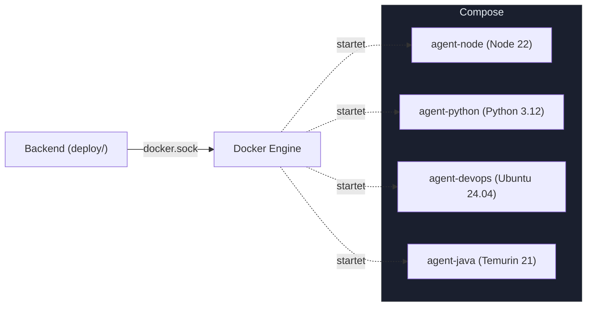
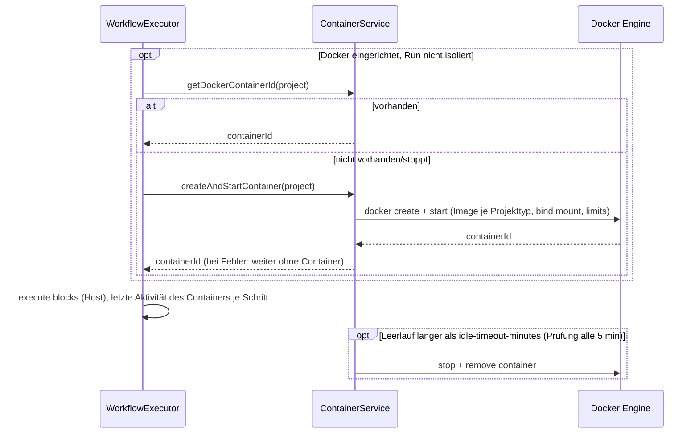

# MySuricates — Deployment & Container Lifecycle

Instanz im Container, Compose-Setup, Agent-Images, Projekt-Container und Ressourcenlimits

## Eigene Instanz — *deploy/*

`scripts/instance.sh up --name NAME` baut mit `deploy/Dockerfile` Backend und Frontend in ein Image und startet genau einen Container (`deploy/compose.yml`); das Backend liefert das Frontend selbst aus.

- Einstellungen je Instanz: `deploy/instances/NAME.env` — `MYSURICATES_PORT` ist Pflicht, `MYSURICATES_BIND` steht auf `127.0.0.1`, wenn nichts anderes gesetzt ist
- Mounts für Projekte, KI-Anbieter und Docker-Socket schreibt `scripts/lib/host-mounts.sh` in ein Override (`deploy/instances/NAME.override.yml`)
- Daten liegen in benannten Volumes und bleiben bei `scripts/instance.sh down` erhalten
- `MYSURICATES_RUNTIME=host` startet dieselbe Instanz statt im Container direkt auf dem Rechner

## Docker Compose — *Agent-Images*

`ai-automation-backend/docker-compose.yml` startet kein Backend mehr — der einzige Docker-Weg für eine Instanz ist `deploy/` (oben). Die Datei baut nur noch die Agent-Images (Profil `build-only`); Container aus diesen Images startet das Backend über die Docker-API.

### Build

`AGENT_APT_REFRESH=$(date +%Y-%m) docker compose --profile build-only build` im Verzeichnis `ai-automation-backend/`

## Agent-Images — *Dockerfiles*

| Image | Basis | Pfad |
|---|---|---|
| agent-node | `node:22-slim` | `docker/Dockerfile.agent-node` |
| agent-python | `python:3.12-slim` | `docker/Dockerfile.agent-python` |
| agent-devops | `ubuntu:24.04` | `docker/Dockerfile.agent-devops` |
| agent-java | `eclipse-temurin:21-jdk-jammy` | `docker/Dockerfile.agent-java` |

Pfade relativ zu `ai-automation-backend/`. Projekt-Container nehmen je Projekttyp `automation-agent-node` (`CODE`, `PERSONAL`) oder `automation-agent-python` (`RESEARCH`, `CONTENT`, `BUSINESS`); Shell-Blöcke können über `container_image` jedes erlaubte Image nutzen (`automation.execution.allowed-container-images`).

## Container Lifecycle — *ContainerService*

Vor dem ersten Block sucht ein Run den laufenden Projekt-Container oder startet einen — sofern Docker eingerichtet ist und der Run nicht isoliert in einem eigenen Workspace-Klon läuft. Scheitert der Start, läuft der Run ohne Container weiter. Die Blöcke selbst laufen auf dem Host (Ausnahme: Shell-Schritte mit `container_image`); den Projekt-Container nutzen Ad-hoc-Befehle während eines Runs und das Terminal.

## Mounts & Limits — *application.yml*

### Ressourcen

`docker.container.cpu-quota: 200000` (2 CPU)

`docker.container.memory-limit: 4000000000` (~4 GB)

`docker.container.pids-limit: 100`

`docker.container.idle-timeout-minutes: 60`

Dazu `/tmp` als tmpfs, alle Capabilities entfernt, `no-new-privileges` und die Benutzer-ID des Hosts

### Mounts

Projektpfad → `/workspace` (lesen und schreiben)

Claude vom Host nach `MYSURICATES_AI_FROM_HOST`; Standard `login`: das Programm schreibgeschützt, die Anmeldung als Token

Docker-Socket: nur für das Backend, per Schalter (`MYSURICATES_DOCKER_SOCKET`, siehe *deploy/*), nicht im Projekt-Container

## Ausführung auf dem Host — *Sicherheit & Reproduzierbarkeit*

KI-CLIs und Shell-Blöcke laufen auf dem Host im Projektverzeichnis — ob ein Projekt-Container läuft oder nicht.

- Werkzeuge und Umgebung stammen vom Host, nicht aus einem Image.
- Einzelne Shell-Schritte isoliert `container_image`: ein Einmal-Container (`docker run --rm`); Docker-Socket und zusätzliche Mounts nur mit `automation.execution.allow-docker-socket-mount` bzw. `allow-extra-mounts`.
- Eine ganze Instanz isoliert `scripts/instance.sh` im Container (siehe oben).
