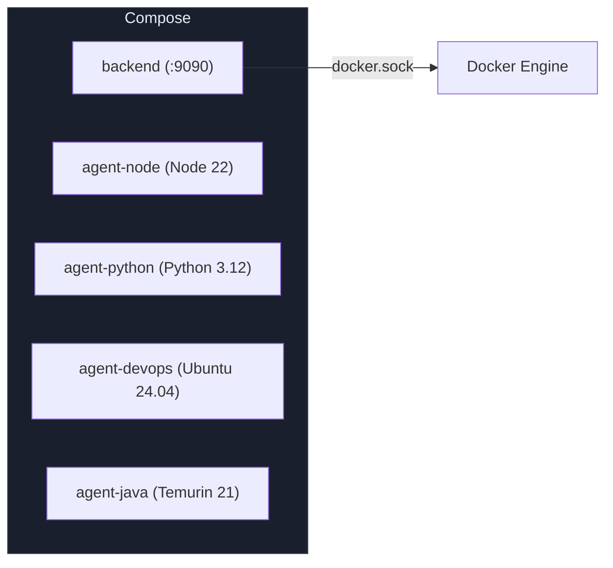
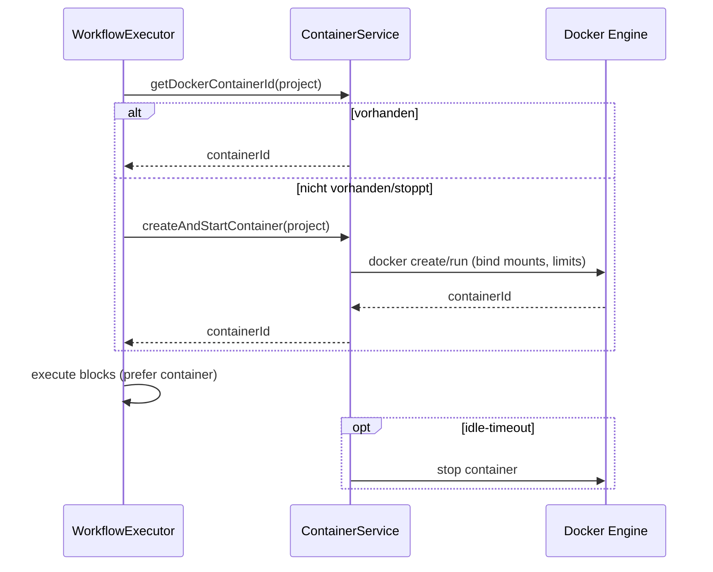

# AutoPilot — Deployment & Container Lifecycle

Compose-Setup, Agent-Images, ContainerService und Ressourcenlimits

## Docker Compose — *Services*

Backend und Agenten werden per Compose gebaut/gestartet.

### Build

`mvn clean package -DskipTests`

`docker compose --profile build-only build`

### Start

`docker compose up --build`

Backend Port: 9090

## Agent-Images — *Dockerfiles*

| Image | Basis | Pfad |
|---|---|---|
| backend | OpenJDK 21 + Spring Boot Jar | `docker/Dockerfile.backend` |
| agent-node | Node 22 | `docker/Dockerfile.agent-node` |
| agent-python | Python 3.12 | `docker/Dockerfile.agent-python` |
| agent-devops | Ubuntu 24.04 | `docker/Dockerfile.agent-devops` |
| agent-java | Temurin 21 | `docker/Dockerfile.agent-java` |

## Container Lifecycle — *ContainerService*

Workflows laufen bevorzugt im Projekt-Container. Falls keiner existiert, wird einer gestartet; bei Problemen fällt die Ausführung auf den Host zurück.

## Mounts & Limits — *application.yml*

### Ressourcen

`docker.container.cpu-quota: 200000` (2 CPU)

`docker.container.memory-limit: 4000000000` (~4 GB)

`docker.container.pids-limit: 100`

`docker.container.idle-timeout-minutes: 60`

### Mounts

Projektpfad wird als Bind-Mount in den Container gelegt.

Docker-Socket: `/var/run/docker.sock` (Backend braucht ihn)

Backups innerhalb des Projekt-Mounts bleiben isoliert.

## Host-Fallback — *Sicherheit & Reproduzierbarkeit*

Falls Containerstart fehlschlägt, laufen Kommandos auf dem Host-Projektpfad.

- Mehr Rechte, weniger Isolation.
- Tools/Env stammen vom Host, nicht vom Image.
- Vermeiden durch: Images vorab bauen, Docker-Daemon verfügbar halten.
