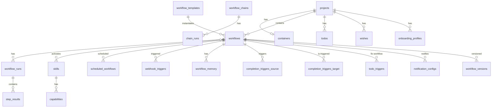

# Data Model

## ER Diagram (Core)

Only the relationships of the core; the columns are under [Tables](#tables).



## Tables

### `projects`

| Column | Type | Constraints | Description |
|---|---|---|---|
| `id` | TEXT | PK | UUID |
| `name` | TEXT | NOT NULL | Project name |
| `subtitle` | TEXT | | Short description (V18) |
| `description` | TEXT | | Detailed description (V18) |
| `type` | TEXT | NOT NULL | Enum: ProjectType |
| `path` | TEXT | NOT NULL | Working directory (host path) |
| `config` | TEXT | | JSON configuration |
| `status` | TEXT | NOT NULL, DEFAULT 'STOPPED' | Enum: ProjectStatus |
| `ai_context` | TEXT | | Additional AI context for the project (V30) |
| `archived_at` | TEXT | | Archival timestamp, NULL = active (V35) |
| `created_at` | TEXT | | ISO-8601 timestamp |
| `updated_at` | TEXT | | ISO-8601 timestamp |

**Note:** Projects are not hard-deleted but archived (`archived_at IS NOT NULL`). Archived projects retain all workflows, runs, and data.

### `containers`

| Column | Type | Constraints | Description |
|---|---|---|---|
| `id` | TEXT | PK | UUID |
| `project_id` | TEXT | FK -> projects, UNIQUE, NOT NULL | 1:1 relationship |
| `docker_container_id` | TEXT | NOT NULL | Docker container ID |
| `image_name` | TEXT | NOT NULL | Docker image name |
| `status` | TEXT | NOT NULL, DEFAULT 'CREATED' | Enum: ContainerStatus |
| `mounts` | TEXT | | JSON: mounted volumes |
| `started_at` | TEXT | | Start time |
| `stopped_at` | TEXT | | Stop time |
| `last_activity_at` | TEXT | | Last activity (V11, auto-stop timeout) |

### `skills`

| Column | Type | Constraints | Description |
|---|---|---|---|
| `id` | TEXT | PK | UUID (stable ID for built-ins) |
| `name` | TEXT | NOT NULL | Skill name |
| `description` | TEXT | | Description |
| `icon` | TEXT | | Emoji or icon name |
| `category` | TEXT | NOT NULL | Enum: SkillCategory |
| `ai_context` | TEXT | | System prompt for AI |
| `config_schema` | TEXT | | JSON schema |
| `builtin` | INTEGER | NOT NULL, DEFAULT 0 | 0=custom, 1=builtin |
| `version` | TEXT | DEFAULT '1.0.0' | Version number |
| `created_at` | TEXT | | Creation time |
| `updated_at` | TEXT | | Update time |

26 built-in skills are created by `SkillSeeder` at startup (idempotent, updates on version bump). The definitions live as `src/main/resources/skills/builtin/<id>.json` + `<id>.md` (prompt). Built-in skills have stable IDs (e.g. `builtin-code-review`).

### `capabilities`

| Column | Type | Constraints | Description |
|---|---|---|---|
| `id` | TEXT | PK | UUID |
| `skill_id` | TEXT | FK -> skills, NOT NULL | Belongs to skill |
| `name` | TEXT | NOT NULL | Capability name |
| `description` | TEXT | | Description |
| `handler_class` | TEXT | | Java handler class |
| `input_schema` | TEXT | | JSON schema for input |
| `output_schema` | TEXT | | JSON schema for output |
| `async` | INTEGER | NOT NULL, DEFAULT 0 | Asynchronous execution |
| `writes` | INTEGER | NOT NULL, DEFAULT 0 | Capability modifies files/state (V64). Block config must set `allow_writes: true`; the source is `"writes": true` in `skills/builtin/<id>.json` |

**Index:** `idx_capabilities_skill_id` (V95)

### `workflows`

| Column | Type | Constraints | Description |
|---|---|---|---|
| `id` | TEXT | PK | UUID |
| `project_id` | TEXT | FK -> projects, NOT NULL | Belongs to project |
| `name` | TEXT | NOT NULL | Workflow name |
| `description` | TEXT | | Description |
| `icon` | TEXT | | Emoji |
| `blocks` | TEXT | | JSON: list of BlockDefinitions |
| `instructions` | TEXT | | Workflow-specific agent instructions (V13) |
| `model` | TEXT | | Claude model override (V13), e.g. `opus` |
| `provider` | TEXT | | AI provider override (V34), e.g. `CLAUDE`, `CODEX` |
| `default_context` | TEXT | DEFAULT '{}' | JSON: default context variables (V23) |
| `template_id` | TEXT | FK -> workflow_templates, ON DELETE SET NULL | Source template (V19) |
| `test_status` | TEXT | DEFAULT 'UNTESTED' | Test status: UNTESTED, PASSED, FAILED (V25) |
| `last_tested_at` | TEXT | | Last test time (V25) |
| `block_types` | TEXT | DEFAULT '' | Denormalized block types, comma-separated (V26) |
| `tags` | TEXT | | JSON array as text — tags for intent-based discovery (V61) |
| `category` | VARCHAR(32) | | Closed taxonomy: Productivity, Dev, Content, Analysis, Ops, Data, Integration, Other (V61) |
| `tags_generated_at` | TIMESTAMP | | When the tagging service last wrote tags (V61) |
| `tags_user_edited` | BOOLEAN | NOT NULL, DEFAULT 0 | Locks tags against auto-regeneration once edited by the user (V61) |
| `version` | TEXT | DEFAULT '1.0.0' | Version number |
| `metadata` | TEXT | | JSON: additional metadata |
| `deleted_at` | TEXT | | Soft-delete timestamp (V32). `@SQLRestriction("deleted_at IS NULL")` |
| `stable_synced_at` | TEXT | | Timestamp of last synchronization to stable (V46) |
| `created_at` | TEXT | | Creation time |
| `updated_at` | TEXT | | Update time |

**Soft-Delete:** The entity class carries `@SQLRestriction("deleted_at IS NULL")`. Deleted workflows are permanently hidden from all queries.

**Index:** `idx_workflows_project_id` (V95)

### `workflow_skills` (Join Table)

| Column | Type | Constraints | Description |
|---|---|---|---|
| `workflow_id` | TEXT | PK, FK -> workflows | Workflow |
| `skill_id` | TEXT | PK, FK -> skills | Activated skill |

M:N relationship between workflows and skills.

### `workflow_runs`

| Column | Type | Constraints | Description |
|---|---|---|---|
| `id` | TEXT | PK | UUID |
| `workflow_id` | TEXT | FK -> workflows, NOT NULL | Associated workflow |
| `workflow_name` | TEXT | | Snapshot of the workflow name at run creation (V60). Remains stable on soft-delete and avoids lazy loading (OSIV disabled) |
| `status` | TEXT | NOT NULL, DEFAULT 'PENDING' | Enum: RunStatus |
| `input_context` | TEXT | | JSON: input context at start (V20) |
| `started_at` | TEXT | | Start time |
| `completed_at` | TEXT | | End time |
| `duration_ms` | INTEGER | | Duration in milliseconds |
| `user_rating` | INTEGER | | Rating 1-5 |
| `error` | TEXT | | JSON: error description |
| `metadata` | TEXT | | JSON: gate status, additional info (`gate_status`, `gate_category`, `gate_description`) |
| `triggered_by_schedule_id` | TEXT | | ID of the triggering schedule (V43) |
| `chain_run_id` | TEXT | | Chain run that started the run as one of its entries (`trigger_source` = `CHAIN`), set on creation; otherwise and for runs from before V89 `NULL`. No foreign key: deleting a chain deletes its chain runs, the runs stay (V89) |

**Indexes:** `idx_workflow_runs_status`, `idx_workflow_runs_started_at`, `idx_workflow_runs_workflow_id` (V10), `idx_workflow_runs_schedule_started` (V87), `idx_workflow_runs_chain_run_id` (V89)

### `step_results`

| Column | Type | Constraints | Description |
|---|---|---|---|
| `id` | TEXT | PK | UUID |
| `workflow_run_id` | TEXT | FK -> workflow_runs, NOT NULL | Associated run |
| `step_index` | INTEGER | NOT NULL | Order (0-based) |
| `input` | TEXT | | Step input/prompt |
| `output` | TEXT | | Step output |
| `status` | TEXT | NOT NULL, DEFAULT 'PENDING' | Enum: StepStatus |
| `started_at` | TEXT | | Start time |
| `completed_at` | TEXT | | End time |
| `duration_ms` | INTEGER | | Duration in milliseconds |
| `metadata` | TEXT | | JSON: additional metadata |
| `context_delta` | TEXT | | JSON: cumulative snapshot of context variables at the end of the step (V47). Used to restore context for INTERRUPTED runs |

### `scheduled_workflows`

| Column | Type | Constraints | Description |
|---|---|---|---|
| `id` | TEXT | PK | UUID |
| `workflow_id` | TEXT | FK -> workflows | Workflow (or NULL for chain target) (V38) |
| `chain_id` | TEXT | FK -> workflow_chains | Chain (V27, when `target_type = CHAIN`) |
| `target_type` | TEXT | NOT NULL, DEFAULT 'WORKFLOW' | `WORKFLOW` or `CHAIN` (V27) |
| `schedule_type` | TEXT | NOT NULL, DEFAULT 'CRON' | `CRON`, `ONCE` (V14) or `DELAYED` (V37) |
| `cron_expression` | TEXT | NOT NULL | Spring Cron (6 fields) |
| `scheduled_at` | TEXT | | One-time execution timestamp (V14, for `ONCE`) |
| `delay_expression` | TEXT | | Human-readable delay for `DELAYED`, e.g. `"2h"`, `"30m"`, `"1d"` (V37) |
| `enabled` | INTEGER | NOT NULL, DEFAULT 1 | Active/inactive |
| `description` | TEXT | | Description |
| `input_context` | TEXT | DEFAULT '{}' | JSON: context variables |
| `last_run_at` | TEXT | | Last execution |
| `next_run_at` | TEXT | | Next scheduled execution |
| `end_date` | TEXT | | Optional end date for CRON schedules — no occurrence at or after `endDate` starts; the schedule is disabled after the last occurrence before it (V44) |
| `max_runs` | INTEGER | DEFAULT 0 | Maximum number of executions (0 = unlimited) (V44) |
| `run_count` | INTEGER | DEFAULT 0 | Counter, incremented after each execution (V44) |
| `conflict_behavior` | TEXT | DEFAULT 'SKIP' | Behavior when an execution is already running: `SKIP` or `OVERLAP` (V45) |
| `catch_up_on_resume` | INTEGER | NOT NULL, DEFAULT 0 | Per-schedule policy on system resume after suspend/freeze: 0 = skip missed runs, 1 = catch up once (V65) |
| `created_at` | TEXT | | Creation time |
| `updated_at` | TEXT | | Update time |

**Indexes:** `idx_scheduled_workflows_workflow_id`, `idx_scheduled_workflows_chain_id` (V95; the table rebuild in V38 left it without an index)

### `webhook_triggers`

| Column | Type | Constraints | Description |
|---|---|---|---|
| `id` | TEXT | PK | UUID |
| `workflow_id` | TEXT | FK -> workflows, NOT NULL | Workflow |
| `secret_token` | TEXT | NOT NULL, UNIQUE | Trigger token |
| `enabled` | INTEGER | NOT NULL, DEFAULT 1 | Active/inactive |
| `description` | TEXT | | Description |
| `default_context` | TEXT | DEFAULT '{}' | JSON: default context |
| `last_triggered_at` | TEXT | | Last trigger time |
| `trigger_count` | INTEGER | NOT NULL, DEFAULT 0 | Number of triggers |
| `created_at` | TEXT | | Creation time |
| `updated_at` | TEXT | | Update time |

**Indexes:** `idx_webhook_triggers_token` on `secret_token` (UNIQUE), `idx_webhook_triggers_workflow_id` (V95)

### `workflow_templates`

| Column | Type | Constraints | Description |
|---|---|---|---|
| `id` | TEXT | PK | UUID |
| `name` | TEXT | NOT NULL | JSON i18n map: `{"de":"...","en":"..."}` |
| `description` | TEXT | | JSON i18n map |
| `icon` | TEXT | | Emoji |
| `category` | TEXT | | Category label |
| `blocks` | TEXT | NOT NULL | JSON: BlockDefinition list |
| `instructions` | TEXT | | Agent instructions |
| `model` | TEXT | | Model override |
| `built_in` | INTEGER | DEFAULT 0 | 1 = built-in (immutable) |
| `sort_order` | INTEGER | DEFAULT 0 | Sort order |
| `quality_status` | TEXT | NOT NULL, DEFAULT 'UNTESTED' | Quality status (V22) |
| `version` | TEXT | DEFAULT '1.0.0' | Template version |
| `created_at` | TEXT | | |
| `updated_at` | TEXT | | |

54 built-in templates are created by `WorkflowTemplateSeeder` at startup. Template definitions are stored as JSON under `src/main/resources/templates/builtin/`.

### `template_verifications`

| Column | Type | Constraints | Description |
|---|---|---|---|
| `id` | TEXT | PK | UUID |
| `template_id` | TEXT | FK -> workflow_templates, NOT NULL | Template |
| `project_id` | TEXT | FK -> projects, NOT NULL | Project |
| `last_run_id` | TEXT | FK -> workflow_runs, ON DELETE SET NULL | Last test run |
| `verified_at` | TIMESTAMP | NOT NULL | Verification timestamp |

**Unique Constraint:** `(template_id, project_id)` — one entry per template+project combination.

### `workflow_memory`

| Column | Type | Constraints | Description |
|---|---|---|---|
| `id` | TEXT | PK | UUID |
| `workflow_id` | TEXT | FK -> workflows, NOT NULL, ON DELETE CASCADE | Associated workflow |
| `title` | TEXT | | Short title of the knowledge entry |
| `content` | TEXT | NOT NULL | Extracted knowledge (Markdown) |
| `tags` | TEXT | | Comma-separated tags (JSON array as text) |
| `source_run_ids` | TEXT | | JSON array of run IDs from which the knowledge was extracted |
| `provider` | TEXT | NOT NULL | `CLAUDE` or `CODEX` |
| `active` | INTEGER | NOT NULL, DEFAULT 0 | 1 = inject into subsequent runs |
| `created_at` | TEXT | NOT NULL | |

**Indexes:** `idx_workflow_memory_workflow`, `idx_workflow_memory_active` on `(workflow_id, active)`, `idx_workflow_memory_active_created_at` on `(active, created_at)` (V95: newest active memories across all workflows)

### `workflow_chains`

| Column | Type | Constraints | Description |
|---|---|---|---|
| `id` | TEXT | PK | UUID |
| `name` | TEXT | NOT NULL | Chain name |
| `description` | TEXT | | Description |
| `icon` | TEXT | | Emoji |
| `entries` | TEXT | | JSON: list of `ChainEntry` objects (sorted by `sortOrder`) |
| `stop_on_failure` | INTEGER | NOT NULL, DEFAULT 1 | Chain-level stop-on-failure flag |
| `metadata` | TEXT | | JSON: additional metadata |
| `created_at` | TEXT | NOT NULL | |
| `updated_at` | TEXT | NOT NULL | |

A chain does not belong to any project and can reference workflows from different projects.

**ChainEntry (JSON structure within `entries`):**
```json
{
  "workflowId": "uuid",
  "label": "optional display name",
  "sortOrder": 0,
  "inputContext": {},
  "stopOnFailure": true
}
```

### `chain_runs`

| Column | Type | Constraints | Description |
|---|---|---|---|
| `id` | TEXT | PK | UUID |
| `chain_id` | TEXT | FK -> workflow_chains, NOT NULL, ON DELETE CASCADE | Associated chain |
| `status` | TEXT | NOT NULL, DEFAULT 'PENDING' | Enum: RunStatus |
| `entry_runs` | TEXT | | JSON: list of `ChainRunEntry` objects (run IDs per entry) |
| `input_context` | TEXT | | JSON: input context |
| `started_at` | TEXT | | |
| `completed_at` | TEXT | | |
| `duration_ms` | INTEGER | | |
| `error` | TEXT | | Error message |
| `metadata` | TEXT | | JSON: additional metadata |
| `triggered_by_schedule_id` | TEXT | | ID of the triggering schedule (V43) |
| `trigger_source` | TEXT | | Enum `TriggerSource`: what started the chain (`MANUAL`, `SCHEDULE`, `WISH`), set at start; the entries inherit it via `__parent_trigger_source`. Existing rows: `SCHEDULE` when `triggered_by_schedule_id` is set, otherwise `NULL` (V96) |

**ChainRunEntry (JSON structure within `entry_runs`):**
```json
{
  "entryIndex": 0,
  "workflowId": "uuid",
  "workflowName": "Name",
  "projectName": "Project",
  "workflowRunId": "uuid",
  "status": "PENDING",
  "startedAt": null,
  "completedAt": null,
  "durationMs": null
}
```

**Indexes:** `idx_chain_runs_chain_id`, `idx_chain_runs_status`, `idx_chain_runs_schedule` (V87)

### `todos`

| Column | Type | Constraints | Description |
|---|---|---|---|
| `id` | TEXT | PK | UUID |
| `title` | TEXT | NOT NULL | Short imperative title |
| `description` | TEXT | | Markdown description |
| `status` | TEXT | NOT NULL, DEFAULT 'OPEN' | `OPEN`, `IN_PROGRESS`, `DONE`, `BACKLOG`, `ARCHIVED` |
| `priority` | TEXT | NOT NULL, DEFAULT 'MEDIUM' | `CRITICAL`, `HIGH`, `MEDIUM`, `LOW` |
| `tags` | TEXT | | JSON array as text |
| `project_id` | TEXT | FK -> projects, ON DELETE SET NULL | Optional project association |
| `source` | TEXT | NOT NULL, DEFAULT 'USER' | `USER`, `AI`, `WORKFLOW` |
| `source_agent` | TEXT | | e.g. `claude-code` |
| `session_id` | TEXT | | Shell session ID of the creator (V36) |
| `workflow_run_id` | TEXT | | Associated workflow run (when auto-created) |
| `reference_type` | TEXT | | Type of the referenced object |
| `reference_id` | TEXT | | ID of the referenced object |
| `related_todo_id` | TEXT | | Related TODO (from AI similarity match) (V48) |
| `fix_attempts` | INTEGER | NOT NULL, DEFAULT 0 | Number of automatic fix attempts by TodoTrigger (V52) |
| `last_fix_run_id` | TEXT | | ID of the last fix workflow run (V52) |
| `due_date` | TEXT | | Due date (V57) |
| `linked_workflow_id` | TEXT | FK -> workflows, ON DELETE SET NULL | Optional resolver workflow (V59) |
| `resolution_state` | TEXT | | Enum: ResolutionState — workflow resolution status (V59) |
| `exported_provider` | TEXT | | Provider identifier of the external system (e.g. `jira`, `github`), decoupled from `reference_type` (V66) |
| `exported_ref` | TEXT | | External reference ID (e.g. issue key) (V66) |
| `exported_url` | TEXT | | URL to the external object (V66) |
| `goal_id` | TEXT | FK → goals, ON DELETE SET NULL | Goal this TODO contributes to – at most one (V85) |
| `goal_rank` | INTEGER | | Position within the goal, 1 = first; NULL = not ordered yet (V85) |
| `complexity` | TEXT | | `S`, `M`, `L`, `XL` (V85) |
| `suggested_effort` | TEXT | | Suggested reasoning effort `low`/`medium`/`high`/`xhigh` (V85) |
| `rating_note` | TEXT | | Reasoning behind the assessment (V85) |
| `rated_by` | TEXT | | `USER` or `AI` – who assessed last (V85) |
| `rated_at` | TEXT | | Time of the assessment (V85) |
| `open_question` | TEXT | | Question that has to be settled before work starts (V85) |
| `decision` | TEXT | | Decision that answered an open question; clears `open_question`, a later new question leaves it in place (V93) |
| `decided_at` | TEXT | | When it was decided (V93) |
| `decided_by` | TEXT | | `USER` or `AI` (V93) |
| `work_package_id` | TEXT | FK → goal_work_packages, ON DELETE SET NULL | Work package of the TODO's own goal and – checked on write – of its own project (V88 as `milestone_id`, renamed in V92) |
| `created_at` | TEXT | NOT NULL | |
| `updated_at` | TEXT | NOT NULL | |

**Indexes:** `idx_todos_status`, `idx_todos_project`, `idx_todos_source`, `idx_todos_created`, `idx_todos_status_priority_created` (V54), `idx_todos_project_status` (V54), `idx_todos_linked_workflow_id` (V59), `idx_todos_agent_session_ref` (V76), `idx_todos_goal` (V85), `idx_todos_last_fix_run_id` (V87), `idx_todos_workflow_run_id` (V87), `idx_todos_work_package` (V92, formerly `idx_todos_milestone`)

TODOs are automatically created by `AutoTodoService` on RED/YELLOW gate status (RED -> HIGH, YELLOW -> MEDIUM). When a `TodoTrigger` is configured, fix workflows are automatically started (self-improvement loop).

### `goals`

| Column | Type | Constraints | Description |
|---|---|---|---|
| `id` | TEXT | PK | UUID |
| `title` | TEXT | NOT NULL | Name of the goal, e.g. "Open-source launch" |
| `description` | TEXT | | Markdown: what "done" means |
| `status` | TEXT | NOT NULL, DEFAULT 'ACTIVE' | `ACTIVE`, `DONE`, `ARCHIVED` |
| `target_date` | TEXT | | Target date |
| `guard_workflow_id` | TEXT | FK → workflows, ON DELETE SET NULL | Workflow of the goal guard (template `goal-guard`); whether it runs is up to its schedule (V88) |
| `created_at` | TEXT | NOT NULL | |
| `updated_at` | TEXT | NOT NULL | |

**Indexes:** `idx_goals_status`

A goal groups TODOs across projects (V85). Membership, rank and assessment live on the TODO (`todos.goal_id` …), not on the goal; `GoalService` computes progress and order from lean projections. Since V92 a goal is explicitly assigned to one or more projects (`goal_projects`), structured into work packages (`goal_work_packages`) with TODOs below, plus milestones as dates of the whole goal (`goal_milestones`). Deleting a goal keeps its TODOs, removes its work packages, milestones and project assignments and pauses a goal guard.

### `goal_projects`

| Column | Type | Constraints | Description |
|---|---|---|---|
| `goal_id` | TEXT | PK (with `project_id`), FK → goals, ON DELETE CASCADE | Goal |
| `project_id` | TEXT | PK (with `goal_id`), FK → projects, ON DELETE CASCADE | Project of the goal |
| `position` | INTEGER | NOT NULL, DEFAULT 0 | Order of the projects within the goal, from 0 |

**Indexes:** `idx_goal_projects_project`

The projects of a goal (V92, TODO c60bf914), n:m. Backfilled from the goals' TODOs (archived ones included); position 0 went to the project with the most non-archived TODOs. When a TODO from a project the goal does not have yet joins the goal (assign, `planning`, the TODO changing its project), the project is appended automatically. A project can only be removed while no work packages or TODOs of the goal hang on it – otherwise with `cascade=true` (work packages deleted along with their milestone links, TODOs released from the goal).

### `goal_work_packages`

| Column | Type | Constraints | Description |
|---|---|---|---|
| `id` | TEXT | PK | UUID |
| `goal_id` | TEXT | NOT NULL, FK → goals, ON DELETE CASCADE | Goal of the work package |
| `project_id` | TEXT | FK → projects, ON DELETE SET NULL | Project of the package; NULL only for legacy data of a goal without projects |
| `title` | TEXT | NOT NULL | e.g. "Promo material" |
| `start_date` | TEXT | | Start of the period; only together with `end_date`, never after it; a bare date counts from 00:00:00 UTC |
| `end_date` | TEXT | | End of the period, the basis for "due soon"/"overdue"; a bare date counts until 23:59:59 UTC |
| `position` | INTEGER | NOT NULL, DEFAULT 0 | Order within its project in the goal, from 0 |
| `completed_at` | TEXT | | First detection of "all assigned TODOs done"; stays even when the package opens again |
| `created_at` | TEXT | NOT NULL | |
| `updated_at` | TEXT | NOT NULL | |

**Indexes:** `idx_goal_work_packages_goal`, `idx_goal_work_packages_goal_project` (`goal_id, project_id, position`)

Work packages of a goal (V92, TODO c60bf914; until V92 they were called milestones, V88/TODO 259f4f66). A package belongs to exactly one project of the goal; TODOs point to it through `todos.work_package_id` and must come from the same project (checked on write, legacy data is still read). The period is optional but only complete (start and end, start ≤ end). The state (`OPEN`, `DUE_SOON` ≤ 3 days, `OVERDUE`, `REACHED` = completed) is computed on read from the end and the TODOs – without a period only `OPEN` or `REACHED`. Deleting a package keeps its TODOs in the goal; milestones lose the link. V92 took over the milestones of V88: date → `end_date` and `start_date` (a one-day package), `reached_at` → `completed_at`; mixed packages were split – one copy per minority project (same title and period, `completed_at` NULL) that the TODOs of that project now point to. Reads are ordered by project position, then `position`.

### `goal_milestones`

| Column | Type | Constraints | Description |
|---|---|---|---|
| `id` | TEXT | PK | UUID |
| `goal_id` | TEXT | NOT NULL, FK → goals, ON DELETE CASCADE | Goal of the milestone |
| `title` | TEXT | NOT NULL | e.g. "Launch" |
| `due_date` | TEXT | NOT NULL | Date; a bare date counts until 23:59:59 UTC |
| `reached_at` | TEXT | | Reached since – with packages the first detection, without packages set by hand |
| `created_at` | TEXT | NOT NULL | |
| `updated_at` | TEXT | NOT NULL | |

**Indexes:** `idx_goal_milestones_goal`

Milestones of a goal (V92, TODO c60bf914): dates of the whole goal, no project, always with a date. With linked work packages a milestone is reached once all of them are completed; `reached_at` keeps the first detection, and if the packages are later no longer all completed it reads "open again". Without packages it is marked as reached by hand. Otherwise the date decides (`OPEN`, `DUE_SOON`, `OVERDUE`). Not to be confused with the milestones of V88 – those are work packages since V92.

### `goal_milestone_work_packages`

| Column | Type | Constraints | Description |
|---|---|---|---|
| `milestone_id` | TEXT | PK (with `work_package_id`), FK → goal_milestones, ON DELETE CASCADE | Milestone |
| `work_package_id` | TEXT | PK (with `milestone_id`), FK → goal_work_packages, ON DELETE CASCADE | Work package of the same goal the milestone depends on |

**Indexes:** `idx_goal_milestone_work_packages_package`

Which work packages a milestone needs (V92, TODO c60bf914). Both sides belong to the same goal (checked on write); a link goes with its milestone or its package.

### `goal_workflows`

| Column | Type | Constraints | Description |
|---|---|---|---|
| `id` | TEXT | PK | UUID |
| `goal_id` | TEXT | NOT NULL, FK → goals, ON DELETE CASCADE | Goal |
| `work_package_id` | TEXT | FK → goal_work_packages, ON DELETE CASCADE | Work package of the goal; NULL = the whole goal |
| `workflow_id` | TEXT | NOT NULL, FK → workflows, ON DELETE CASCADE | Workflow |
| `role` | TEXT | NOT NULL, DEFAULT 'WORKER' | `WORKER` ("works on it") or `STATUS` ("reports the status") |
| `created_at` | TEXT | NOT NULL | |
| `updated_at` | TEXT | NOT NULL | |

**Indexes:** `idx_goal_workflows_unique` (UNIQUE over `goal_id`, `IFNULL(work_package_id, '')`, `workflow_id`), `idx_goal_workflows_workflow`, `idx_goal_workflows_work_package`

Workflows on a goal or one of its work packages (V94, TODO 52bc1e8c). Each attachment exists only once; "on the goal" (NULL) counts as a value of its own. Workflows are soft-deleted: the attachment stays and is hidden on read. The goal guard is not stored here; it hangs on the goal via `goals.guard_workflow_id`.

### `activity_log`

| Column | Type | Constraints | Description |
|---|---|---|---|
| `id` | TEXT | PK | UUID |
| `timestamp` | TEXT | NOT NULL | ISO-8601 event timestamp |
| `level` | TEXT | NOT NULL | `DEBUG`, `INFO`, `WARN`, `ERROR` |
| `category` | TEXT | NOT NULL | `SYSTEM`, `EXECUTION`, `SCHEDULE`, `WEBHOOK`, `SECURITY`, `CONTAINER` |
| `message` | TEXT | NOT NULL | Log message |
| `source` | TEXT | | Source (service name, etc.) |
| `reference_id` | TEXT | | ID of the affected object |
| `workflow_id` | TEXT | | Associated workflow (V31) |
| `metadata` | TEXT | | JSON: additional info |
| `created_at` | TEXT | NOT NULL | DB insertion timestamp |

**Indexes:** `idx_activity_log_timestamp`, `idx_activity_log_level`, `idx_activity_log_category`, `idx_activity_log_level_created`, `idx_activity_log_workflow_id` (V31)

### `wishes`

| Column | Type | Constraints | Description |
|---|---|---|---|
| `id` | TEXT | PK | UUID |
| `original_text` | TEXT | NOT NULL | Natural-language wish |
| `status` | TEXT | NOT NULL, DEFAULT 'RECEIVED' | Enum: WishStatus |
| `project_id` | TEXT | FK -> projects | Optional project association |
| `decomposition` | TEXT | | JSON: analysis and task decomposition |
| `generated_workflow_ids` | TEXT | | JSON array of generated workflow IDs |
| `generated_chain_id` | TEXT | | ID of the generated chain |
| `reference_workflow_ids` | TEXT | | JSON array of reference workflows for the wish (V29) |
| `iteration_count` | INTEGER | NOT NULL, DEFAULT 0 | Current iteration count |
| `max_iterations` | INTEGER | NOT NULL, DEFAULT 5 | Maximum iteration count |
| `auto_refine` | BOOLEAN | NOT NULL, DEFAULT FALSE | Autonomous iteration mode (V62): skips `AWAITING_DECOMPOSE_APPROVAL` + `AWAITING_APPROVAL`, runs until satisfied, FAILED, or `max_iterations` |
| `current_run_id` | TEXT | | Currently running run |
| `result_summary` | TEXT | | Result summary |
| `iteration_history` | TEXT | | JSON: history of all iterations (V33) |
| `error` | TEXT | | Error message |
| `stopped_phase` | TEXT | | Enum WishStatus: phase a `FAILED`/`CANCELLED` wish stopped in (set by `Wish.setStatus`, otherwise `NULL`; existing rows `NULL`) (V97) |
| `metadata` | TEXT | | JSON: additional info |
| `created_at` | TEXT | NOT NULL | |
| `updated_at` | TEXT | NOT NULL | |

**Indexes:** `idx_wishes_status`, `idx_wishes_project_id`

### `completion_triggers`

| Column | Type | Constraints | Description |
|---|---|---|---|
| `id` | TEXT | PK | UUID |
| `source_workflow_id` | TEXT | FK -> workflows, NOT NULL | Workflow that fires the trigger |
| `target_workflow_id` | TEXT | FK -> workflows, NOT NULL | Workflow that gets started |
| `enabled` | INTEGER | NOT NULL, DEFAULT 1 | Active/inactive |
| `trigger_on_success` | INTEGER | NOT NULL, DEFAULT 1 | Trigger on successful completion |
| `trigger_on_failure` | INTEGER | NOT NULL, DEFAULT 0 | Trigger on failure |
| `trigger_always` | INTEGER | NOT NULL, DEFAULT 0 | Always trigger regardless of status |
| `description` | TEXT | | Description |
| `context_variables` | TEXT | | JSON: context variables for the target workflow |
| `last_triggered_at` | TEXT | | Last trigger time |
| `trigger_count` | INTEGER | NOT NULL, DEFAULT 0 | Number of triggers |
| `created_at` | TEXT | | Creation time |
| `updated_at` | TEXT | | Update time |

Automatically starts a target workflow when a source workflow completes. The trigger condition (success, failure, always) is configurable (V39).

### `todo_triggers`

| Column | Type | Constraints | Description |
|---|---|---|---|
| `id` | TEXT | PK | UUID |
| `tag_pattern` | TEXT | NOT NULL | Comma-separated tags (AND logic), e.g. `"backend,testing"` |
| `project_id` | TEXT | | Optional: only match TODOs in this project |
| `source_filter` | TEXT | | Optional: `"USER"`, `"AI"` or `"WORKFLOW"` |
| `min_priority` | TEXT | | Optional: `"LOW"`, `"MEDIUM"`, `"HIGH"`, `"CRITICAL"` |
| `target_workflow_id` | TEXT | FK -> workflows, NOT NULL | Fix workflow to be started |
| `context_template` | TEXT | DEFAULT '{}' | JSON: static context variables (merged with TODO data) |
| `enabled` | INTEGER | NOT NULL, DEFAULT 1 | Active/inactive |
| `max_attempts` | INTEGER | NOT NULL, DEFAULT 3 | Max fix attempts per TODO |
| `auto_close` | INTEGER | NOT NULL, DEFAULT 1 | Auto-close TODO on GREEN gate |
| `process_backlog` | INTEGER | NOT NULL, DEFAULT 1 | Retroactively process existing open TODOs when the trigger is activated (V53) |
| `description` | TEXT | | Human-readable description |
| `last_triggered_at` | TEXT | | Last trigger time |
| `trigger_count` | INTEGER | NOT NULL, DEFAULT 0 | Number of triggers |
| `created_at` | TEXT | | Creation time |
| `updated_at` | TEXT | | Update time |

**Indexes:** `idx_todo_triggers_enabled`, `idx_todo_triggers_target_workflow_id` (V95)

Closes the self-improvement loop: when a TODO is created (e.g. by AutoTodoService), `TodoTriggerService` checks all active TodoTriggers. On tag match, the fix workflow is started; on GREEN gate, the TODO is closed. Loop prevention via `todoTriggerRun` metadata flag, max-attempts counter, and running check (V51/V52).

### `notification_configs`

| Column | Type | Constraints | Description |
|---|---|---|---|
| `id` | TEXT | PK | UUID |
| `name` | TEXT | NOT NULL | Name of the notification configuration |
| `enabled` | INTEGER | NOT NULL, DEFAULT 1 | Active/inactive |
| `channel_type` | TEXT | NOT NULL, DEFAULT 'WEBHOOK' | `WEBHOOK` or `DESKTOP` |
| `webhook_url` | TEXT | | URL for WEBHOOK channel (Slack/Discord/Teams incoming webhook) |
| `workflow_id` | TEXT | FK -> workflows | Optional workflow filter (NULL = global for all workflows) |
| `trigger_on_success` | INTEGER | NOT NULL, DEFAULT 1 | Notify on success |
| `trigger_on_failure` | INTEGER | NOT NULL, DEFAULT 1 | Notify on failure |
| `trigger_always` | INTEGER | NOT NULL, DEFAULT 0 | Always notify |
| `message_template` | TEXT | | Optional message template with variables: `{{workflow_name}}`, `{{status}}`, `{{duration}}`, `{{error_message}}` |
| `created_at` | TEXT | | Creation time |
| `updated_at` | TEXT | | Update time |

Configurable notifications via webhook or desktop on workflow completion (V40).

### `assistant_sessions`

| Column | Type | Constraints | Description |
|---|---|---|---|
| `id` | TEXT | PK | UUID |
| `page` | TEXT | NOT NULL | Page/context of the assistant session |
| `entity_id` | TEXT | | Optional entity ID for context-specific sessions |
| `messages` | TEXT | NOT NULL, DEFAULT '[]' | JSON array of chat messages |
| `message_count` | INTEGER | NOT NULL, DEFAULT 0 | Number of messages |
| `preview` | TEXT | | Preview text of the last response |
| `started_at` | TEXT | NOT NULL | Session start |
| `ended_at` | TEXT | | Session end |

Stores assistant chat sessions for the floating chat panel (V41, V58).

### `page_suggestions`

| Column | Type | Constraints | Description |
|---|---|---|---|
| `id` | TEXT | PK | UUID |
| `page` | TEXT | NOT NULL | Page identifier |
| `locale` | TEXT | NOT NULL, DEFAULT 'de' | Language of the suggestion set; `UNIQUE (page, locale)` |
| `suggestions` | TEXT | NOT NULL, DEFAULT '[]' | JSON array of suggestions |
| `generated_by` | TEXT | NOT NULL, DEFAULT 'CLAUDE' | Generator (e.g. `CLAUDE`) |
| `generated_at` | REAL | NOT NULL | Generation timestamp |
| `based_on_sessions` | INTEGER | NOT NULL, DEFAULT 0 | Number of underlying sessions |

AI-generated action suggestions per page and language, based on assistant sessions (V42; since V91 one set per language, existing rows count as German).

### `integration_connections`

| Column | Type | Constraints | Description |
|---|---|---|---|
| `id` | TEXT | PK | UUID |
| `provider_id` | TEXT | NOT NULL | Provider identifier (e.g. `google-calendar`, `jira`) |
| `connection_name` | TEXT | NOT NULL, DEFAULT 'default'; UNIQUE with `provider_id` | Name of the connection within its provider (V86); the pre-V86 connection is called `default` |
| `status` | TEXT | NOT NULL, DEFAULT 'DISCONNECTED' | Enum: ConnectionStatus (CONNECTED, DISCONNECTED, EXPIRED) |
| `access_token_encrypted` | TEXT | | AES-256-GCM encrypted OAuth access token |
| `refresh_token_encrypted` | TEXT | | AES-256-GCM encrypted OAuth refresh token |
| `token_expiry` | TEXT | | Token expiry timestamp (ISO-8601) |
| `scopes` | TEXT | | Granted OAuth scopes (comma-separated) |
| `account_info` | TEXT | | JSON with account details (name, email) |
| `client_id_encrypted` | TEXT | | AES-256-GCM encrypted OAuth client ID |
| `client_secret_encrypted` | TEXT | | AES-256-GCM encrypted OAuth client secret |
| `created_at` | TEXT | | Creation time |
| `updated_at` | TEXT | | Update time |

Stores OAuth connections and client credentials for integration providers. All sensitive data is AES-256-GCM encrypted (V55 + V56). Since V86 a provider can have several named connections (`UNIQUE(provider_id, connection_name)`).

### `onboarding_profiles`

| Column | Type | Constraints | Description |
|---|---|---|---|
| `id` | TEXT | PK | UUID |
| `key` | TEXT | NOT NULL, UNIQUE | Profile key (e.g. `developer`, `research`) |
| `name` | TEXT | NOT NULL | JSON i18n map: `{"de":"...","en":"..."}` |
| `description` | TEXT | | JSON i18n map |
| `content` | TEXT | NOT NULL | JSON i18n map `{"de":"...","en":"..."}` with the Markdown text (since V81) |
| `type` | TEXT | NOT NULL | Enum: OnboardingProfileType |
| `built_in` | INTEGER | NOT NULL, DEFAULT 0 | Whether built-in (not deletable) |
| `sort_order` | INTEGER | NOT NULL, DEFAULT 0 | Sort order |
| `version` | INTEGER | NOT NULL, DEFAULT 1 | Current version |
| `customized` | INTEGER | NOT NULL, DEFAULT 0 | Text changed by hand (V83) |
| `shipped_version` | INTEGER | NOT NULL, DEFAULT 0 | Shipped text the profile is based on; 0 = unknown (V83) |
| `created_at` | TEXT | | Creation time |
| `updated_at` | TEXT | | Update time |

AI context templates for project onboarding. Built-in profiles + user-defined profiles (V49).

### `onboarding_profile_history`

| Column | Type | Constraints | Description |
|---|---|---|---|
| `id` | TEXT | PK | UUID |
| `profile_id` | TEXT | FK NOT NULL | Reference to `onboarding_profiles.id` |
| `version` | INTEGER | NOT NULL | Version number |
| `content` | TEXT | NOT NULL | Profile content of this version, JSON i18n map (since V81) |
| `changed_by` | TEXT | NOT NULL | Who made the change |
| `changed_at` | TEXT | NOT NULL | Timestamp of the change |

Version history for onboarding profiles (V49).

### `workflow_versions`

| Column | Type | Constraints | Description |
|---|---|---|---|
| `id` | TEXT | PK | UUID |
| `workflow_id` | TEXT | FK NOT NULL | Reference to `workflows.id` |
| `version_number` | INTEGER | NOT NULL | Sequential version number |
| `snapshot` | TEXT | NOT NULL | JSON snapshot of the workflow state (blocks, instructions, etc.) |
| `change_source` | TEXT | NOT NULL, DEFAULT 'user' | Change source: `user`, `ai`, `pool-install`, `import`, `api` |
| `change_message` | TEXT | | Optional description of the change (V50) |
| `created_at` | TEXT | | Creation time |

UNIQUE constraint on (`workflow_id`, `version_number`). Stores complete workflow snapshots for version history and restore (V50).

### `dead_letter_entries`

| Column | Type | Constraints | Description |
|---|---|---|---|
| `id` | TEXT | PK | UUID |
| `workflow_run_id` | TEXT | | Failed run (no FK constraint — entry survives run deletion) |
| `workflow_id` | TEXT | | Associated workflow |
| `workflow_name` | TEXT | | Snapshot of the workflow name |
| `error_message` | TEXT | | Error message of the last attempt |
| `failed_step_index` | INTEGER | | Index of the failed step |
| `retry_count` | INTEGER | NOT NULL, DEFAULT 0 | Number of retry attempts |
| `last_failure_at` | TEXT | NOT NULL | Timestamp of the last failure |
| `status` | TEXT | NOT NULL, DEFAULT 'OPEN' | Enum: DeadLetterEntry.Status (`OPEN`, `RETRIED`, `DISCARDED`) |
| `created_at` | TEXT | NOT NULL | Creation time |
| `updated_at` | TEXT | | Update time |

**Indexes:** `idx_dlq_status`, `idx_dlq_created_at` (DESC), `idx_dead_letter_entries_workflow_run_id` (V95). Dead-letter queue for repeatedly failed workflow runs (V63).

### `app_settings`

| Column | Type | Constraints | Description |
|---|---|---|---|
| `key` | TEXT | PK | Setting key, e.g. `api-key` |
| `value` | TEXT | NOT NULL | Setting value |
| `created_at` | TEXT | NOT NULL, DEFAULT `datetime('now')` | |

The only persistent system configuration outside of `application.yml`.

## Enums

### ProjectType

| Value | Description |
|---|---|
| `CODE` | Software project |
| `CONTENT` | Content creation |
| `RESEARCH` | Research project |
| `BUSINESS` | Business project |
| `PERSONAL` | Personal project |

### ProjectStatus

| Value | Description |
|---|---|
| `STOPPED` | Container stopped |
| `STARTING` | Container is starting |
| `RUNNING` | Container is running |
| `ERROR` | Error during container start |

### ContainerStatus

| Value | Description |
|---|---|
| `CREATED` | Container created, not yet started |
| `RUNNING` | Container is running |
| `STOPPED` | Container stopped |
| `ERROR` | Container error |

### RunStatus

| Value | Description |
|---|---|
| `PENDING` | Waiting for execution |
| `RUNNING` | Being executed |
| `PAUSED` | Paused (approval/human-input block waiting) |
| `COMPLETED` | Successfully completed |
| `COMPLETED_WITH_ERRORS` | Completed, but a `checked_command` step failed (the run continued via `on_failure: continue`) |
| `FAILED` | Failed |
| `CANCELLED` | Cancelled |
| `INTERRUPTED` | Interrupted (e.g. by server restart), can be resumed |

### StepStatus

| Value | Description |
|---|---|
| `PENDING` | Not yet started |
| `RUNNING` | Being executed |
| `COMPLETED` | Successful |
| `FAILED` | Failed |
| `SKIPPED` | Skipped (e.g. in conditional) |
| `WAITING_APPROVAL` | Waiting for a person: approval or input pending (approval, human-input, agentic with `require_approval`, nested ones too). Set while the question is open; afterwards `RUNNING` again, then the final status |

### SkillCategory

| Value | Description |
|---|---|
| `DOCUMENT` | Document processing |
| `CODE` | Code analysis and generation |
| `DATA` | Data analysis |
| `CONTENT` | Content creation |
| `RESEARCH` | Research |
| `BUSINESS` | Business operations |
| `PRODUCTIVITY` | Productivity |

### GateStatus

| Value | Description |
|---|---|
| `GREEN` | Quality gate passed |
| `YELLOW` | Gate passed with warnings (the run status is unchanged) |
| `RED` | Gate not passed (AutoTodoService creates HIGH-priority TODO) |

### WishStatus

| Value | Description |
|---|---|
| `RECEIVED` | Wish received, not yet processed |
| `DECOMPOSING` | Wish is being decomposed into tasks |
| `AWAITING_DECOMPOSE_APPROVAL` | Waiting for decomposition approval |
| `EXECUTING` | Generated workflows are being executed |
| `EVALUATING` | Results are being evaluated |
| `REFINING` | Workflows are being refined (iteration) |
| `AWAITING_CLARIFICATION` | Waiting for clarification from the user |
| `AWAITING_APPROVAL` | Waiting for final approval |
| `COMPLETED` | Wish successfully implemented |
| `FAILED` | Implementation failed |
| `CANCELLED` | Wish cancelled |

### Todo.Status

| Value | Description |
|---|---|
| `OPEN` | Open, ready for processing |
| `IN_PROGRESS` | In progress |
| `DONE` | Completed |
| `BACKLOG` | Deferred |
| `ARCHIVED` | Archived |

### Todo.ResolutionState

| Value | Description |
|---|---|
| `IDLE` | No resolver workflow active |
| `RUNNING` | Resolver workflow running |
| `FAILED` | Resolver workflow failed |
| `SUCCEEDED` | Resolver workflow succeeded |

### Todo.Priority

| Value | Description |
|---|---|
| `LOW` | Nice-to-have |
| `MEDIUM` | Should be done soon |
| `HIGH` | Blocking, do immediately |
| `CRITICAL` | Critical, highest priority |

### Todo.Source

| Value | Description |
|---|---|
| `USER` | Manually created |
| `AI` | Created by AI agent (e.g. Claude Code) |
| `WORKFLOW` | Automatically created by workflow (e.g. AutoTodoService) |

### Todo.Complexity / Todo.RatedBy / Goal.Status (V85)

| Enum | Values | Meaning |
|---|---|---|
| `Todo.Complexity` | `S`, `M`, `L`, `XL` | Size and uncertainty, coarse – the same scale for people and AI |
| `Todo.RatedBy` | `USER`, `AI` | Who set the assessment last; a person overrides the AI |
| `Goal.Status` | `ACTIVE`, `DONE`, `ARCHIVED` | Archived goals only show up with an explicit filter |
| `GoalDueState` (V88, since V92 for work packages and milestones) | `OPEN`, `DUE_SOON`, `OVERDUE`, `REACHED` | Not stored, computed on read; `DUE_SOON` = at most 3 days. Work package: based on its end, `REACHED` (completed) = all TODOs done, without a period only `OPEN`/`REACHED`. Milestone: based on its date, `REACHED` = all linked packages completed or – without packages – marked by hand |
| `Todo.DecisionState` (V93) | `QUESTION`, `DECIDED`, `NONE` | Not stored: `QUESTION` while a question is open (even with an earlier decision), `DECIDED` with a decision and no open question |
| `GoalWorkflow.Role` (V94) | `WORKER`, `STATUS` | Role of a workflow on a goal or work package |

### LogLevel (ActivityLog)

| Value | Description |
|---|---|
| `DEBUG` | Debug information |
| `INFO` | Information |
| `WARN` | Warning |
| `ERROR` | Error |

### LogCategory (ActivityLog)

| Value | Description |
|---|---|
| `SYSTEM` | System events |
| `EXECUTION` | Workflow executions |
| `SCHEDULE` | Schedule events |
| `WEBHOOK` | Webhook events |
| `SECURITY` | Security events |
| `CONTAINER` | Container events |
| `PLUGIN` | Plugin/integration events |

### ScheduleType (ScheduledWorkflow)

| Value | Description |
|---|---|
| `CRON` | Recurring by cron expression |
| `ONCE` | One-time execution at a specific time |
| `DELAYED` | Delayed execution (e.g. `"2h"`, `"30m"`) |

### ConflictBehavior (ScheduledWorkflow)

| Value | Description |
|---|---|
| `SKIP` | Skip if the target is already running |
| `OVERLAP` | Start anyway, even if the target is already running |

### ChannelType (NotificationConfig)

| Value | Description |
|---|---|
| `WEBHOOK` | Notification via webhook (Slack/Discord/Teams) |
| `DESKTOP` | Desktop notification |

### ConnectionStatus (IntegrationConnection)

| Value | Description |
|---|---|
| `CONNECTED` | Connection active |
| `DISCONNECTED` | Not connected |
| `EXPIRED` | Token expired |

### OnboardingProfileType

| Value | Description |
|---|---|
| `BASE` | Base profile |
| `PROFILE` | Specialized profile |

### DeadLetterEntry.Status

| Value | Description |
|---|---|
| `OPEN` | Open, not yet processed |
| `RETRIED` | Retried |
| `DISCARDED` | Discarded |

## BlockDefinition (JSON Structure)

Blocks are stored as a JSON array in the `blocks` column of the `workflows` table.

```json
{
  "type": "simple | shell | retry | conditional | foreach | while | switch | agentic | approval | sub-workflow | skill-capability | human-input | integration | document | todo-create | todo-update | todo-close | compress | compress-ai | dashboard-report",
  "name": "Optional display name",
  "config": {
    "command": "Instruction or command",
    "timeout_seconds": 300,
    "on_failure": "stop | continue"
  },
  "requiredCapabilities": [],
  "skillIds": ["builtin-code-review"]
}
```

| Field | Type | Description |
|---|---|---|
| `type` | string | Block type (see below) |
| `name` | string | Optional. Display name of the block |
| `config` | object | Type-specific configuration |
| `requiredCapabilities` | string[] | Optional. Required capabilities |
| `skillIds` | string[] | Optional. Skill IDs additionally activated for this block beyond workflow-level skills (additive) |

**Type-specific config fields:**

The keys the executors read; every key with type, default and values is in the [block reference](block-referenz.md), behaviour and examples in [WORKFLOW-GUIDE.md](WORKFLOW-GUIDE.md).
`DataModelConfigKeysGateTest` holds the table (here and in the German version) against the code: every key
must be read where the block type runs, and every block type needs a row. Each entry starts with its key
in backticks, parentheses behind it give the default or values, free text follows a `;`.

| Type | Key Config Fields |
|---|---|
| `simple` | `command` (the prompt), `timeout_seconds` |
| `shell` | `command` (shell script), `timeout_seconds`, `shell_escape_variables`, `container_image` |
| `retry` | `command`, `max_retries` (3), `delay` (5), `exponential_backoff`, `execution_mode` (`ai`/`shell`) |
| `conditional` | `condition`, `then_command`, `else_command`, `execution_mode` |
| `foreach` | `command`, `items_source` (`list`/`command`), `items`, `items_command`, `variable_name` (`item`), `execution_mode`, `continue_on_error`, `max_consecutive_failures` (`3`, `0` = off); instead of `command`: `workflow_id` (one child run per item) with optional `context` (name → template) |
| `while` | `command`, `condition_command`, `max_iterations` (100), `execution_mode` |
| `switch` | `expression`, `cases` (list with `value`, `blocks`), `default` |
| `agentic` | `goal`, `success_criteria`, `max_iterations` (10), `iteration_timeout_seconds` (300), `total_timeout_seconds` (1800), `max_total_tokens` (200000), `max_repeated_actions` (3), `require_approval` (false) |
| `approval` | `question`, `options`, `reject_options`, `on_no`, `variable_name`, `timeout_minutes` (30), `mode`, `auto_answer` |
| `sub-workflow` | `workflow_id` (deprecated, still read: `workflowId` — the analyzer reports it as `legacy-config-key`) |
| `skill-capability` | `capability`, `input`, `params`, `allow_writes`; the capability's skill goes in `skillIds` on the block |
| `human-input` | `prompt`, `input_type` (text/textarea/number/select/checkbox/date), `variable_name`, `options`, `default_value`, `required`, `timeout_minutes` (30), `use_default_on_timeout`, `fields` |
| `document` | `file_path`, `variable_name`, `fail_on_empty`, `min_characters` |
| `integration` | `provider` (integration provider), `action`, `params` |
| `todo-create` | `title`, `description`, `priority`, `tags`, `project_id`, `variable_name` (`todo_id`) |
| `todo-update` | `id`, `title`, `description`, `priority`, `tags` |
| `todo-close` | `id` |
| `compress` | `source`, `stages`, `max_chars` |
| `compress-ai` | `source`, `instruction`, `max_chars` |
| `dashboard-report` | `status`, `title`, `summary`, `kpis`, `items` |

**Common optional fields:** `on_failure` (`stop` by default, `continue`) on every block. `timeout_seconds` overrides the global Claude CLI timeout for AI calls (`automation.host-claude.timeout-seconds`, default 300s) and limits shell commands (default 300s).

## Flyway Migrations

The migrations live under `ai-automation-backend/src/main/resources/db/migration/` (`V{N}__description.sql`) and run when the backend starts; before that, `FlywayConfig` switches on `PRAGMA foreign_keys = ON`. What a migration changes is in its file; in the tables above, `(Vnn)` names the migration that introduced a column. The number used last is shown by `ls ai-automation-backend/src/main/resources/db/migration | sort -V | tail -1`.

## SQLite Specifics

- **No native TIMESTAMP type:** All timestamps are stored as `TEXT` in ISO-8601 format (`Instant.toString()`)
- **No native BOOLEAN type:** Booleans are stored as `INTEGER` (`0` = false, `1` = true)
- **JSON as TEXT:** All JSON fields are stored as `TEXT` and mapped via JPA `@Convert` annotations (`JsonMapConverter`, `BlockDefinitionListConverter`, `JsonStringMapConverter`, `ChainEntryListConverter`, `ChainRunEntryListConverter`, `StringListConverter`, `JsonListConverter`, `InstantStringConverter`)
- **UUID as TEXT:** IDs are stored as `TEXT`
- **WAL mode:** Enabled for better concurrent read performance (`?journal_mode=WAL`)
- **Busy timeout:** 10 seconds (`?busy_timeout=10000`)
- **Connection pool:** HikariCP with max 1 connection (SQLite only allows one concurrent writer; pool-size=1 serializes all DB operations)
- **Dialect:** `org.hibernate.community.dialect.SQLiteDialect`
- **NEVER access the DB directly, neither reading nor writing** (via `sqlite3` CLI or SQL – not from workflow shell blocks or scripts either). Always use the REST API or service/repository layer — direct access bypasses the Hibernate cache, causes inconsistent state and competes for the single connection (HikariCP pool-size=1).
