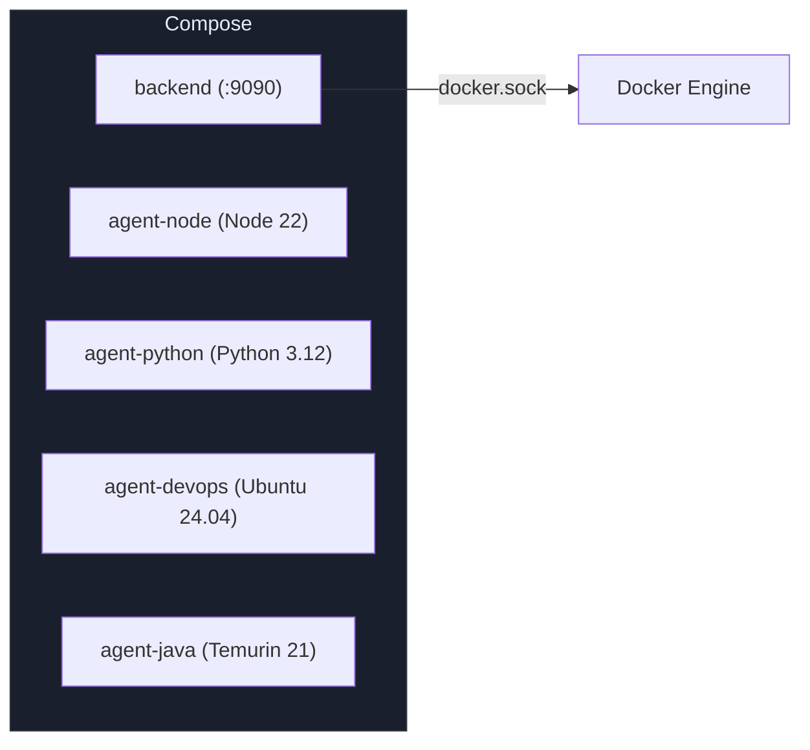
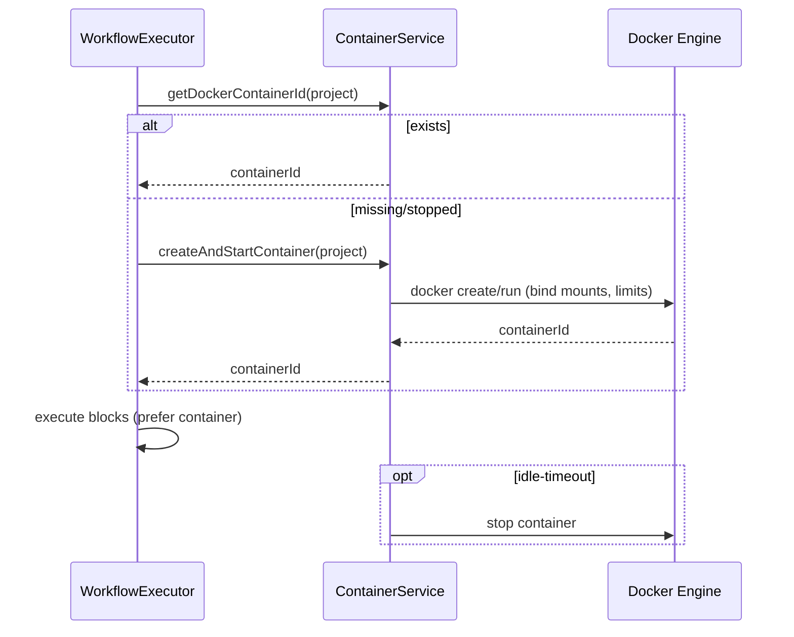

<!-- Generated from docs/deployment-container-diagrams.md and docs/i18n/deployment-container-diagrams.en.json by scripts/docs-diagrams.py — do not edit by hand. -->

# MySuricates — Deployment & Container Lifecycle

Compose setup, agent images, ContainerService and resource limits

## Docker Compose — *Services*

Backend and agents are built and started with Compose.

### Build

`mvn clean package -DskipTests`

`docker compose --profile build-only build`

### Start

`docker compose up --build`

Backend port: 9090

## Agent Images — *Dockerfiles*

| Image | Base | Path |
|---|---|---|
| backend | OpenJDK 21 + Spring Boot jar | `docker/Dockerfile.backend` |
| agent-node | Node 22 | `docker/Dockerfile.agent-node` |
| agent-python | Python 3.12 | `docker/Dockerfile.agent-python` |
| agent-devops | Ubuntu 24.04 | `docker/Dockerfile.agent-devops` |
| agent-java | Temurin 21 | `docker/Dockerfile.agent-java` |

## Container Lifecycle — *ContainerService*

Workflows preferably run in the project container. If none exists, one is started; if there are problems, execution falls back to the host.

## Mounts & Limits — *application.yml*

### Resources

`docker.container.cpu-quota: 200000` (2 CPUs)

`docker.container.memory-limit: 4000000000` (~4 GB)

`docker.container.pids-limit: 100`

`docker.container.idle-timeout-minutes: 60`

### Mounts

The project path is bind-mounted into the container.

Docker socket: `/var/run/docker.sock` (the backend needs it)

Backups inside the project mount stay isolated.

## Host Fallback — *Security & Reproducibility*

If the container fails to start, commands run in the project path on the host.

- More privileges, less isolation.
- Tools and environment come from the host, not from the image.
- Avoid it by building the images in advance and keeping the Docker daemon available.
