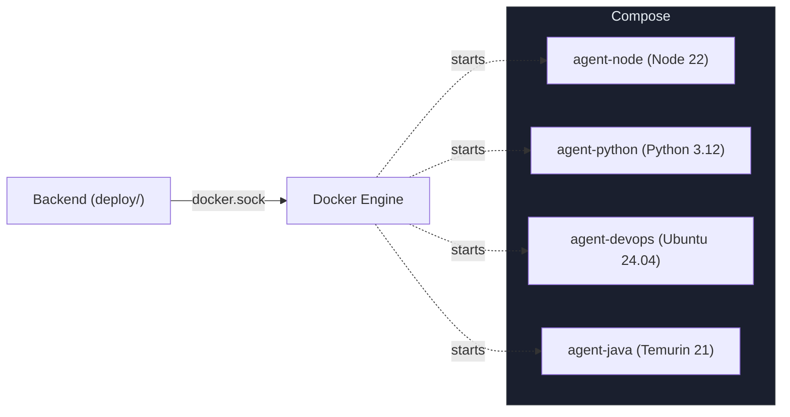
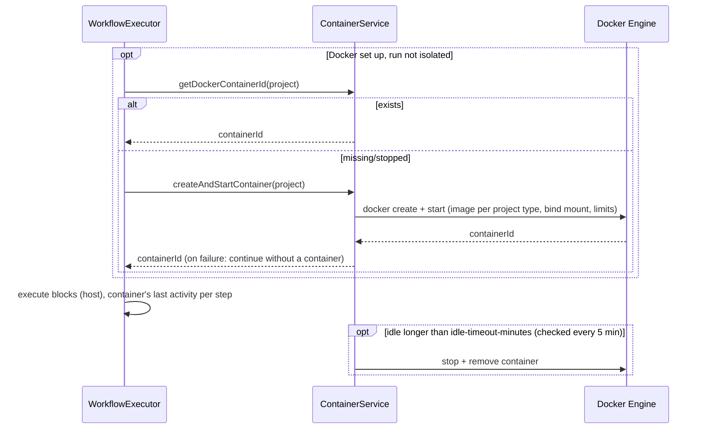

<!-- Generated from docs/deployment-container-diagrams.md and docs/i18n/deployment-container-diagrams.en.json by scripts/docs-diagrams.py — do not edit by hand. -->

# MySuricates — Deployment & Container Lifecycle

Instance in a container, Compose setup, agent images, project containers and resource limits

## Your Own Instance — *deploy/*

`scripts/instance.sh up --name NAME` builds backend and frontend into one image with `deploy/Dockerfile` and starts exactly one container (`deploy/compose.yml`); the backend serves the frontend itself.

- Settings per instance: `deploy/instances/NAME.env` — `MYSURICATES_PORT` is required, `MYSURICATES_BIND` is `127.0.0.1` unless set otherwise
- Mounts for projects, AI providers and the Docker socket are written by `scripts/lib/host-mounts.sh` into an override (`deploy/instances/NAME.override.yml`)
- Data lives in named volumes and survives `scripts/instance.sh down`
- `MYSURICATES_RUNTIME=host` starts the same instance directly on the machine instead of in a container

## Docker Compose — *Agent Images*

`ai-automation-backend/docker-compose.yml` no longer starts a backend — the only Docker way to run an instance is `deploy/` (above). The file only builds the agent images (profile `build-only`); the backend starts containers from these images through the Docker API.

### Build

`AGENT_APT_REFRESH=$(date +%Y-%m) docker compose --profile build-only build` in the directory `ai-automation-backend/`

## Agent Images — *Dockerfiles*

| Image | Base | Path |
|---|---|---|
| agent-node | `node:22-slim` | `docker/Dockerfile.agent-node` |
| agent-python | `python:3.12-slim` | `docker/Dockerfile.agent-python` |
| agent-devops | `ubuntu:24.04` | `docker/Dockerfile.agent-devops` |
| agent-java | `eclipse-temurin:21-jdk-jammy` | `docker/Dockerfile.agent-java` |

Paths relative to `ai-automation-backend/`. Project containers use `automation-agent-node` (`CODE`, `PERSONAL`) or `automation-agent-python` (`RESEARCH`, `CONTENT`, `BUSINESS`) depending on the project type; shell blocks can use any allowed image via `container_image` (`automation.execution.allowed-container-images`).

## Container Lifecycle — *ContainerService*

Before the first block, a run looks up the running project container or starts one — provided Docker is set up and the run does not run isolated in its own workspace clone. If the start fails, the run continues without a container. The blocks themselves run on the host (exception: shell steps with `container_image`); the project container is used by ad-hoc commands during a run and by the terminal.

## Mounts & Limits — *application.yml*

### Resources

`docker.container.cpu-quota: 200000` (2 CPUs)

`docker.container.memory-limit: 4000000000` (~4 GB)

`docker.container.pids-limit: 100`

`docker.container.idle-timeout-minutes: 60`

Plus `/tmp` as tmpfs, all capabilities dropped, `no-new-privileges` and the host's user ID

### Mounts

Project path → `/workspace` (read and write)

Claude from the host according to `MYSURICATES_AI_FROM_HOST`; default `login`: the program read-only, the login as a token

Docker socket: only for the backend, via a switch (`MYSURICATES_DOCKER_SOCKET`, see *deploy/*), not in the project container

## Execution on the Host — *Security & Reproducibility*

AI CLIs and shell blocks run on the host in the project directory — whether a project container is running or not.

- Tools and environment come from the host, not from an image.
- `container_image` isolates single shell steps: a one-off container (`docker run --rm`); Docker socket and extra mounts only with `automation.execution.allow-docker-socket-mount` or `allow-extra-mounts`.
- `scripts/instance.sh` isolates a whole instance in a container (see above).
