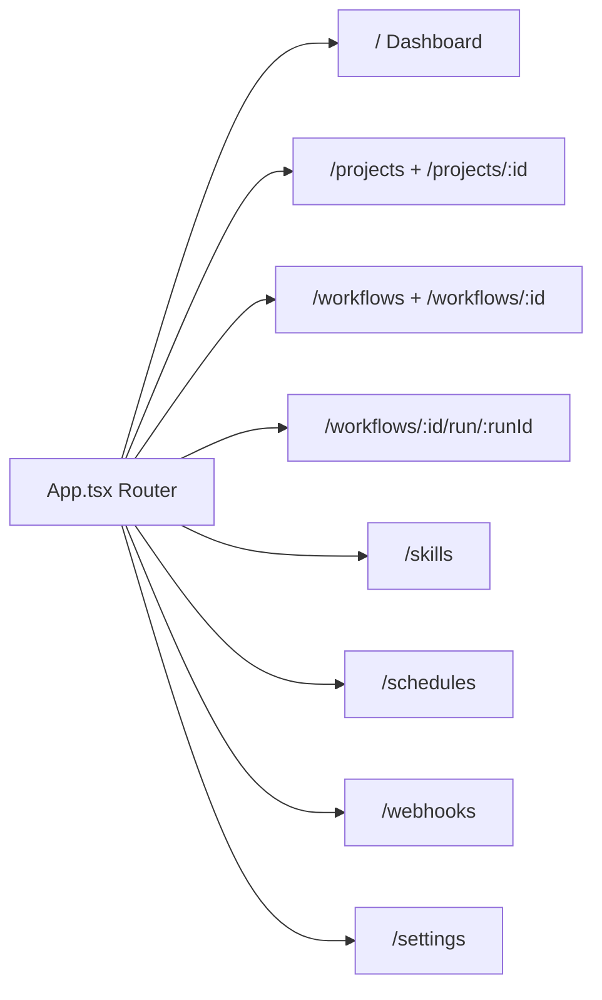
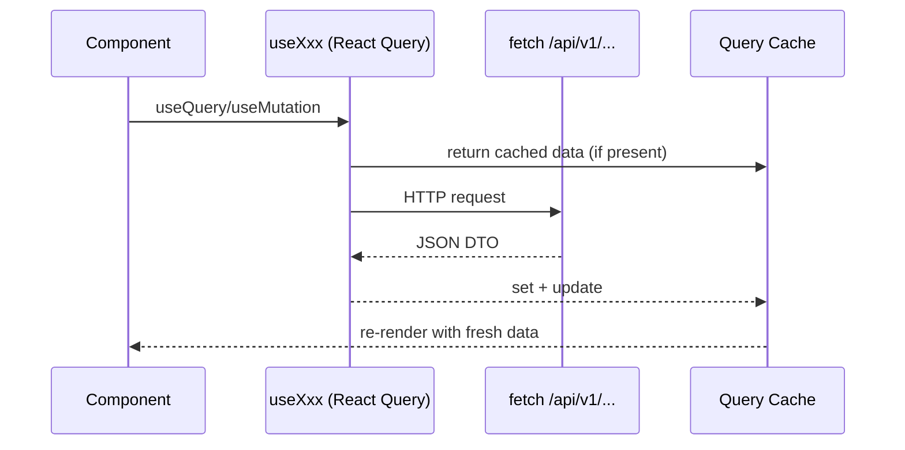
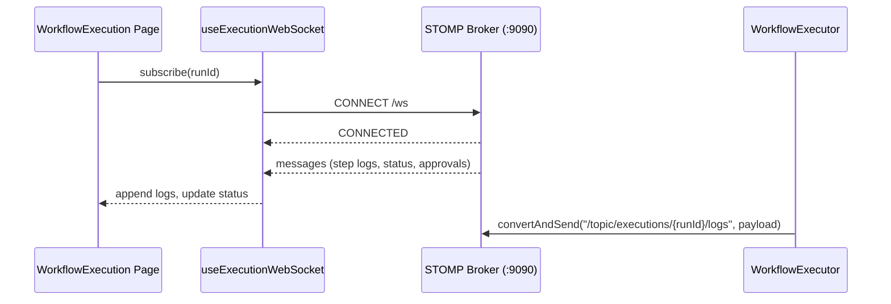

<!-- Generated from docs/frontend-flow-diagrams.md and docs/i18n/frontend-flow-diagrams.en.json by scripts/docs-diagrams.py — do not edit by hand. -->

# MySuricates — Frontend Flow

Routing, state, data flow, WebSockets and cache invalidation

## Routing — *App.tsx*

React Router with a layout (sidebar + header) and 10 main pages.

## Data Flow — *Client → API*

Fetches go through the Vite proxy `/api` to the backend; the WebSocket lives at `/ws`.

## Queries & Mutations — *Invalidation*

| Resource | Query Hook | Mutations | Invalidates |
|---|---|---|---|
| Projects | `useProjects` | create/update/delete/start/stop | projects, project detail |
| Workflows | `useWorkflows` | create/update/delete/execute | workflows, workflow detail, runs |
| Skills | `useSkills` | activate/deactivate | skills, workflow detail |
| Schedules | `useSchedules` | create/toggle/delete | schedules list |
| Webhooks | `useWebhooks` | create/toggle/delete | webhooks list |
| Settings | `useSystemHealth` | — | health |

## State — *Zustand Stores*

### Client State

`useSidebarStore`: collapse

`useThemeStore`: light/dark, overrides

`useSettingsStore`: API key, advanced mode

`useI18nStore`: locale

`useToastStore`: toasts

### Persistence

Sidebar, theme, settings, locale → localStorage

Toasts are transient

## Live Logs — *WebSocket /ws*

Execution logs arrive via STOMP on `/topic/executions/{runId}/logs`.

