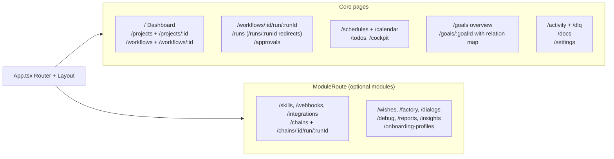
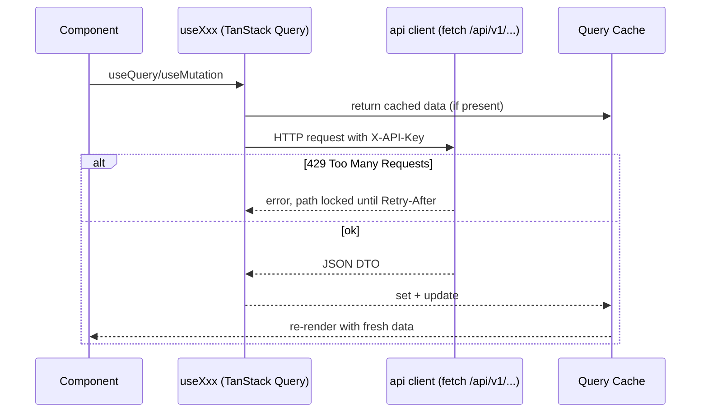
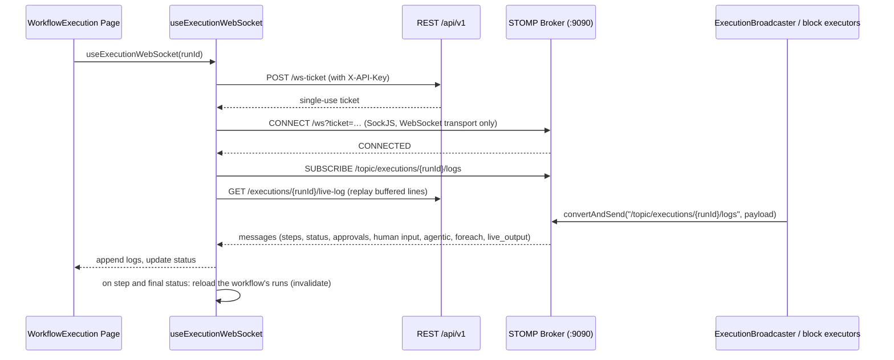

<!-- Generated from docs/frontend-flow-diagrams.md and docs/i18n/frontend-flow-diagrams.en.json by scripts/docs-diagrams.py — do not edit by hand. -->

# MySuricates — Frontend Flow

Routing, state, data flow, WebSockets and cache invalidation

## Routing — *App.tsx*

`createBrowserRouter` with one layout (sidebar + header) around all pages. Pages of optional modules sit in `ModuleRoute` and, without their module, explain how to switch it on; several core pages switch to their own, simpler version in Simple Mode (`useSettingsStore`). Every page is `simple` (own version), `shared` (both modes) or `pro` (`utils/simpleRoutes.ts`); when Simple Mode lands on a Pro page, `ProPageNotice` says so below the header and offers the switch.

## Data Flow — *Client → API*

All hooks call the `api` client (`src/api/client.ts`): `fetch` on `/api/v1/...` with the `X-API-Key` from `useSettingsStore`. In development the Vite proxy forwards `/api` and `/ws` to the backend; otherwise the backend serves the built frontend itself (`automation.serve-frontend`).

## Queries & Mutations — *Invalidation*

A key such as `['workflows']` matches all queries below it as a prefix — detail, runs, versions.

| Resource | Query Hook | Mutations | Invalidates |
|---|---|---|---|
| Projects | `useProjects`, `useProject` | create/update/archive/restore, container start/stop | `projects` (list, detail, archive) |
| Workflows | `useWorkflows`, `useWorkflow` | create/update/delete/import/seal | `workflows` |
| Runs | `useWorkflowRuns`, `useAllRuns` | execute/pause/resume/cancel/retry/delete | `workflows` and `learning`, depending on the action also `runs` and `dlq` |
| Skills | `useSkills` | create/update/delete/import | `skills`; delete also `workflows` |
| Skill activation | `useWorkflow` | activate/deactivate | `workflows` |
| Schedules | `useSchedules` | create/update/toggle/delete | `schedules` (list, calendar, preview) |
| Webhooks | `useWebhooks` | create/toggle/delete, token and secret | `webhooks` |
| Goals | `useGoals`, `useGoal`, `useGoalRelations` | create/update/delete, assign and order TODOs, assessment, milestones, goal guard | `goals`; whatever touches TODOs also `todos`; the guard also `schedules` and `workflows` |
| System | `useSystemHealth`, `useSystemInfo` | — | none; health refetches every 30 s |

## State — *Zustand Stores*

### Client State

`useSidebarStore`: collapsed, open on mobile

`useThemeStore`: theme, last chosen light and dark themes, overrides

`useSettingsStore`: API key, Simple and Advanced Mode, sidebar order, hints, model defaults

`useI18nStore` (`src/i18n`): locale

`useToastStore`: toasts

`useAssistantStore`: assistant sessions, panel size

`useDashboardLayoutStore`, `useDashboardSyncStore`: dashboard views and their sync state

### Persistence

All stores except `useToastStore` → localStorage (Zustand `persist`)

The sidebar only stores "collapsed", the assistant only sessions and panel size

Toasts are transient

## Live Logs — *WebSocket /ws*

Execution logs arrive via STOMP on `/topic/executions/{runId}/logs`. A single-use ticket from `POST /api/v1/ws-ticket` opens the handshake — the API key never appears in the URL.

