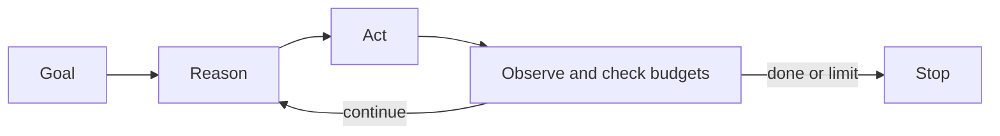

<!-- last-sync: 2026-09-23 from: docs/konzepte/agentische-budgets.md -->

<!-- concept-facts-sha256: 47f72cd8883f6032a246606f7af297a20af1c83a1a13ed6078d019d53951318a -->
<!-- concept-source: d7e7e28cf7209b4369ad33467bb4fe781a178baa -->

# Agentic blocks with budgets

## What is it useful for?
Agentic budgets limit a block that does not just execute a fixed command, but works in a Reason-Act-Observe loop: the model plans the next step, an action is executed, the result is returned, and then the next iteration decides whether to continue or finish. Configurable limits cover maximum iterations, total and iteration time, repeated identical actions, and a cumulative token budget. Optionally, approval can be required before actions. This is useful for open-ended tasks where the exact path only becomes visible along the way, such as debugging with several check commands and evaluation of the outputs. Deterministic work is better kept in simple shell blocks.

## Benefits
The mechanism makes open-ended AI work more controllable and traceable. Each iteration collects reasoning, action, result, duration, token metadata, and finally status, stop reason, and goal achievement. Events can show progress live. Repeat protection prevents simple infinite loops, timeouts terminate hanging steps, and the token budget stops execution when ongoing consumption exceeds the limit. This allows exploratory approaches to be incorporated into workflows without being fully dependent on manual observation.

## Drawbacks and costs
The budget is not a sandbox and not a hard cost cap. Token values depend on the provider; if real usage data is missing, they are estimated. The budget check happens after a call, so the limit can be exceeded. Execution stops after several blind iterations without real usage data, unless a provider is expected to work with estimates. Operational data shows only usage, not value: in a 30-day sample, 7 of 223 typed records were agentic, 144 were shell blocks. Due to retention, soft deletion, and changing metadata, this is not comparable with older inventories; error rates, domain success, and verification coverage are missing.

## Operational evidence

Measurement: **2026-09-19 (UTC)**, one local development instance. Inventory counters refer to the records visible via REST; step counts count stored steps with type metadata in the 30-day window. Wrappers count once. This is not evidence of effectiveness.

| Metric | Count / denominator |
|---|---:|
| Agentic steps in the 30-day window | 7 / 223 |
| Shell steps in the 30-day window | 144 / 223 |

[Definitions, measurement limits, and raw counters](../../konzepte/betriebsdaten.json) · [Measurement method and repetition](README.md)

## In the code

- [AgenticBlockExecutor.java](../../../ai-automation-backend/src/main/java/com/automation/executor/blocks/AgenticBlockExecutor.java)
- [AgenticStopRules.java](../../../ai-automation-backend/src/main/java/com/automation/executor/blocks/AgenticStopRules.java)
- [AgenticTokenTracker.java](../../../ai-automation-backend/src/main/java/com/automation/executor/blocks/AgenticTokenTracker.java)
