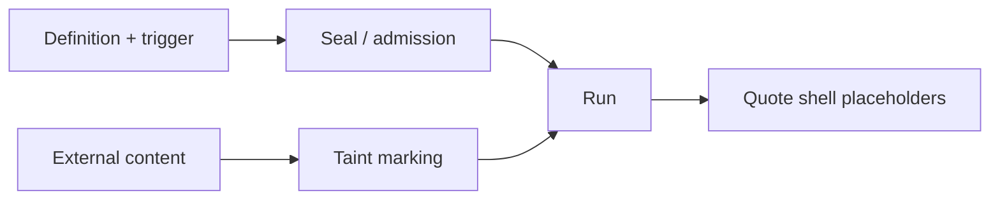

<!-- last-sync: 2026-09-23 from: docs/konzepte/haertung.md -->

<!-- concept-source: d7e7e28cf7209b4369ad33467bb4fe781a178baa -->

# Hardening: Seal, Admission, and Taint

## What is it useful for?

The mechanism hardens workflow executions in three places. A seal binds an existing definition to its hash; before each run, admission checks whether a sealed definition still matches exactly. If it differs, or if the hash cannot be computed, the run is rejected before a run record is created. Optionally, unattended starts can require the workflow to be sealed; this also takes the effective origin into account for chained or sub-workflows. In addition, origin metadata, that is definition hash and matching version, is recorded on the run if provenance is active. Taint markings track untrusted inputs and derived block outputs across continuations and sub-workflows so that placeholders in shell commands are escaped appropriately.

## Benefits

This is useful, for example, for production automations that start on a schedule, via webhook, or as a consequence of other workflows and execute shell commands. The seal makes silent changes to an approved definition detectable. Admission enforces a clear boundary: a damaged seal does not start “best effort”, but fails closed. Provenance makes later traceability easier without necessarily stopping the run for pure metadata problems. Taint reduces concrete shell quoting risks, even when data only reaches commands again through block outputs, AI prompts, or continued runs.

## Drawbacks and costs

Hardening is not complete prompt-injection protection, not a process sandbox, and not a trust guarantee for imported definitions. More protection means operational effort: workflows must be sealed deliberately, and optional rules can block unattended runs.

## In the code

- [RunAdmission.java](../../../ai-automation-backend/src/main/java/com/automation/service/workflow/RunAdmission.java)
- [OutputTaint.java](../../../ai-automation-backend/src/main/java/com/automation/executor/OutputTaint.java)
- [ExecutionContextTaint.java](../../../ai-automation-backend/src/main/java/com/automation/executor/ExecutionContextTaint.java)
