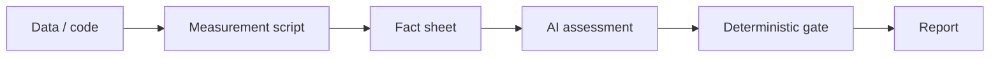

<!-- last-sync: 2026-09-23 from: docs/konzepte/messen-vor-bewerten.md -->

<!-- concept-source: d7e7e28cf7209b4369ad33467bb4fe781a178baa -->

# Deterministic measurement before AI assessment

## What is it useful for?

“Measure before assessing” separates data collection, classification, and checking. First, a deterministic step gathers facts with shell commands, optionally in a container. The step logs input, output, runtime, exit code, and execution mode; with check mode enabled, the command is also run with `set -e -o pipefail`. Only after that does an AI step assess the available findings instead of guessing freely. Finally, a gate status can be read from the output, such as GREEN, YELLOW, or RED together with a category and description. This is useful, for example, in technical reviews: tests, file statistics, or security checks are measured first; the AI then summarizes risks and next steps.

## Benefits

The mechanism saves model work where simple tools are sufficient. Measurements provide concrete artifacts such as exit codes, duration, and outputs that remain verifiable later. Container execution can make the environment clearer without mixing it with the assessment itself. Gates create a concise machine-readable decision layer over longer outputs. As a result, the AI is used more as an interpreter of findings, not as the source of raw data.

## Drawbacks and costs

Shell is not free: commands require time, resources, maintenance, and suitable tools. Results are only as good as the measurement scripts, data quality, and current environment; changed data can produce different results. Data on verification coverage and causal benefit is missing.

## In the code

- [ShellBlockExecutor.java](../../../ai-automation-backend/src/main/java/com/automation/executor/blocks/ShellBlockExecutor.java)
- [GateStatusOutputParser.java](../../../ai-automation-backend/src/main/java/com/automation/service/runoutput/GateStatusOutputParser.java)
