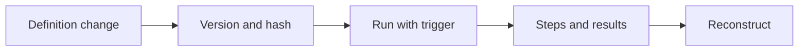

<!-- last-sync: 2026-09-23 from: docs/konzepte/persistenz-herkunft.md -->

<!-- concept-source: d7e7e28cf7209b4369ad33467bb4fe781a178baa -->

# Persistence and provenance

## What is it useful for?

For a workflow change, the platform stores a version snapshot, a sequential version number, a change source, a message, and a definition hash. Before a run, the same workflow goes through admission: if provenance tracking is active, the executable definition is canonically hashed and, where possible, assigned to the matching stored version. The run can therefore later be compared with the definition known at the time and its trigger type. This is useful, for example, when unattended automations must be explainable after the fact: you can see not only that a run took place, but which definition was executed and whether it matches a versioned change.

## Benefits

The mechanism separates readable metadata from the executable definition: name, description, or tags do not change the hash, while block order and relevant execution parameters do. Sorted, canonical JSON generation makes identical definitions stably comparable. For sealed workflows, the hash is always checked; if it does not match, the run is denied. Optionally, it can also be required that unattended runs only start sealed workflows. This does not create complete audit proof, but it does provide a practical reconstruction trail for changes, runs, and security decisions.

## Drawbacks and costs

Provenance can be disabled; in that case, the hash and version reference remain empty. Legacy data may be missing. The definition hash does not prove the origin of an imported file and is not a snapshot of the environment, input data, or external services. Retention limits the history, while soft deletion and changed metadata make time-based comparisons harder. A populated session ID on an AI TODO does not prove a resumable transcript.

## In the code

- [WorkflowVersionService.java](../../../ai-automation-backend/src/main/java/com/automation/service/workflow/WorkflowVersionService.java)
- [WorkflowDefinitionHasher.java](../../../ai-automation-backend/src/main/java/com/automation/service/workflow/WorkflowDefinitionHasher.java)
- [RunAdmission.java](../../../ai-automation-backend/src/main/java/com/automation/service/workflow/RunAdmission.java)
