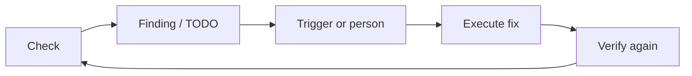

<!-- last-sync: 2026-09-23 from: docs/konzepte/selbstverbesserung.md -->

<!-- concept-source: d7e7e28cf7209b4369ad33467bb4fe781a178baa -->

# The self-improvement loop

## What is it useful for?

Self-improvement here follows a regulated loop: a workflow or audit writes findings as gate status or TODO markers into the run metadata. TODO triggers check open TODOs by tags, project, source, and minimum priority. If an entry matches and maximum attempts as well as running fix runs are not critical, a configured target workflow is started with the TODO context. After that, attempt counters, the last fix run, and trigger statistics are updated. A renewed check remains a separate step; a technically completed run is not yet proof of substantive effectiveness.

A useful application is controlled follow-up work on recurring quality findings: for example, when an analysis workflow produces red or yellow gates and targeted TODOs for limited fix workflows are created from them.

## Benefits

The mechanism separates detection, work order, execution, and assessment. This allows automatic reactions to be configured narrowly instead of reacting broadly to every finding. Backlog processing prevents only newly created TODOs from being considered; per poll, however, only one matching candidate is started. Three layers counter endless loops: a fix run started by the trigger is marked as such in the run metadata and does not itself create a TODO, the number of fix attempts is limited per TODO, and as long as a fix run is running, no second one starts; the pause window additionally disables the mechanism for a limited time. Gate summaries in metadata allow later comparison without re-evaluating all step outputs.

## Drawbacks and costs

The benefit depends heavily on good trigger rules, TODO quality, and downstream verification. Evidence of causal benefit, error rate, and verification coverage is missing.

## In the code

- [RunCompletionHandler.java](../../../ai-automation-backend/src/main/java/com/automation/service/workflow/RunCompletionHandler.java)
- [TodoTriggerService.java](../../../ai-automation-backend/src/main/java/com/automation/service/trigger/TodoTriggerService.java)
- [GateStatusResolver.java](../../../ai-automation-backend/src/main/java/com/automation/service/todo/GateStatusResolver.java)
