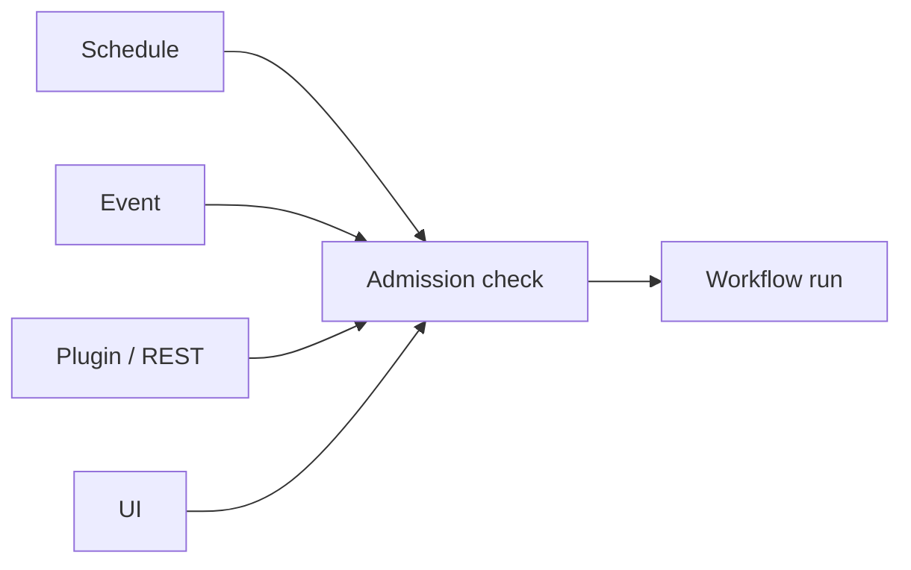

<!-- last-sync: 2026-09-23 from: docs/konzepte/zugaenge.md -->

<!-- concept-source: d7e7e28cf7209b4369ad33467bb4fe781a178baa -->

# Access paths: schedule, event, plugin and UI

## What is it useful for?

The mechanism bundles several access paths to workflow runs: manual starts from the UI or REST, resume and repeat, scheduled starts, webhooks, TODO and completion triggers, and chained or subordinate workflows. All paths arrive at a shared admission step before the actual run. There, the origin is evaluated as the trigger source, derived from the parent run for chains, and then passed on to the executor. An external session plugin can trigger runs via REST; however, this does not imply a general dynamic plugin system.

A useful case is a local single-user system where the same automation should run both ad hoc and at night on a schedule. The business logic remains identical, while start type, traceability, and protection rules are decided centrally.

## Benefits

The main benefit is unification: new start paths do not each have to rebuild their own security and provenance logic. Admission can record the hash and matching version of a workflow definition and check sealed definitions before the start. Optionally, unattended runs may execute only sealed workflows; unknown origin is treated as unattended as a precaution. Manual starts remain distinguishable from automatic starts, and chains inherit the origin of their parent run instead of obscuring it.

## Drawbacks and costs

The solution does not guarantee exactly-once execution. Unattended starts depend on configuration and enabled triggers, not only on the code. In addition, operation is designed around one API key and local single-user operation; tenant or permission concepts are therefore not evidenced.

## In the code

- [TriggerSource.java](../../../ai-automation-backend/src/main/java/com/automation/entity/TriggerSource.java)
- [RunAdmission.java](../../../ai-automation-backend/src/main/java/com/automation/service/workflow/RunAdmission.java)
- [WorkflowController.java](../../../ai-automation-backend/src/main/java/com/automation/controller/WorkflowController.java)
