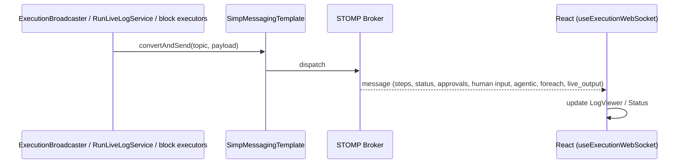
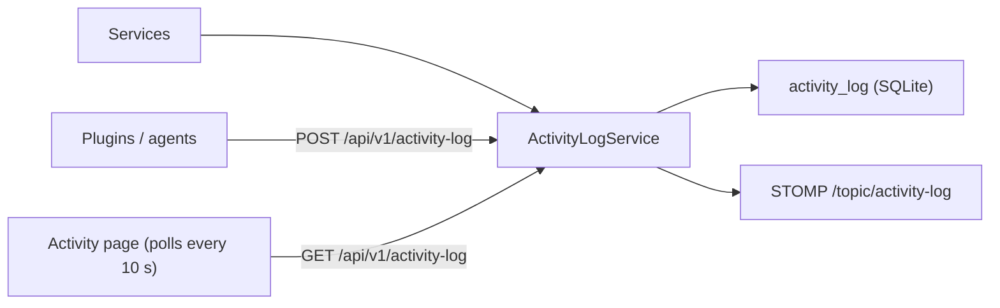

<!-- Generated from docs/logging-monitoring-diagrams.md and docs/i18n/logging-monitoring-diagrams.en.json by scripts/docs-diagrams.py — do not edit by hand. -->

# MySuricates — Logging & Monitoring

WebSocket logs, ActivityLog, health/info, RateLimit header

## WebSocket Log Pipeline — */topic/executions/{runId}/logs*

Messages: step result (`stepIndex`, `status`, `input`, `output`, `durationMs`, block type and name), `status`, `approval_required`/`approval_resolved`, `human_input_required`/`human_input_resolved`, `agentic_*`, `foreach_*`, `container_*`, `command` and `live_output`.

`live_output` batches the output of running blocks. `RunLiveLogService` keeps the latest lines in memory only; `GET /api/v1/executions/{id}/live-log` replays them to a client that reloads the page or opens it later.

## ActivityLogService — *LogCategory*

| Category | Examples |
|---|---|
| `EXECUTION` | Workflow started, completed, failed; cleanup after startup, ghost run watchdog |
| `SCHEDULE` | Schedule triggered, skipped, caught up |
| `SECURITY` | wrong or missing API key, rejected webhook signature, seal set or removed, refused start |
| `SYSTEM` | Workflow created, changed, deleted |
| `WEBHOOK` | Webhook created, triggered, deleted |
| `CONTAINER` | Project container started, stopped, cleaned up when idle |
| `PLUGIN` | Entries from outside via `POST /api/v1/activity-log` |

## Health & Info — */api/v1/system*

### Health

`GET /api/v1/system/health`: `status` `UP`, `DEGRADED` (Docker set up but not answering) or `DOWN` (database unreachable), plus `components.database` and `components.docker`

Open (no API key)

### Info

`GET /api/v1/system/info`: name, version, build type and timestamp, Java version, runtime mode, Tailscale status, environment, rate limit figures

Open (no API key)

### Other Open Probes

`GET /api/v1/system/auth-status`, `GET /api/v1/system/jvm-memory` (three heap figures) and `/actuator/health`

The other `/actuator/**` endpoints, such as `/actuator/metrics`, need the API key

## Rate Limit Header — *Filter*

The `RateLimitFilter` is on by default (120 requests per minute and client IP, `/api/**` only); every response it lets through states the remainder, a 429 the waiting time.

| Header | Meaning |
|---|---|
| `X-RateLimit-Remaining` | Remaining requests in the current 1-minute window |
| `Retry-After` | On 429: seconds until the window frees up again |
