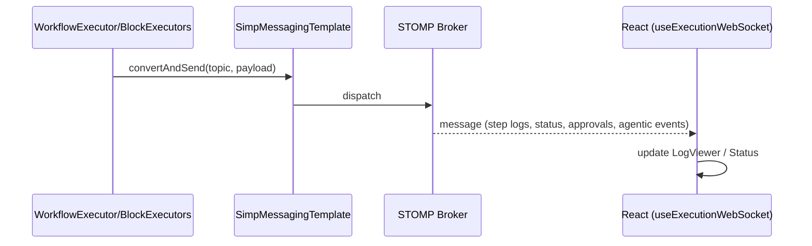
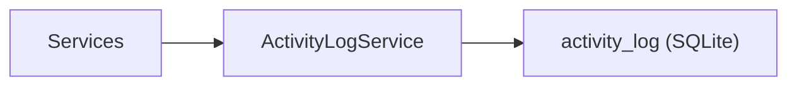

<!-- Generated from docs/logging-monitoring-diagrams.md and docs/i18n/logging-monitoring-diagrams.en.json by scripts/docs-diagrams.py — do not edit by hand. -->

# MySuricates — Logging & Monitoring

WebSocket logs, ActivityLog, health/info, RateLimit header

## WebSocket Log Pipeline — */topic/executions/{runId}/logs*

Payloads: StepResult (input/output/duration/status), status events, approval_required/approval_resolved, agentic_* events.

## ActivityLogService — *LogCategory*

| Category | Examples |
|---|---|
| `EXECUTION` | Workflow start/complete/fail |
| `SCHEDULE` | Schedule triggered/failed |
| `SECURITY` | auth/rate-limit events |

## Health & Info — */api/v1/system*

### Health

`GET /api/v1/system/health`: status OK

Open (no API key)

### Info

`GET /api/v1/system/info`: version, build timestamp

Open (no API key)

## Rate Limit Header — *Filter*

With the RateLimitFilter active, the remaining requests are reported in a header.

| Header | Meaning |
|---|---|
| `X-RateLimit-Remaining` | Remaining requests in the current 1-minute window |
