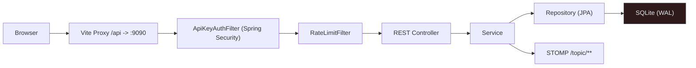
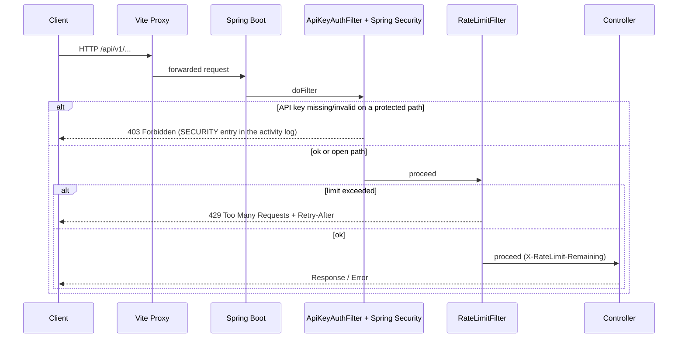
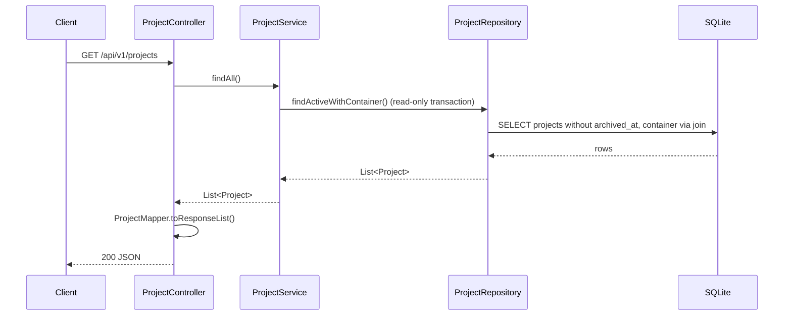

<!-- Generated from docs/request-lifecycle-diagrams.md and docs/i18n/request-lifecycle-diagrams.en.json by scripts/docs-diagrams.py — do not edit by hand. -->

# MySuricates — Request Lifecycle & Security

From the browser to the database: filters, error format, auth, rate limits

## System Overview — *Request Path*

HTTP requests go through the Vite proxy (dev) or straight to the Spring Boot backend, pass Spring Security with the `ApiKeyAuthFilter` and the `RateLimitFilter`, and end up in the REST controllers. Services send live messages via STOMP.

## Filter Chain — *Before the Controllers*

Order: Spring Security with `ApiKeyAuthFilter` → `RateLimitFilter` → controller. Without a valid key, Spring Security rejects protected paths with 403 before any business logic runs; the rate limit only counts `/api/**`.

## Controller → Service → Repository — *Example: /projects*

Controllers are thin; services encapsulate logic and transactions, repositories talk to SQLite over a single connection (HikariCP `maximum-pool-size: 1`). Open Session in View is off: lazy loading belongs in the service, the controller maps to DTOs with MapStruct.

## Error Format — *GlobalExceptionHandler*

| Case | Status | Body |
|---|---|---|
| Validation | 400 | `{"code":"VALIDATION_FAILED","error":"Validation failed","timestamp":"…","fieldErrors":{...}}` |
| Invalid argument | 400 | `{"code":"INVALID_ARGUMENT","error":"…","timestamp":"…"}` |
| Not found | 404 | `{"code":"RESOURCE_NOT_FOUND","error":"…","timestamp":"…"}` |
| State conflict | 409 | `{"code":"STATE_CONFLICT","error":"…","timestamp":"…"}` |
| Rate limit (filter, not handler) | 429 | `{"error": "Rate limit exceeded", "retryAfterSeconds": N}` |
| Server | 500 | `{"code":"INTERNAL_ERROR","error":"Internal server error","timestamp":"…"}` |

## Security & Rate Limit — *Configuration*

### API Key

`automation.security.enabled=true` (default)

Header: `X-API-Key`; without `automation.security.api-key` the backend generates a key on first start and stores it in `app_settings`

Constant-time comparison (`MessageDigest.isEqual`)

### Rate Limit

`automation.security.rate-limit.enabled` (default `true`), `requests-per-minute` (default `120`)

Fixed 1-minute window per client IP; `X-Forwarded-For` only counts behind `trusted-proxies`

Header: `X-RateLimit-Remaining`, on 429 `Retry-After`

## Open Endpoints — *Without API Key*

- `GET /api/v1/system/health`, `/info`, `/auth-status`, `/jvm-memory`
- `POST /api/v1/webhook/trigger/{token}` — with a signing secret set, only with a valid HMAC signature (`X-Signature`)
- `GET /api/v1/integrations/{providerId}/callback` (OAuth callback)
- `/ws/**` (SockJS/STOMP) — no key header, but the handshake requires a single-use ticket from `POST /api/v1/ws-ticket`
- `/actuator/health`; the other `/actuator/**` only with the key
