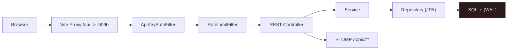
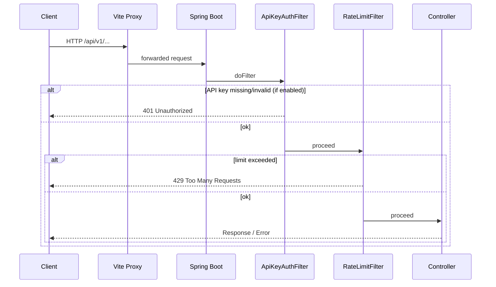
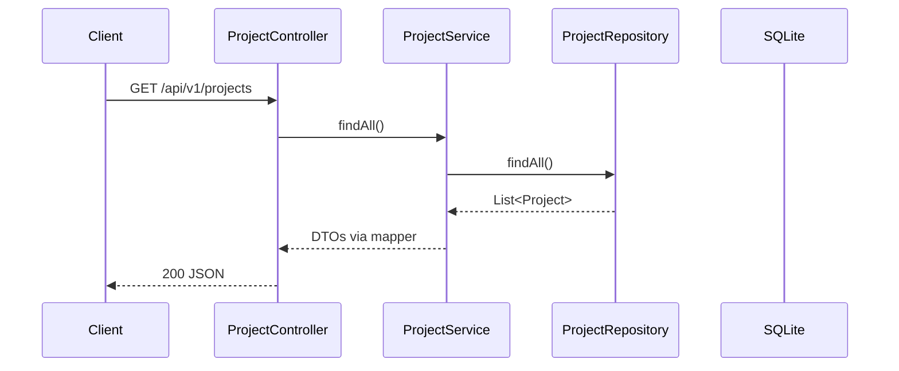

<!-- Generated from docs/request-lifecycle-diagrams.md and docs/i18n/request-lifecycle-diagrams.en.json by scripts/docs-diagrams.py — do not edit by hand. -->

# AutoPilot — Request Lifecycle & Security

From the browser to the database: filters, error format, auth, rate limits

## System Overview — *Request Path*

HTTP requests go through the Vite proxy (dev) or straight to the Spring Boot backend, pass the security filters and end up in the REST controllers.

## Filter Chain — *Before the Controllers*

Order: ApiKeyAuth → RateLimit → Controller. With a misconfiguration or a missing key, the request is rejected before any business logic runs.

## Controller → Service → Repository — *Example: /projects*

Controllers are thin; services encapsulate the logic, repositories talk to SQLite.

## Error Format — *GlobalExceptionHandler*

| Case | Status | Body |
|---|---|---|
| Validation | 400 | `{"error":"Validation failed","fieldErrors":{...}}` |
| Not Found | 404 | `{"error":"Resource not found"}` |
| Rate Limit | 429 | `{"error":"Too many requests"}` |
| Server | 500 | `{"error":"Internal server error"}` |

## Security & Rate Limit — *Configuration*

### API Key

`automation.security.enabled=true`

Header: `X-API-Key`

Constant-time comparison (`MessageDigest.isEqual`)

### Rate Limit

`automation.security.rate-limit.enabled` (default false)

Sliding window, 120 req/min per client IP

Header: `X-RateLimit-Remaining`

## Open Endpoints — *Without API Key*

- `GET /api/v1/system/health`
- `GET /api/v1/system/info`
- `POST /api/v1/webhook/trigger/{token}`
- `/ws/**` (SockJS/STOMP)
- `/actuator/**`
