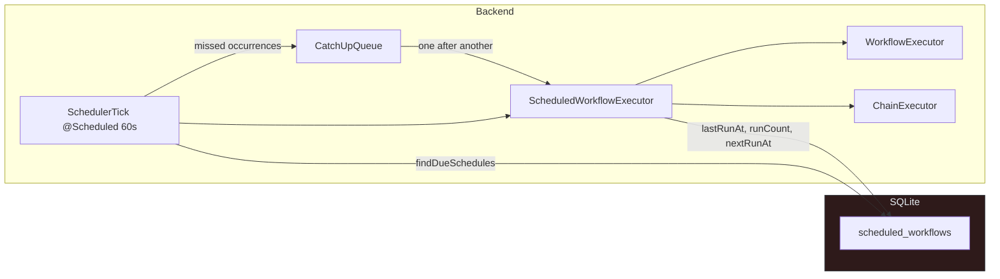
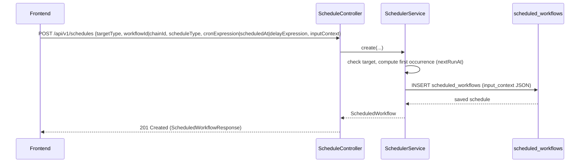
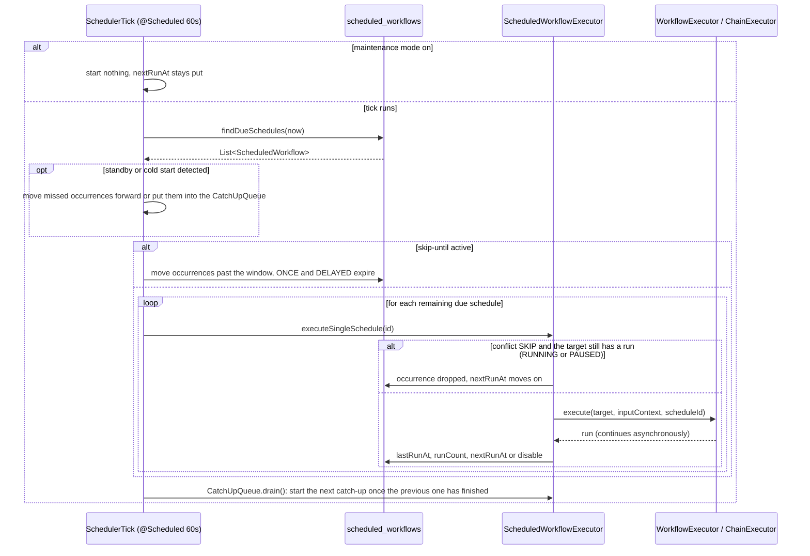

<!-- Generated from docs/scheduler-diagrams.md and docs/i18n/scheduler-diagrams.en.json by scripts/docs-diagrams.py — do not edit by hand. -->

# MySuricates — Scheduler & Cron

Schedules, InputContext, triggering and execution pipeline

## System Overview — *Scheduler Tick*

Every 60 seconds `SchedulerTick` checks the due schedules and starts their target — a workflow or a chain — with the stored `inputContext`. Occurrences that fell due during a gap (standby, cold start) are caught up one after another by the `CatchUpQueue` or moved to their next occurrence.

## Creating Schedules — *API Flow*

### Types

`scheduleType`: `CRON` (default), `ONCE` or `DELAYED`

CRON needs `cronExpression`, ONCE `scheduledAt`, DELAYED a `delayExpression` such as `30s`, `10m`, `2h` or `1d`

Target: `targetType` `WORKFLOW` (default, with `workflowId`) or `CHAIN` (with `chainId`)

### InputContext

Any JSON object; `ScheduledWorkflowExecutor` passes it to `WorkflowExecutor.execute(…)` or `ChainExecutor.execute(…)`.

For a workflow, its values override entries of the same name in the `defaultContext` — so schedules run with the stored variables.

## Execution — *Due Schedules*

## Data Model — *scheduled_workflows*

| Column | Description |
|---|---|
| `target_type` | `WORKFLOW` \| `CHAIN` |
| `workflow_id`, `chain_id` | Target (FK → `workflows` or `workflow_chains`) |
| `schedule_type` | `CRON` \| `ONCE` \| `DELAYED` |
| `cron_expression` | CRON string (empty for ONCE and DELAYED) |
| `scheduled_at` | Execution time for ONCE and DELAYED |
| `delay_expression` | Delay for DELAYED, e.g. `2h` |
| `input_context` | JSON map (parameters for the run) |
| `enabled` | On/off |
| `last_run_at`, `next_run_at` | Last start, next occurrence |
| `end_date`, `max_runs`, `run_count` | End conditions for CRON (`max_runs` = `0`: unlimited) |
| `conflict_behavior` | `SKIP` (default) or `OVERLAP` |
| `catch_up_on_resume` | Catch up this schedule's missed occurrences |

## Config & Behavior — *Key Points*

### Validation

CRON is validated with `CronExpression.isValidExpression`.

ONCE requires `scheduledAt`, DELAYED a `delayExpression`.

### Tick & nextRunAt

Tick: `@Scheduled(fixedRate = 60_000)` in `SchedulerTick`.

After a start: CRON → next occurrence, disabled once `maxRuns` or `endDate` is reached; ONCE and DELAYED → disabled.

### Conflict

`SKIP` (default): if the target still has a run in `RUNNING` or `PAUSED`, the occurrence is dropped — CRON moves on to the next one, ONCE and DELAYED expire; `lastRunAt` and `runCount` stay unchanged.

`OVERLAP` starts a second run alongside.

### Missed Occurrences

Detected as a tick gap above `automation.scheduler.resume-grace-minutes` (default 5) or as the first tick after startup.

Catch-up runs one at a time through the `CatchUpQueue` — for all schedules while `scheduler-catch-up-on-resume` is on (default), otherwise only with `catchUpOnResume`. All others jump to their next occurrence.

### Pauses

Maintenance mode (`POST /api/v1/schedules/maintenance`): the tick starts nothing, `nextRunAt` stays put.

`automation.scheduler.skip-until` (ISO instant): due occurrences jump past the window; it also wins over catching up.
