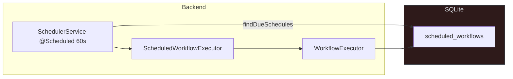
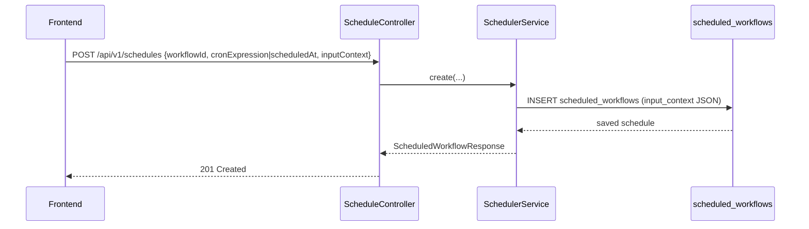
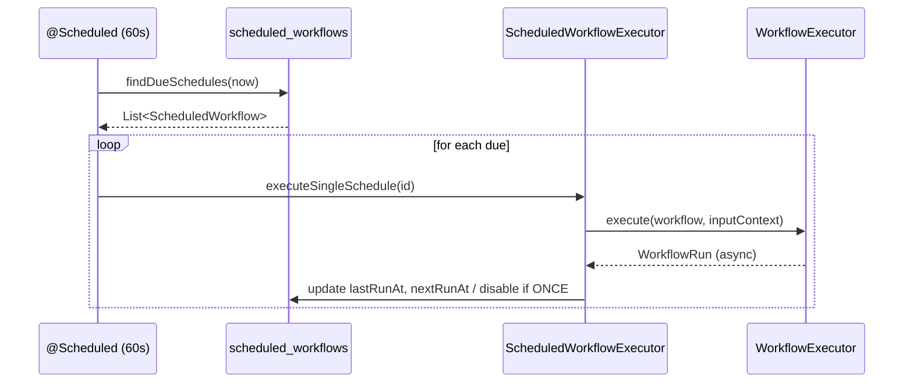

<!-- Generated from docs/scheduler-diagrams.md and docs/i18n/scheduler-diagrams.en.json by scripts/docs-diagrams.py — do not edit by hand. -->

# MySuricates — Scheduler & Cron

Schedules, InputContext, triggering and execution pipeline

## System Overview — *Scheduler Loop*

A one-minute tick checks for due schedules and starts workflows with their stored `inputContext`.

## Creating Schedules — *API Flow*

### Types

`scheduleType`: `CRON` (default) or `ONCE`

CRON needs `cronExpression`; ONCE needs `scheduledAt`

### InputContext

Any JSON; passed on 1:1 to `workflowExecutor.execute(..., context)`.

This way, schedules run deterministically with the stored variables.

## Execution — *Due Schedules*

## Data Model — *scheduled_workflows*

| Column | Description |
|---|---|
| `workflow_id` | FK → workflow |
| `cron_expression` | CRON string (empty for ONCE) |
| `schedule_type` | `CRON` \| `ONCE` |
| `scheduled_at` | Execution timestamp for ONCE |
| `input_context` | JSON map (parameters for the run) |
| `enabled` | Toggle |
| `last_run_at`, `next_run_at` | Tracking |

## Config & Behavior — *Key Points*

### Validation

CRON is validated with `CronExpression.isValidExpression`.

ONCE requires `scheduledAt`.

### Tick & NextRun

Check: every minute (`@Scheduled(fixedRate=60_000)`).

After execution: CRON → nextRun recalculated, ONCE → disabled.
