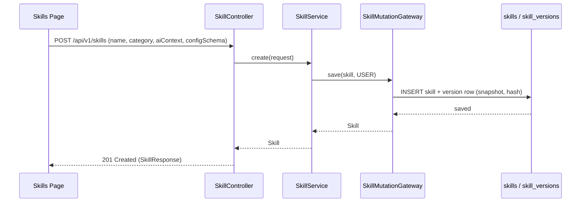
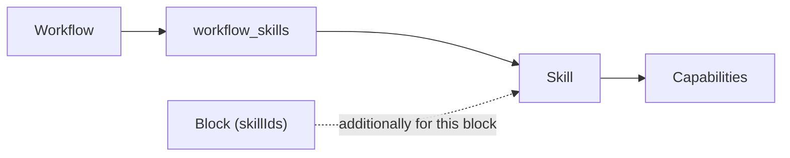
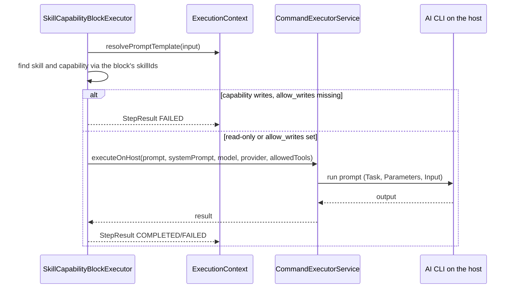

<!-- Generated from docs/skills-diagrams.md and docs/i18n/skills-diagrams.en.json by scripts/docs-diagrams.py — do not edit by hand. -->

# MySuricates — Skills & Capabilities

Skill lifecycle, activation per workflow, execution in the skill-capability block

## Lifecycle — *CRUD*

Skills are an optional module (`skills`, in the preset `full`). Every change goes through `SkillMutationGateway`, which writes a version row.

Capabilities are not created along with a skill: they come from the built-in skills (`skills/builtin/*.json`, loaded at startup) or from an import (`POST /api/v1/skills/import`). Built-ins are read-only; the gateway refuses changes to a skill that a sealed workflow uses with 409.

## Activation per Workflow — */workflows/{id}/skills*

`POST /api/v1/workflows/{id}/skills` activates, `DELETE /api/v1/workflows/{id}/skills/{skillId}` deactivates.

Before the first block, the run writes the `aiContext` of the activated skills to `.claude/rules/skills-context.md` in the project (`CommandExecutorService.writeSkillContextToProject`); a block with its own `skillIds` adds them for its duration. The Claude CLI reads `.claude/rules/` by itself, Codex and Pi get the file appended to the system prompt.

## Executing a Capability — *skill-capability Block*

### Prompt Structure

`Task: <description>` + `Parameters: {…}` + `Input: …` — without a description, the capability's name stands there

System prompt = the skill's `aiContext` + workflow instructions

### Permissions

Without `allow_writes` the CLI only gets read-only tools: `Read`, `Grep`, `Glob`, `WebFetch`, `WebSearch`, `Task`, `TodoWrite`.

A capability with `writes` requires `allow_writes: true`, otherwise the step fails.

### Context

`input` is resolved like a prompt: `{{ previous_output }}`, `{{ block.<name>.output }}`, context variables.

`params` go into the prompt as parameters.

## Data Model — *skills & capabilities*

| Table | Key columns |
|---|---|
| `skills` | name, description, icon, category, ai_context, config_schema, builtin, version |
| `capabilities` | skill_id, name, description, handler_class, input_schema, output_schema, async, writes |
| `workflow_skills` | workflow_id, skill_id (activation) |
| `skill_versions` | skill_id, version_number, operation, snapshot, content_hash, change_source |
