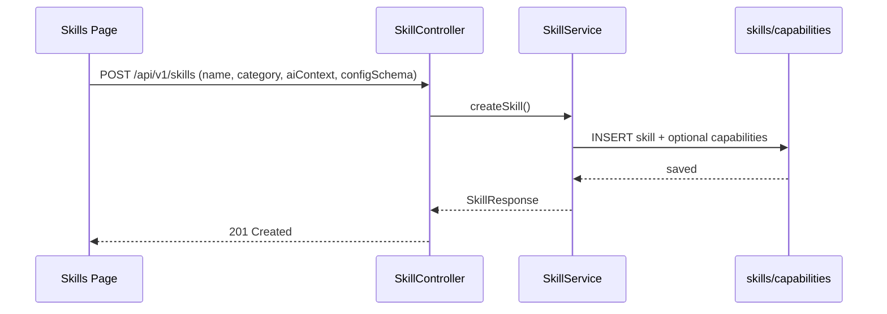
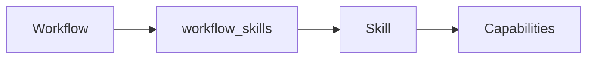
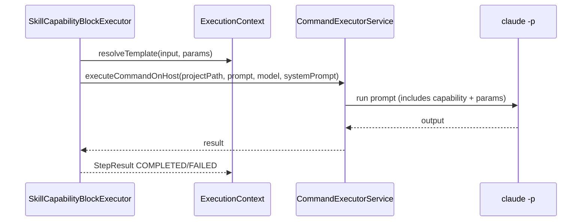

<!-- Generated from docs/skills-diagrams.md and docs/i18n/skills-diagrams.en.json by scripts/docs-diagrams.py — do not edit by hand. -->

# AutoPilot — Skills & Capabilities

Skill lifecycle, activation per workflow, execution in the skill-capability block

## Lifecycle — *CRUD*

## Activation per Workflow — */workflows/{id}/skills*

Activated skills are injected into the project before execution (`injectSkillContextOnHost`).

## Executing a Capability — *skill-capability Block*

### Prompt Structure

`"Use your '<capability>' capability..."` + params + input

SystemPrompt = workflow instruction prefix

### Context

Skill context (aiContext) injected into the CLI session beforehand.

Template variables: `{{ previous_output }}`, `{{ vars }}`

## Data Model — *skills & capabilities*

| Table | Key columns |
|---|---|
| `skills` | name, description, category, ai_context, config_schema, builtin, version |
| `capabilities` | skill_id, name, description, handler_class, input_schema, output_schema, async |
| `workflow_skills` | workflow_id, skill_id (activation) |
