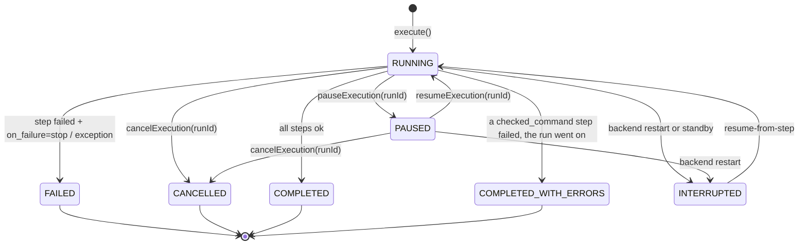
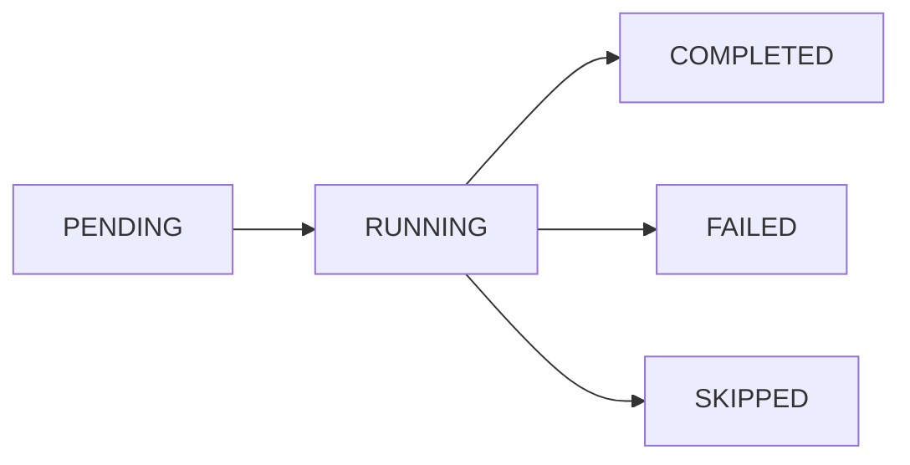
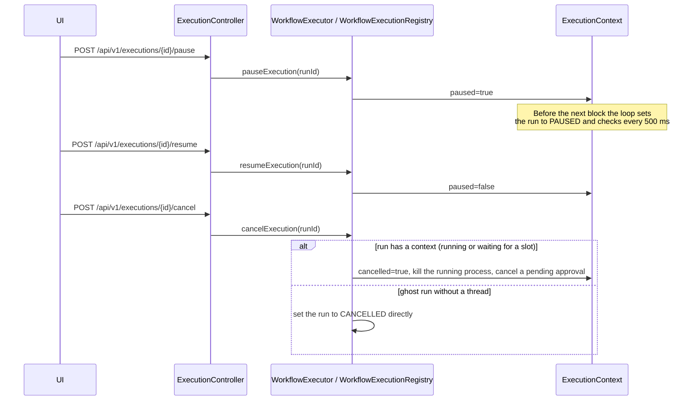
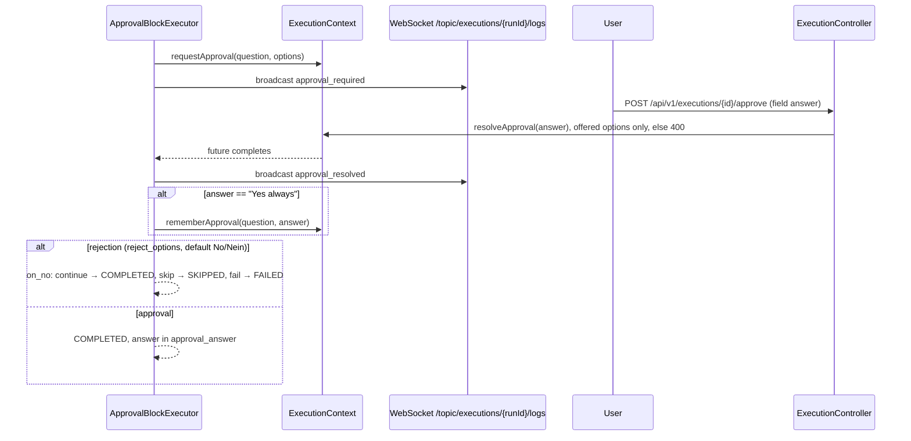

<!-- Generated from docs/workflow-control-diagrams.md and docs/i18n/workflow-control-diagrams.en.json by scripts/docs-diagrams.py — do not edit by hand. -->

# MySuricates — Workflow Control & States

State machines, pause/resume/cancel, approval & error paths

## WorkflowRun State Machine — *RunStatus*

A workflow run is created directly as `RUNNING` (`PENDING` is only the entity's default). If `RunAdmission` refuses the start — a sealed workflow no longer matches its seal, or an unattended start meets an unsealed workflow with `require-sealed-for-unattended` —, no run is created at all.

At startup the backend cleans up runs still stored as `RUNNING` or `PAUSED` and sets them to `INTERRUPTED`. A run without an execution thread becomes `FAILED` after `automation.execution.ghost-watchdog-stale-minutes` — or `INTERRUPTED` if a standby was detected shortly before. `resume-from-step` continues after the last completed step; without a completed step a new run starts.

## StepResult Status — *StepStatus*

`BlockStepRunner` creates every step directly as `RUNNING` (`PENDING` is the entity's default) and then sets the BlockExecutor's result: exit code of the shell or the AI CLI → COMPLETED/FAILED; a conditional without a command for the chosen branch and a rejected approval with `on_no: skip` → SKIPPED.

## Pause / Cancel — *ExecutionContext*

## Approval Flow — *ApprovalBlock & Agentic*

Without an answer after `timeout_minutes` (default 30) or when the run is cancelled, the step ends `FAILED`. `GET /api/v1/executions/pending-input` lists waiting approvals (page `/approvals`). The agentic block asks through the same mechanism with `require_approval` (`agentic_approval_required`); there, "No" repeats the iteration with a new proposal.

## Error Paths & Stop-on-Failure — *BlockDefinition.on_failure*

### Default Behavior

`on_failure` missing or set to `"stop"` → a FAILED step ends the run with `FAILED`.

With `"continue"` the following steps run anyway; if a step with `checked_command` fails along the way, the run ends as `COMPLETED_WITH_ERRORS`.

### Agentic Specifics

Stop reasons: TOTAL_TIMEOUT, ITERATION_TIMEOUT, TOKEN_BUDGET_EXCEEDED, REPEATED_ACTIONS, TOKEN_TRACKING_FAILED; also GOAL_STATUS=IMPOSSIBLE and reaching `max_iterations`.

Status: COMPLETED only with GOAL_STATUS=ACHIEVED, otherwise FAILED.
