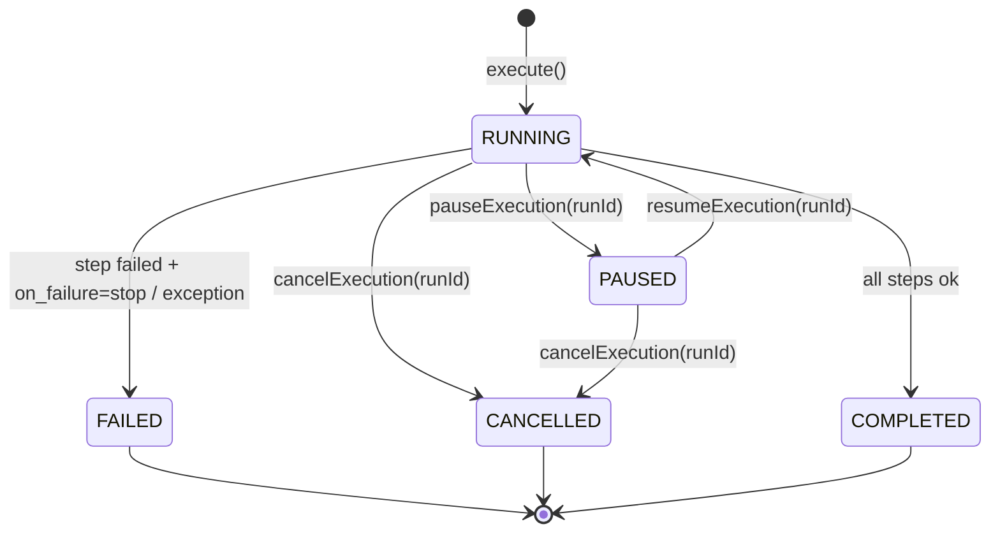
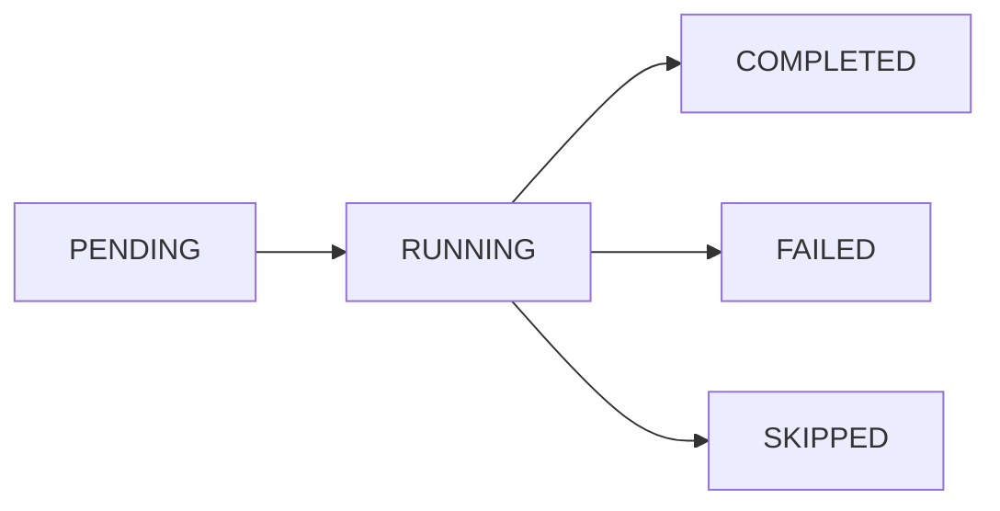
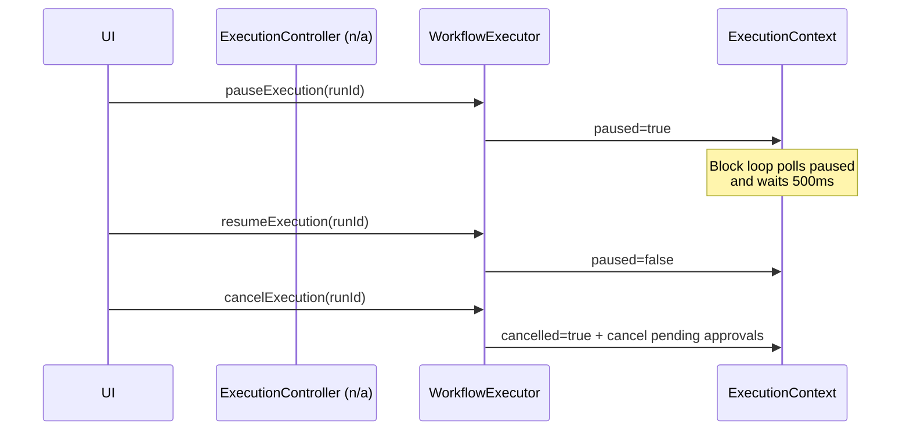
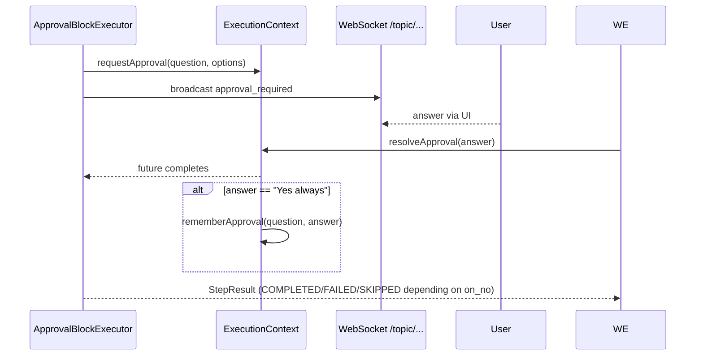

<!-- Generated from docs/workflow-control-diagrams.md and docs/i18n/workflow-control-diagrams.en.json by scripts/docs-diagrams.py — do not edit by hand. -->

# AutoPilot — Workflow Control & States

State machines, pause/resume/cancel, approval & error paths

## WorkflowRun State Machine — *RunStatus*

## StepResult Status — *StepStatus*

Set by the BlockExecutor: shell/Claude exit code -> COMPLETED/FAILED; conditional without a branch -> SKIPPED.

## Pause / Cancel — *ExecutionContext*

## Approval Flow — *ApprovalBlock & Agentic*

## Error Paths & Stop-on-Failure — *BlockDefinition.on_failure*

### Default Behavior

`on_failure` missing → the run stops at a FAILED step.

Can be set to `"continue"` if the following steps should run anyway.

### Agentic Specifics

Stop reasons: ITERATION_TIMEOUT, TOTAL_TIMEOUT, TOKEN_BUDGET_EXCEEDED, REPEATED_ACTIONS, GOAL_STATUS=IMPOSSIBLE.

Status: FAILED if the goal is not reached.
