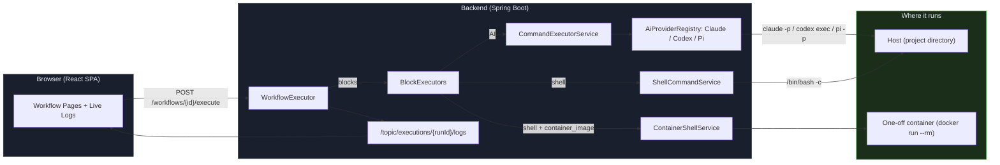
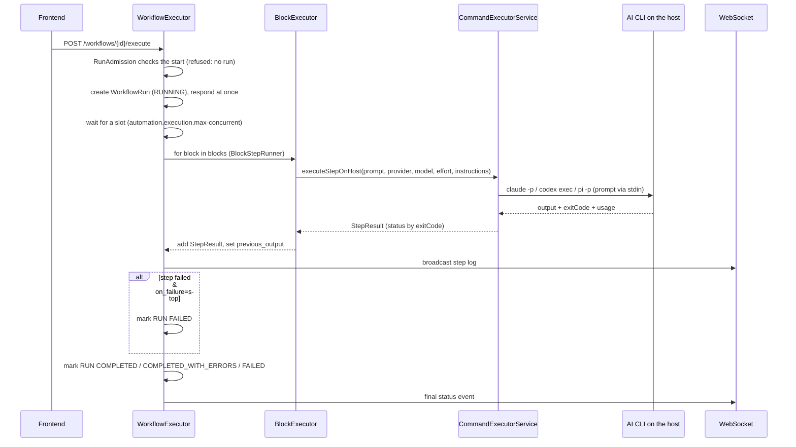
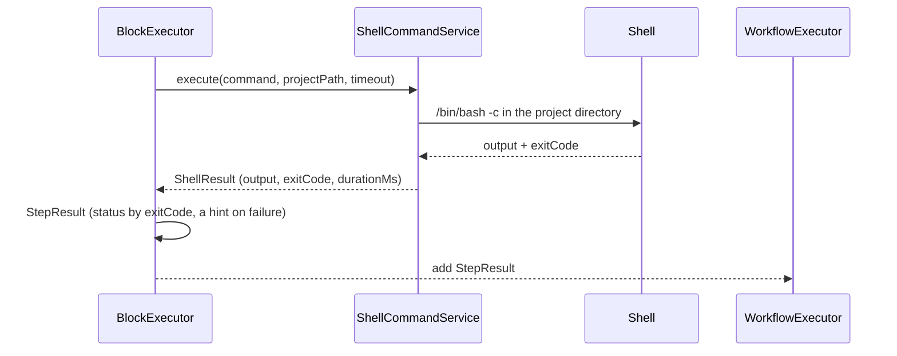
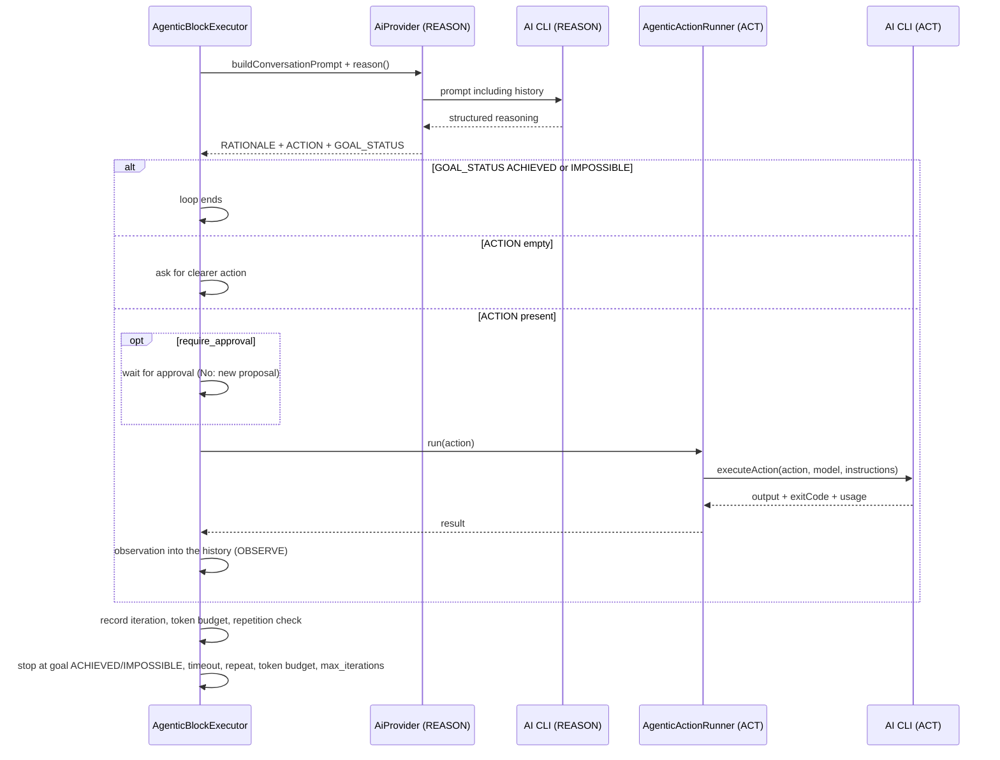
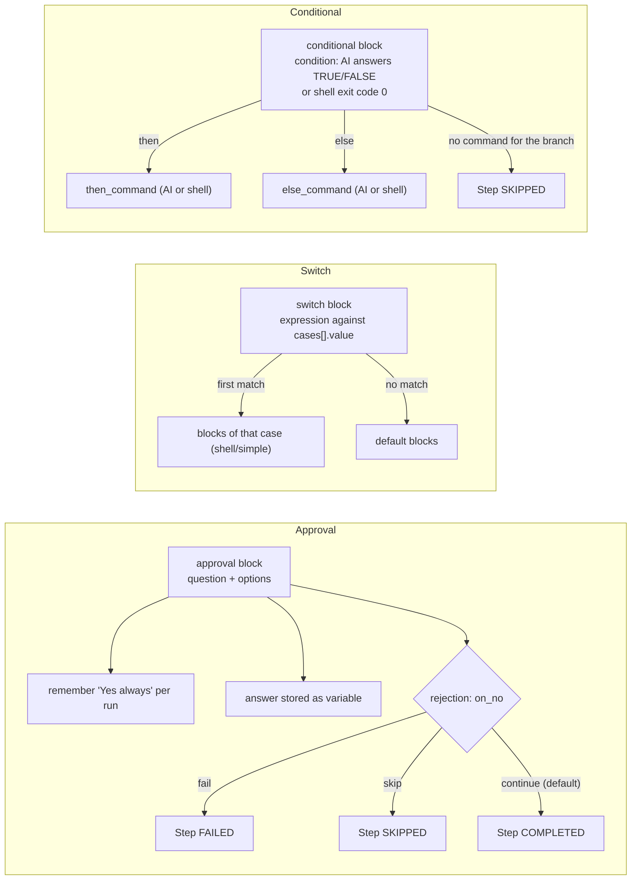

<!-- Generated from docs/workflow-engine-diagrams.md and docs/i18n/workflow-engine-diagrams.en.json by scripts/docs-diagrams.py — do not edit by hand. -->

# MySuricates — Workflow Engine

Core logic, execution modes (with/without AI) and control flows

## System Overview — *High-Level*

All workflows run through the `WorkflowExecutor`: it has `RunAdmission` check the start, creates the run and works through the blocks on a virtual thread. AI blocks call the chosen provider's CLI on the host via the `CommandExecutorService`; shell blocks run on the host or, with `container_image`, in a one-off container. Logs reach the UI via WebSocket.



## Execution (Default, AI-Assisted) — *AI Block*

An AI block (such as `simple`) sends its prompt via `CommandExecutorService.executeStepOnHost` to the provider from the block or workflow, otherwise to the system default; model and effort follow the same precedence. The instructions (base from `agent-instructions.md` plus workflow instructions) go along as the system prompt.



## Execution (Without AI) — *Shell Paths*

Shell mode uses neither models nor instructions and only evaluates the exit code.



### When Shell?

- Block type `shell`
- `execution_mode: shell` for foreach, while, retry and conditional as well as for blocks in switch cases
- `container_image` on the shell command: the same path, but in a one-off container

### Differences

- No model, no tokens
- Deterministic through the exit code; after `timeout_seconds` (default 300) exit code 124
- Metadata: `exitCode`, `executionMode` (`shell` or `container:<image>`)

## Agentic Loop — *Reason–Act–Observe*

Multi-step AI planning with token and time budgets, a repetition stop and optional approval. Both phases go through the provider from the block or workflow; with Claude, REASON reaches the CLI with `--system-prompt` and `--max-turns 3`, ACT with `--append-system-prompt`.



## Control Flow — *Conditional, Switch & Approval*

Branches and approvals within a run.



## Provider & Execution Modes — *AI vs. No AI*

| Aspect | AI (Claude, Codex, Pi) | Without AI (Shell) |
|---|---|---|
| CLI | `claude -p`, `codex exec`, `pi -p` | `/bin/bash -c` |
| Provider | `provider` on the block > on the workflow > system default | — |
| Context | Instructions as system prompt, `.claude/rules/` (skills, memory, project context), `{{ previous_output }}` | Only the command with resolved placeholders |
| Determinism | Lower (LLM) | High (exit code) |
| Telemetry | Tokens, cost, model in `StepResult.metadata` (`aiRequest`) | `exitCode`, `executionMode`, duration |
| Location | Host, project directory | Host, project directory; with `container_image` a one-off container |

## Block Matrix — *Type → Exec Mode*

A step with status FAILED ends the run unless `on_failure` is `"continue"`.

| Block | Default | Options (selection) | Step FAILED when … |
|---|---|---|---|
| `simple` | AI | `timeout_seconds`, `provider`, `model`, `effort` | the AI CLI ends with an error |
| `shell` | Shell | `timeout_seconds`, `container_image`, `checked_command`, `shell_escape_variables` | the exit code is not 0 |
| `retry` | AI | `execution_mode`=ai/shell, `max_retries`, `delay`, `exponential_backoff`, `timeout_seconds` | all attempts fail |
| `foreach` | AI | `execution_mode`=ai/shell, `items_source`=list/command, `continue_on_error`, `max_consecutive_failures`, `timeout_seconds`, `workflow_id` + `context` (one child run per item instead of a command) | an item fails (unless `continue_on_error`); `max_consecutive_failures` items fail in a row (default 3, also with `continue_on_error`); with `workflow_id`: a child run does not end `COMPLETED` |
| `while` | AI | `execution_mode`=ai/shell, `condition_command`, `max_iterations`, `timeout_seconds` | an iteration fails |
| `conditional` | AI | `execution_mode`=ai/shell, `then_command`, `else_command`, `timeout_seconds` | the chosen command fails |
| `switch` | – | `expression`, `cases`, `default` | a block in the chosen case fails |
| `approval` | – | `mode`=ask/auto, `on_no`=continue/skip/fail, `timeout_minutes` | rejected with `on_no: fail`, timeout or cancel |
| `human-input` | – | `input_type`, `fields`, `timeout_minutes` | timeout without a default value |
| `skill-capability` | AI | `capability`, `params`, `input`, `allow_writes`, `timeout_seconds` | a writing capability runs without `allow_writes` or the call fails |
| `sub-workflow` | as the child workflow | `workflow_id`; depth ≤ 5, waits at most 30 min | the child run does not end COMPLETED, cycle, timeout |
| `agentic` | AI | budget, iterations, `require_approval`, `timeout_seconds` | the goal is not reached |

`integration`, `document`, `todo-create`, `todo-update`, `todo-close`, `compress` and `dashboard-report` work without AI and without a shell; `compress-ai` is a single Claude call without tools. The complete keys per type are in the [WORKFLOW-GUIDE.md](WORKFLOW-GUIDE.md).

## Configuration — *application.yml (relevant)*

### Execution Limits

`automation.execution.max-concurrent`: parallel runs (default 10)

`automation.host-claude.timeout-seconds`: timeout of one Claude CLI call (default 300); per block `timeout_seconds` applies

`automation.host-claude.max-concurrent-calls` and `reserved-for-interactive`: concurrent Claude calls (5, of which 1 is kept free for the chat); likewise `automation.host-pi.*` for pi and `automation.ai-cli.codex-*` for Codex, plus `automation.ai-cli.max-concurrent-calls` across all AI CLIs together (8, 1 kept free). All of them can be changed at runtime in the settings

`docker.container.idle-timeout-minutes`: stop idle project containers

### Security

`automation.security.enabled` / `api-key`

`automation.security.rate-limit.*`: on by default, 120 requests per minute

CORS: `automation.cors.allowed-origins`

## File Structure — *Core Classes*

```text
ai-automation-backend/src/main/java/com/automation/
├── executor/
│   ├── ExecutionContext.java
│   ├── BlockExecutor.java
│   └── blocks/            (*BlockExecutor per block type + helpers)
├── service/workflow/
│   ├── WorkflowExecutor.java
│   ├── RunAdmission.java
│   ├── BlockStepRunner.java
│   ├── ExecutionContextFactory.java
│   ├── ExecutionBroadcaster.java
│   ├── RunCompletionHandler.java
│   └── AgentInstructionsService.java
├── service/cli/
│   ├── CommandExecutorService.java
│   ├── ShellCommandService.java
│   └── ContainerShellService.java
└── service/ai/
    ├── AiProviderRegistry.java
    ├── HostClaudeService.java
    ├── HostCodexService.java
    └── HostPiService.java
```
