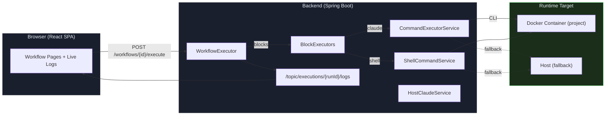
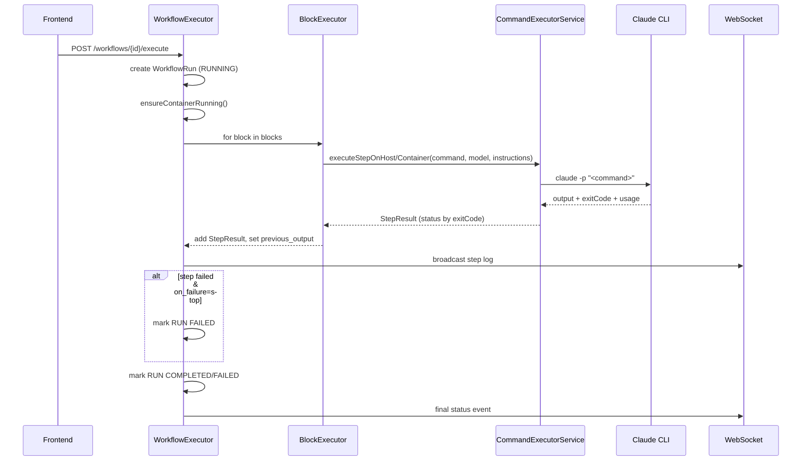
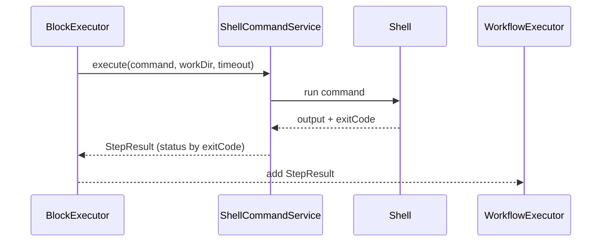
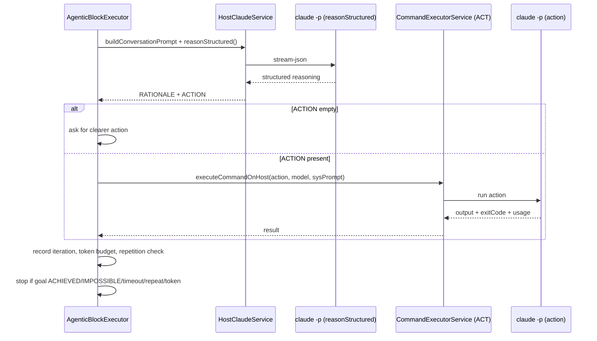
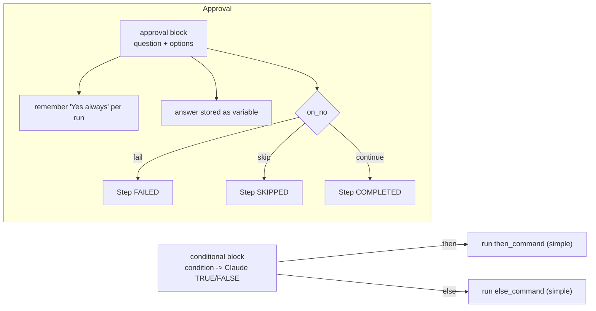

<!-- Generated from docs/workflow-engine-diagrams.md and docs/i18n/workflow-engine-diagrams.en.json by scripts/docs-diagrams.py — do not edit by hand. -->

# MySuricates — Workflow Engine

Core logic, execution modes (with/without AI) and control flows

## System Overview — *High-Level*

All workflows run through the WorkflowExecutor. It orchestrates BlockExecutors, container start, skill context and WebSocket logs.



## Execution (Default, AI-Assisted) — *Reason/Act*

Default: commands go to the Claude CLI (host/container). Instruction prefix + model come from the workflow.



## Execution (Without AI) — *Shell Paths*

Shell mode uses no models and no instruction prefixes; it only evaluates the exit code.



### When Shell?

- Block type `shell`
- `execution_mode=shell` for foreach/while/retry

### Differences

- No model / no prompt limit
- Deterministic through the exit code
- No token metadata

## Agentic Loop — *Reason–Act–Observe*

Multi-step AI planning with token and time budgets, a repetition stop and optional approval.



## Control Flow — *Conditional & Approval*

Branching and user gates within a run.



## Provider & Execution Modes — *AI vs. No AI*

| Aspect | AI (Claude) | Without AI (Shell) |
|---|---|---|
| CLI | `claude -p` | System shell |
| Context | Instruction prefix, skill context, previous_output | Shell command string only |
| Determinism | Lower (LLM) | High (exit code) |
| Telemetry | Tokens/cost in StepResult.metadata | exitCode + duration |
| Fallback | Host, if the container does not start | Host, same path |

## Block Matrix — *Type → Exec Mode*

| Block | Default | Options | Stop on failure |
|---|---|---|---|
| `simple` | claude | `timeout_seconds` | Yes (default) |
| `shell` | shell | `timeout_seconds` | Yes |
| `retry` | claude | `execution_mode`=shell/ai, `max_retries`, `delay`, `exponential_backoff`, `timeout_seconds` | Yes (when all attempts fail) |
| `foreach` | claude | `execution_mode`=shell, `items_source`=list/command, `timeout_seconds` | Aggregated result |
| `while` | claude | `execution_mode`=shell, `condition_command`, `timeout_seconds` | Yes, on an inner failure |
| `conditional` | claude | `timeout_seconds` | Branch-specific |
| `approval` | - | `mode`=ask/auto, `on_no`=fail/skip/continue | on_no=fail |
| `skill-capability` | claude | `params`, `input`, `timeout_seconds` | Yes |
| `sub-workflow` | depends | Depth<=5, timeout 30 min | Yes, on timeout/cycle |
| `agentic` | claude | Budget, iterations, approval, `timeout_seconds` | Yes, on stop reasons |

## Configuration — *application.yml (relevant)*

### Execution Limits

`automation.execution.max-concurrent`: parallel runs

`automation.host-claude.timeout-seconds`: CLI timeout

`docker.container.idle-timeout-minutes`: container idle stop

### Security

`automation.security.enabled` / `api-key`

`rate-limit` defaults disabled

CORS: `automation.cors.allowed-origins`

## File Structure — *Core Classes*

```text
ai-automation-backend/src/main/java/com/automation/
├── executor/
│   ├── ExecutionContext.java
│   ├── BlockExecutor.java
│   ├── blocks/ (Simple, Shell, Retry, ForEach, While, Conditional, Approval, SkillCapability, SubWorkflow, Agentic)
├── service/workflow/
│   ├── WorkflowExecutor.java
│   └── AgentInstructionsService.java
├── service/cli/
│   ├── CommandExecutorService.java
│   ├── ShellCommandService.java
│   └── CliSessionManager.java
└── service/ai/
    └── HostClaudeService.java
```
