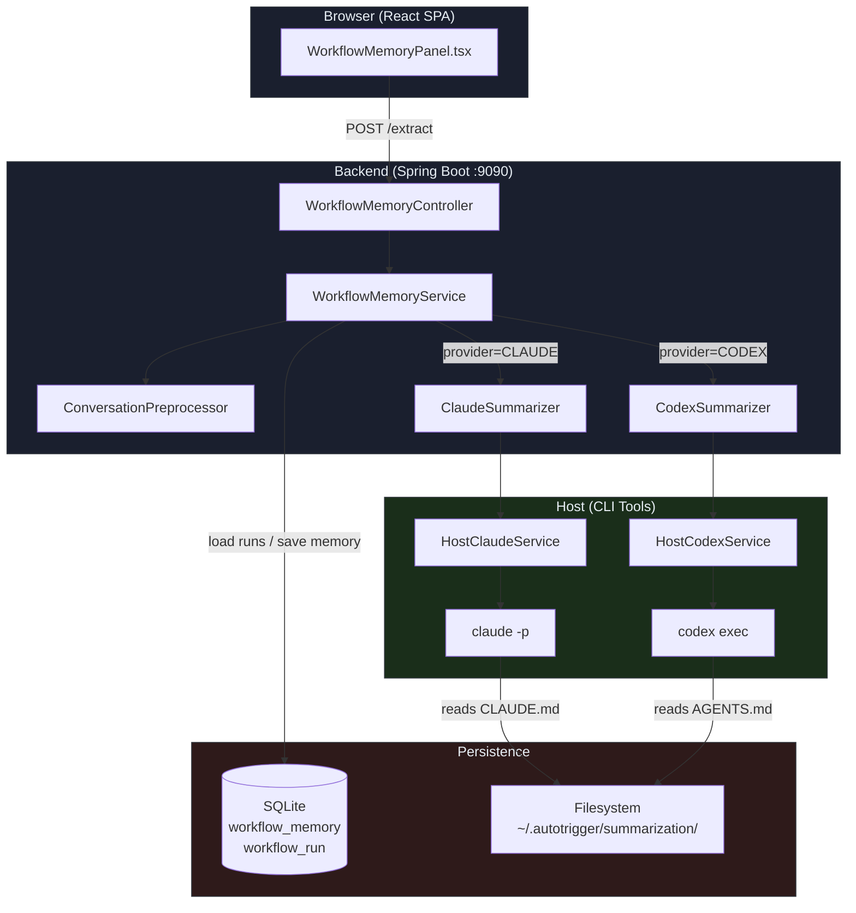
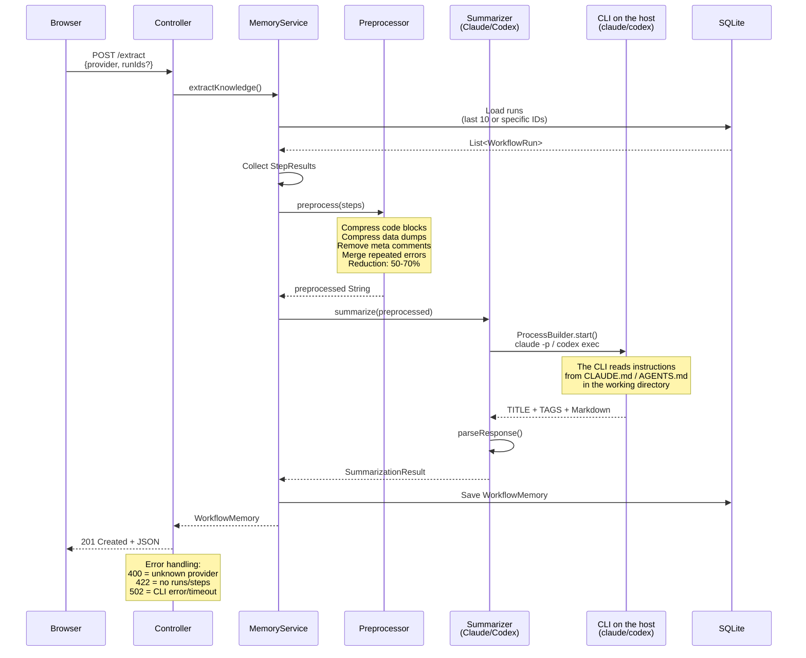
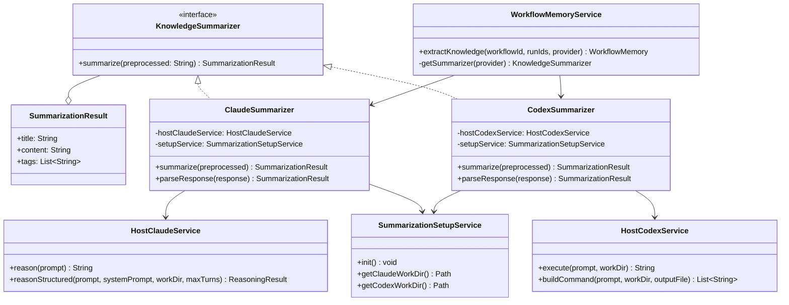
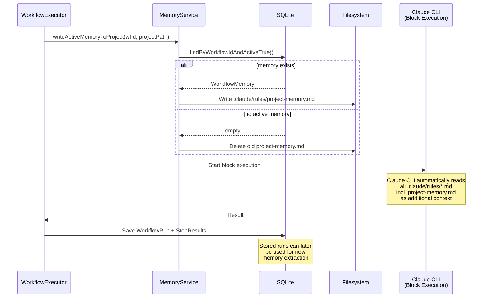
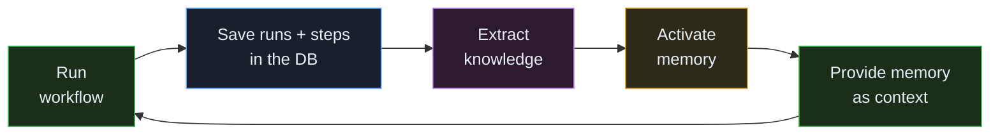
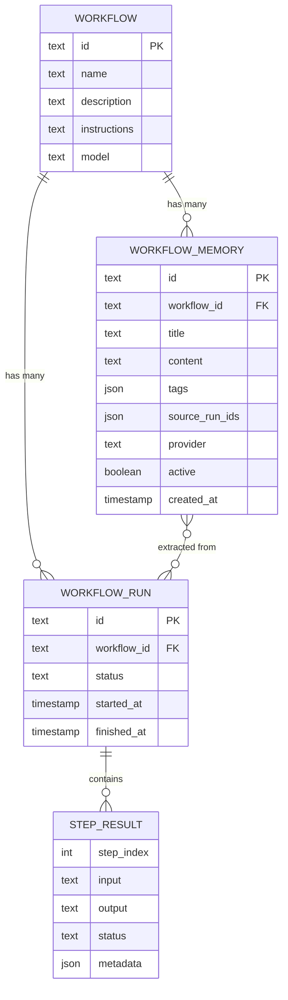
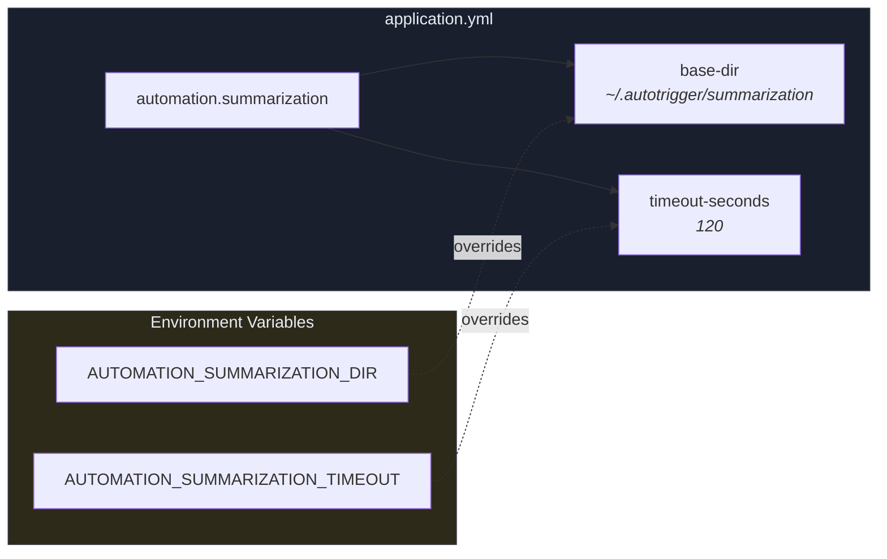

<!-- Generated from docs/workflow-memory-diagrams.md and docs/i18n/workflow-memory-diagrams.en.json by scripts/docs-diagrams.py — do not edit by hand. -->

# AutoPilot — Workflow Memory

Architecture, data flow & file structure

## System Overview — *High-Level Architecture*

The Workflow Memory feature extracts knowledge from past runs and provides it as context for future executions.



## Data Flow: Extracting Knowledge — *POST /api/v1/workflows/{id}/memory/extract*

Step-by-step flow of extracting knowledge from workflow runs.



## Summarizer Architecture — *Provider Abstraction*

Both providers implement the same interface but use different CLIs following the same pattern.



### Provider Comparison

| Property | ClaudeSummarizer | CodexSummarizer |
|---|---|---|
| CLI command | `claude -p` | `codex exec` |
| Max turns | `1` (no tool use) | Default (exec mode) |
| Output | Parse stream JSON | `-o result.txt` |
| Instructions | `CLAUDE.md` | `AGENTS.md` |
| Auth | `~/.claude/` | `~/.codex/` |
| API keys needed? | No (CLI auth) | No (CLI auth) |

## Data Flow: Memory During Workflow Execution — *Feedback Loop*

Activated memories are written into the project directory automatically before a workflow runs.





## Data Model — *SQLite Tables*

Entity-relationship diagram of the tables involved.



### workflow_memory

`provider`: CLAUDE or CODEX

`active`: at most 1 active per workflow

`source_run_ids`: JSON array of the run IDs used for the extraction

`content`: knowledge formatted as Markdown

### Relationships

A workflow has many runs and many memories.

A memory points via `source_run_ids` to the runs it was extracted from.

Activating a memory sets `active=false` for all other memories of the same workflow.

## File Structure — *Project + Runtime*

All files that belong to the Workflow Memory feature. `[NEU]` (new) = created in this refactoring, `[ENTFERNT]` (removed) = deleted.

```text
ai-automation-backend/src/main/java/com/automation/
├── config/
│   ├── SummarizationConfig.java          ← Base-Dir + Timeout Config [NEU]
│   ├── HostClaudeConfig.java             ← Timeout fuer Claude CLI (besteht)
│   └── KnowledgeConfig.java              ← OpenAI API-Key Config [ENTFERNT]
│
├── controller/
│   └── WorkflowMemoryController.java     ← REST API, Error Handling 400/422/502
│
├── dto/
│   ├── request/
│   │   └── ExtractMemoryRequest.java     ← {provider, runIds?}
│   └── response/
│       └── WorkflowMemoryResponse.java   ← DTO fuer Frontend
│
├── entity/
│   └── WorkflowMemory.java               ← JPA Entity
│
├── mapper/
│   └── WorkflowMemoryMapper.java         ← MapStruct Entity ↔ DTO
│
├── repository/
│   └── WorkflowMemoryRepository.java     ← Spring Data JPA
│
├── service/ai/
│   ├── HostClaudeService.java            ← +reasonStructured(workDir, maxTurns)
│   └── HostCodexService.java             ← codex exec Wrapper [NEU]
│
└── service/memory/
    ├── KnowledgeSummarizer.java          ← Interface + SummarizationResult
    ├── ClaudeSummarizer.java             ← claude -p, --max-turns 1, Work Dir
    ├── CodexSummarizer.java              ← codex exec, Work Dir [NEU]
    ├── OpenAiSummarizer.java             ← REST + API-Key [ENTFERNT]
    ├── ConversationPreprocessor.java     ← Regelbasierte Kompression
    ├── SummarizationSetupService.java    ← Work Dirs + .md Setup bei Start [NEU]
    └── WorkflowMemoryService.java        ← Orchestrierung, getSummarizer()

ai-automation-backend/src/main/resources/
├── agent-instructions.md                 ← Base Instructions (Block-Execution)
├── application.yml                       ← +summarization.base-dir/timeout
├── db/migration/
│   └── V16__create_workflow_memory_table.sql
└── summarization/                        [NEU]
    ├── claude-summarizer.md              ← Template → CLAUDE.md
    └── codex-summarizer.md               ← Template → AGENTS.md

ai-automation-backend/src/test/java/com/automation/
├── service/ai/
│   ├── HostClaudeServiceTest.java        ← +customMaxTurns Test
│   └── HostCodexServiceTest.java         [NEU]
└── service/memory/
    ├── ClaudeSummarizerTest.java         ← Angepasst an WorkDir
    ├── CodexSummarizerTest.java          [NEU]
    ├── ConversationPreprocessorTest.java
    └── WorkflowMemoryServiceTest.java    ← CodexSummarizer statt OpenAi

ai-automation-frontend/src/
├── components/workflow/
│   └── WorkflowMemoryPanel.tsx           ← Provider: OPENAI → CODEX
├── hooks/
│   └── useWorkflowMemory.ts              ← TanStack Query Hooks
└── types/
    └── index.ts                          ← WorkflowMemory, ExtractMemoryRequest

~/.autotrigger/summarization/             ← Runtime (erstellt bei Backend-Start)
├── claude/
│   └── CLAUDE.md                         ← Kopie von claude-summarizer.md
└── codex/
    └── AGENTS.md                         ← Kopie von codex-summarizer.md

docs/
└── workflow-memory-architecture.md       [NEU]
```

## API Endpoints — */api/v1/workflows/{id}/memory*

| Method | Path | Description | Response |
|---|---|---|---|
| `GET` | `/memory` | All memories of a workflow | `200` List<WorkflowMemoryResponse> |
| `POST` | `/memory/extract` | Extract knowledge (~30-60s) | `201` / `400` / `422` / `502` |
| `PUT` | `/memory/{memId}` | Update title/content | `200` WorkflowMemoryResponse |
| `PUT` | `/memory/{memId}/activate` | Activate memory (deactivates the others) | `200` |
| `DELETE` | `/memory/{memId}` | Delete memory | `204` |

### Error Responses (POST /extract)

| Status | Cause | Body |
|---|---|---|
| `400` | Unknown provider | `{"error": "Unknown provider: X"}` |
| `422` | No runs or steps | `{"error": "No runs found..."}` |
| `502` | CLI timeout / crash | `{"error": "Knowledge extraction failed: ..."}` |

## Configuration — *application.yml*



### Prerequisites

- `claude` CLI installed and authenticated (`~/.claude/`)
- `codex` CLI installed and authenticated (`~/.codex/`)
- No API keys needed in the app configuration

### Startup

- `SummarizationSetupService.init()` runs at backend start
- Creates the working directories if they do not exist
- Copies the instruction templates from the resources into the directories
- Overwrites them on every start (latest bundled version)
