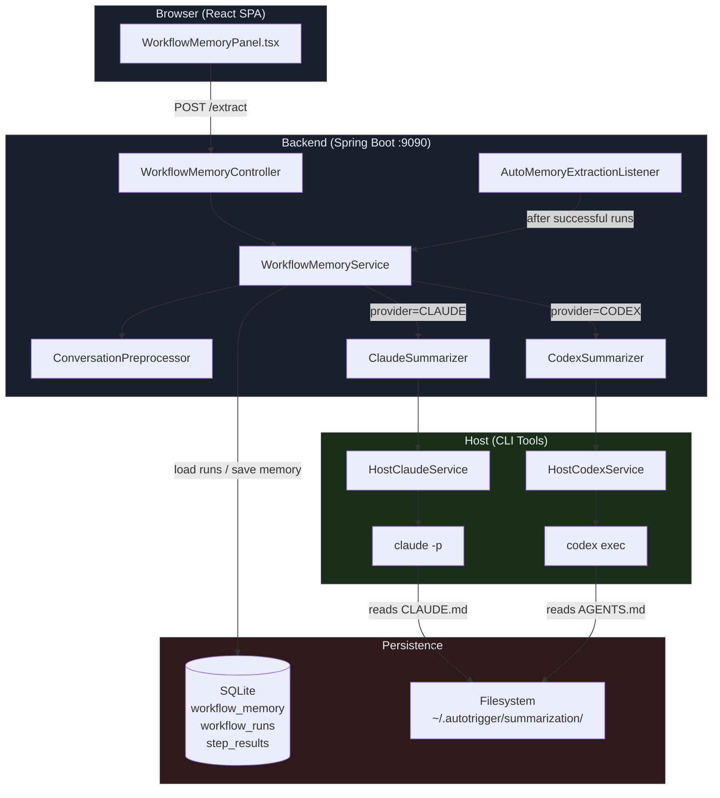
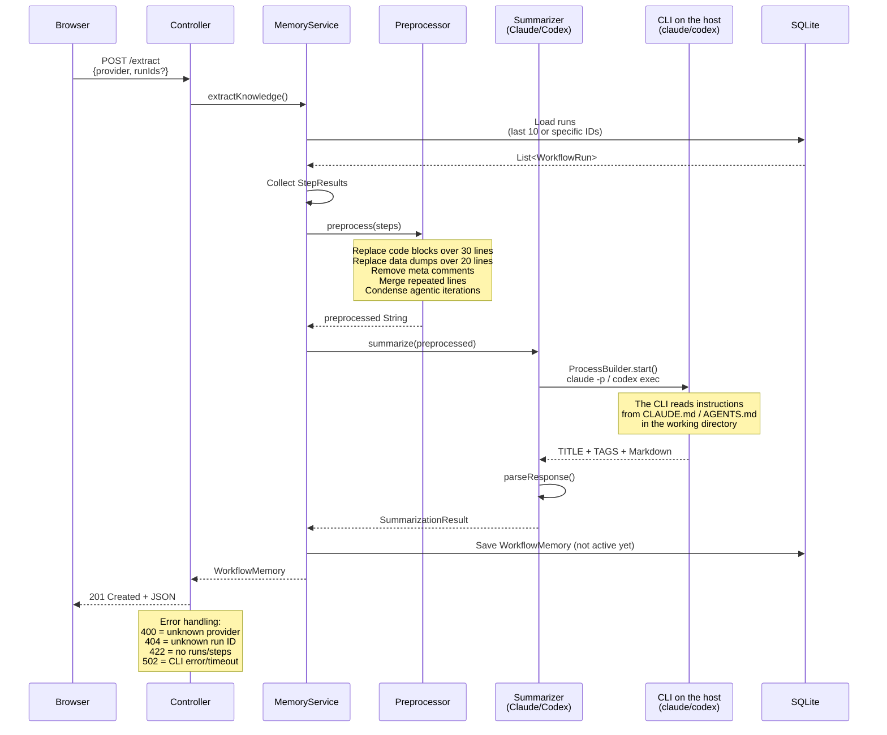
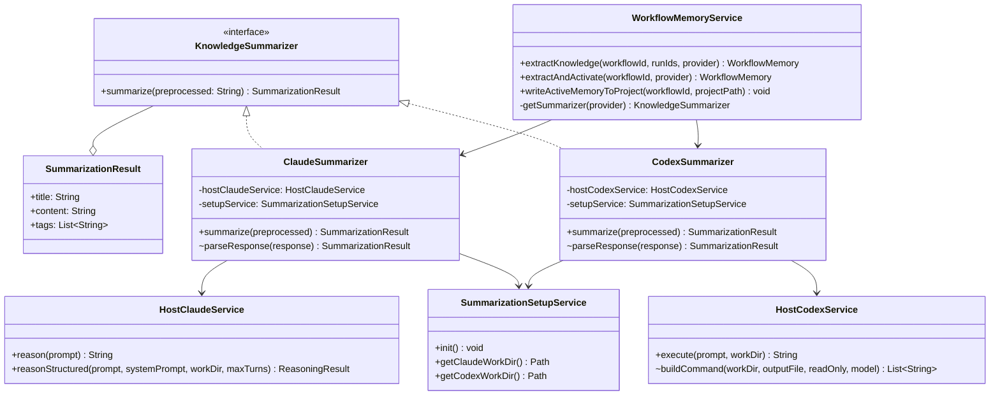
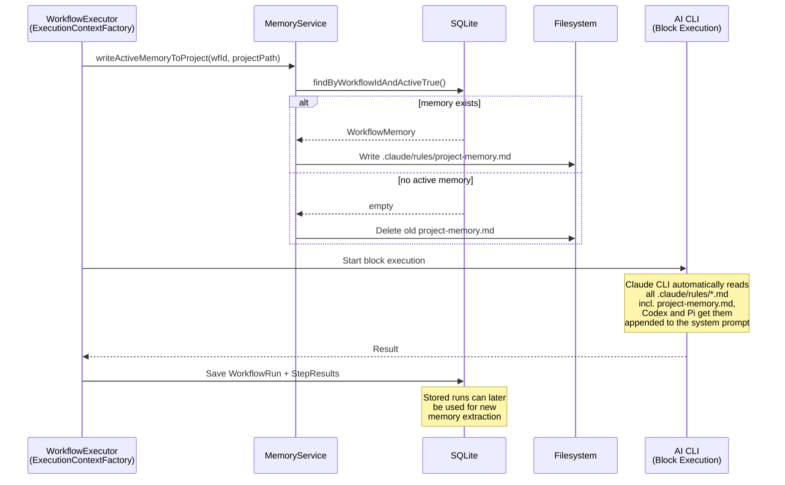
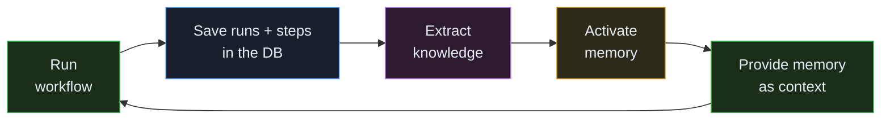
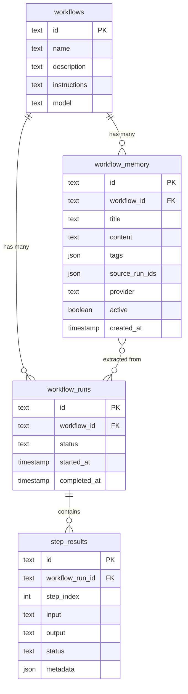
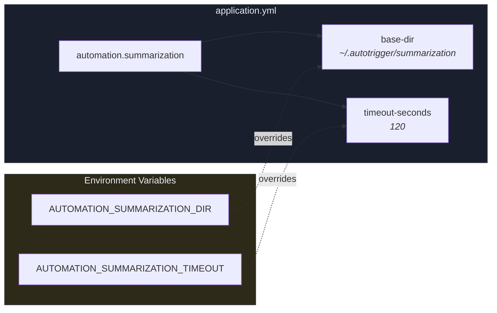

<!-- Generated from docs/workflow-memory-diagrams.md and docs/i18n/workflow-memory-diagrams.en.json by scripts/docs-diagrams.py — do not edit by hand. -->

# MySuricates — Workflow Memory

Architecture, data flow & file structure

## System Overview — *High-Level Architecture*

Workflow Memory extracts knowledge from past runs and provides it as context to later executions. It is an optional module (`memory`, in the presets `research` and `full`).



## Data Flow: Extracting Knowledge — *POST /api/v1/workflows/{id}/memory/extract*

Step by step: read runs, condense, summarize, store. The AI call runs outside any transaction — between a short read and a short write, because the database has only one connection.



## Summarizer Architecture — *Provider Abstraction*

Both providers implement the same interface but use different CLIs following the same pattern.



### Provider Comparison

| Property | ClaudeSummarizer | CodexSummarizer |
|---|---|---|
| CLI command | `claude -p` | `codex exec` (prompt via stdin) |
| Max turns | `1` (no tool use) | Default (exec mode) |
| Output | Parse stream JSON | `-o` into a temporary file |
| Instructions | `CLAUDE.md` | `AGENTS.md` |
| Timeout | `automation.host-claude.timeout-seconds` | `automation.summarization.timeout-seconds` |
| Auth | `~/.claude/` | `~/.codex/` |
| API keys needed? | No (CLI auth) | No (CLI auth) |

## Data Flow: Memory During Workflow Execution — *Feedback Loop*

Before the first block, the run writes the workflow's active memory into the project directory.





Automatically: with `autoMemoryExtraction` in the workflow metadata (optionally with `interval`, default 5), the `AutoMemoryExtractionListener` extracts a new memory via Claude after a run with `COMPLETED` once that many runs have succeeded since the last memory, activates it and writes it into the project.

## Data Model — *SQLite Tables*

Entity-relationship diagram of the tables involved.



### workflow_memory

`provider`: CLAUDE or CODEX

`active`: at most 1 active per workflow

`source_run_ids`: JSON array of the run IDs used for the extraction

`content`: knowledge formatted as Markdown

### Relationships

A workflow has many runs and many memories.

A memory points via `source_run_ids` to the runs it was extracted from.

Activating a memory sets `active=false` for all other memories of the same workflow.

## File Structure — *Project + Runtime*

All files that belong to the Workflow Memory feature.

```text
ai-automation-backend/src/main/java/com/automation/
├── config/
│   ├── SummarizationConfig.java          ← base-dir + timeout (automation.summarization)
│   └── HostClaudeConfig.java             ← timeout of the Claude CLI
│
├── controller/
│   └── WorkflowMemoryController.java     ← REST API, errors 400/422/502
│
├── dto/
│   ├── request/
│   │   ├── ExtractMemoryRequest.java     ← {provider, runIds?}
│   │   └── UpdateMemoryRequest.java      ← {title, content}
│   └── response/
│       └── WorkflowMemoryResponse.java
│
├── entity/
│   └── WorkflowMemory.java               ← JPA entity
│
├── mapper/
│   └── WorkflowMemoryMapper.java         ← MapStruct entity ↔ DTO
│
├── repository/
│   └── WorkflowMemoryRepository.java     ← Spring Data JPA
│
├── service/ai/
│   ├── HostClaudeService.java            ← reasonStructured(…, workDir, maxTurns)
│   ├── HostCodexService.java             ← codex exec wrapper
│   └── RunContextFiles.java              ← .claude/rules/project-memory.md, appended for Codex/Pi
│
└── service/memory/
    ├── KnowledgeSummarizer.java          ← interface + SummarizationResult
    ├── ClaudeSummarizer.java             ← claude -p, --max-turns 1, work dir
    ├── CodexSummarizer.java              ← codex exec, work dir
    ├── ConversationPreprocessor.java     ← rule-based compression
    ├── SummarizationSetupService.java    ← work dirs + CLAUDE.md/AGENTS.md at startup
    ├── AutoMemoryExtractionListener.java ← automatic extraction after successful runs
    └── WorkflowMemoryService.java        ← orchestration, getSummarizer(), writeActiveMemoryToProject()

ai-automation-backend/src/main/resources/
├── agent-instructions.md                 ← base instructions (block execution)
├── application.yml                       ← automation.summarization.base-dir / timeout-seconds
├── db/migration/
│   └── V16__create_workflow_memory_table.sql
└── summarization/
    ├── claude-summarizer.md              ← template → CLAUDE.md
    └── codex-summarizer.md               ← template → AGENTS.md

ai-automation-backend/src/test/java/com/automation/
├── service/ai/
│   ├── HostClaudeServiceTest.java
│   └── HostCodexServiceTest.java
└── service/memory/
    ├── AutoMemoryExtractionListenerTest.java
    ├── ClaudeSummarizerTest.java
    ├── CodexSummarizerTest.java
    ├── ConversationPreprocessorTest.java
    ├── KnowledgeSummarizerTest.java
    ├── SummarizationSetupServiceTest.java
    └── WorkflowMemoryServiceTest.java

ai-automation-frontend/src/
├── components/workflow/
│   └── WorkflowMemoryPanel.tsx           ← provider CLAUDE or CODEX
├── hooks/
│   └── useWorkflowMemory.ts              ← TanStack Query hooks
└── types/
    └── index.ts                          ← WorkflowMemory, ExtractMemoryRequest

~/.autotrigger/summarization/             ← runtime (created at backend start)
├── claude/
│   └── CLAUDE.md                         ← copy of claude-summarizer.md
└── codex/
    └── AGENTS.md                         ← copy of codex-summarizer.md

docs/
└── workflow-memory-architecture.md
```

## API Endpoints — */api/v1/workflows/{id}/memory*

| Method | Path | Description | Response |
|---|---|---|---|
| `GET` | `/memory` | All memories of a workflow, newest first | `200` `List<WorkflowMemoryResponse>` |
| `POST` | `/memory/extract` | Extract knowledge (without `provider`: CLAUDE) | `201` / `400` / `404` / `422` / `502` |
| `PUT` | `/memory/{memId}` | Update title/content | `200` `WorkflowMemoryResponse` |
| `PUT` | `/memory/{memId}/activate` | Activate memory (deactivates the others) | `204` |
| `DELETE` | `/memory/{memId}` | Delete memory | `204` |

### Error Responses (POST /extract)

| Status | Cause | Body |
|---|---|---|
| `400` | Unknown provider | `{"error": "Unknown provider: X. Available: [CLAUDE, CODEX]"}` |
| `404` | Unknown run ID in `runIds` | `{"code": "RESOURCE_NOT_FOUND", ...}` |
| `422` | No runs or steps | `{"error": "No runs found..."}` |
| `502` | CLI timeout / crash | `{"error": "Knowledge extraction failed: ..."}` |

## Configuration — *application.yml*



`timeout-seconds` limits the Codex call and can be changed at runtime in the settings (`summarization-timeout-seconds`); the Claude call follows `automation.host-claude.timeout-seconds`.

### Prerequisites

- For the provider CLAUDE: `claude` CLI installed and logged in (`~/.claude/`)
- For the provider CODEX: `codex` CLI installed and logged in (`~/.codex/`)
- No API keys needed in the app configuration

### Startup

- `SummarizationSetupService.init()` runs at backend start
- Creates the working directories if they do not exist
- Copies the instruction templates from the resources into the directories
- Overwrites them on every start (latest bundled version)
