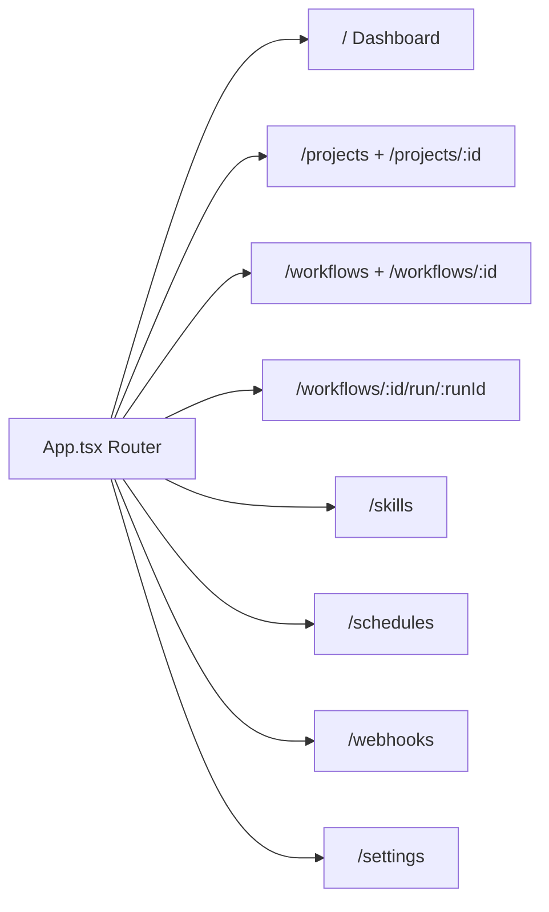
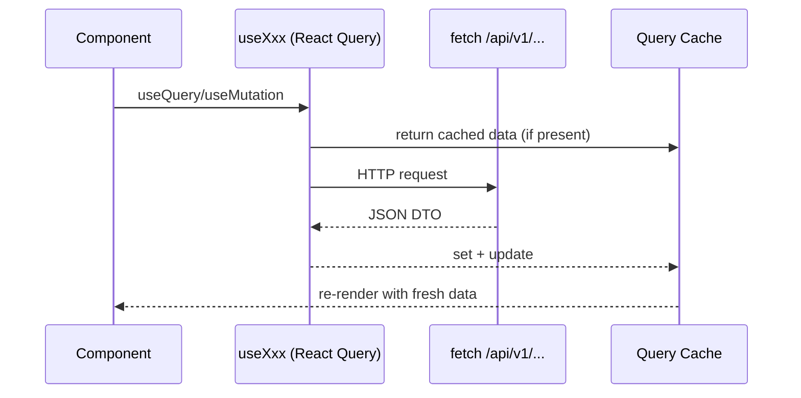
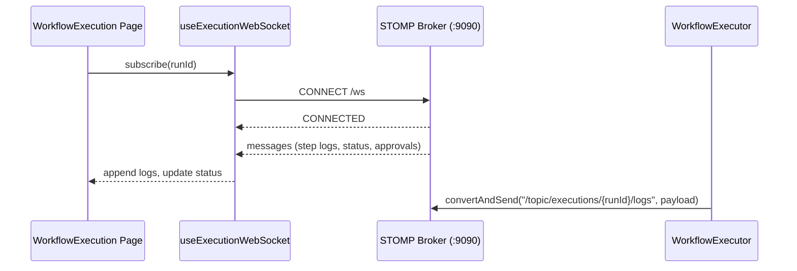

# AutoPilot — Frontend Flow

Routing, State, Datenfluss, WebSockets und Cache-Invalidierung

## Routing — *App.tsx*

React Router mit Layout (Sidebar + Header) und 10 Hauptseiten.

## Datenfluss — *Client → API*

Fetches laufen ueber Vite-Proxy `/api` an das Backend; WebSocket unter `/ws`.

## Queries & Mutations — *Invalidierung*

| Ressource | Query Hook | Mutationen | Invalidiert |
|---|---|---|---|
| Projects | `useProjects` | create/update/delete/start/stop | projects, project detail |
| Workflows | `useWorkflows` | create/update/delete/execute | workflows, workflow detail, runs |
| Skills | `useSkills` | activate/deactivate | skills, workflow detail |
| Schedules | `useSchedules` | create/toggle/delete | schedules list |
| Webhooks | `useWebhooks` | create/toggle/delete | webhooks list |
| Settings | `useSystemHealth` | — | health |

## Zustand — *Zustand Stores*

### Client State

`useSidebarStore`: Collapse

`useThemeStore`: Light/Dark, Overrides

`useSettingsStore`: API-Key, Advanced Mode

`useI18nStore`: Locale

`useToastStore`: Toasts

### Persistenz

Sidebar, Theme, Settings, Locale → localStorage

Toasts sind flüchtig

## Live-Logs — *WebSocket /ws*

Ausführungs-Logs kommen via STOMP auf `/topic/executions/{runId}/logs`.

