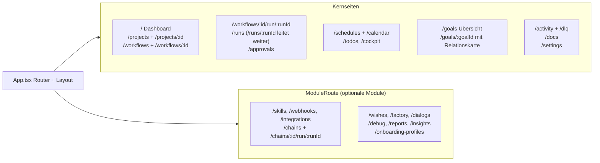
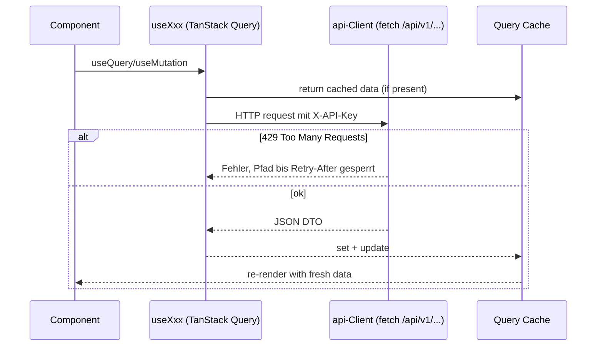
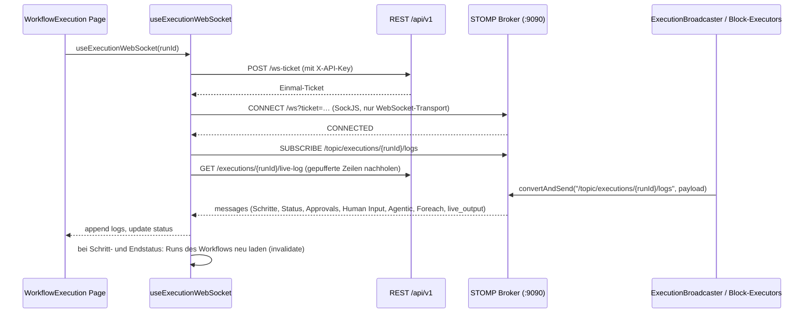

# MySuricates — Frontend Flow

Routing, State, Datenfluss, WebSockets und Cache-Invalidierung

## Routing — *App.tsx*

`createBrowserRouter` mit einem Layout (Sidebar + Header) über allen Seiten. Seiten optionaler Module stehen in `ModuleRoute` und erklären ohne ihr Modul, wie es sich einschalten lässt; mehrere Kernseiten wechseln im Simple Mode (`useSettingsStore`) auf eine eigene, einfachere Fassung. Jede Seite ist `simple` (eigene Fassung), `shared` (beide Modi) oder `pro` (`utils/simpleRoutes.ts`); landet der Simple Mode auf einer Pro-Seite, sagt `ProPageNotice` das unter dem Header und bietet den Wechsel an.

## Datenfluss — *Client → API*

Alle Hooks rufen den `api`-Client (`src/api/client.ts`): `fetch` auf `/api/v1/...` mit dem `X-API-Key` aus `useSettingsStore`. Im Dev-Betrieb leitet der Vite-Proxy `/api` und `/ws` an das Backend weiter; sonst liefert das Backend das gebaute Frontend selbst aus (`automation.serve-frontend`).

## Queries & Mutations — *Invalidierung*

Ein Schlüssel wie `['workflows']` trifft als Präfix alle Queries darunter — Detail, Runs, Versionen.

| Ressource | Query Hook | Mutationen | Invalidiert |
|---|---|---|---|
| Projects | `useProjects`, `useProject` | create/update/archive/restore, Container start/stop | `projects` (Liste, Detail, Archiv) |
| Workflows | `useWorkflows`, `useWorkflow` | create/update/delete/import/seal | `workflows` |
| Runs | `useWorkflowRuns`, `useAllRuns` | execute/pause/resume/cancel/retry/delete | `workflows` und `learning`, je nach Aktion auch `runs` und `dlq` |
| Skills | `useSkills` | create/update/delete/import | `skills`; delete auch `workflows` |
| Skill-Aktivierung | `useWorkflow` | activate/deactivate | `workflows` |
| Schedules | `useSchedules` | create/update/toggle/delete | `schedules` (Liste, Kalender, Vorschau) |
| Webhooks | `useWebhooks` | create/toggle/delete, Token und Secret | `webhooks` |
| Ziele | `useGoals`, `useGoal`, `useGoalRelations` | create/update/delete, TODOs zuordnen und ordnen, Einschätzung, Meilensteine, Ziel-Wächter | `goals`; was TODOs berührt, auch `todos`; der Wächter auch `schedules` und `workflows` |
| System | `useSystemHealth`, `useSystemInfo` | — | keine; Health fragt alle 30 s neu ab |

## Zustand — *Zustand Stores*

### Client State

`useSidebarStore`: eingeklappt, mobil geöffnet

`useThemeStore`: Theme, zuletzt gewählte helle und dunkle Themes, Overrides

`useSettingsStore`: API-Key, Simple und Advanced Mode, Sidebar-Anordnung, Hinweise, Modell-Vorgaben

`useI18nStore` (`src/i18n`): Locale

`useToastStore`: Toasts

`useAssistantStore`: Sitzungen des Assistenten, Panelgröße

`useDashboardLayoutStore`, `useDashboardSyncStore`: Dashboard-Ansichten und ihr Sync-Stand

### Persistenz

Alle Stores außer `useToastStore` → localStorage (Zustand `persist`)

Die Sidebar speichert nur „eingeklappt“, der Assistent nur Sitzungen und Panelgröße

Toasts sind flüchtig

## Live-Logs — *WebSocket /ws*

Ausführungs-Logs kommen per STOMP auf `/topic/executions/{runId}/logs`. Den Handshake öffnet ein Einmal-Ticket aus `POST /api/v1/ws-ticket` — der API-Key steht nie in der URL.

