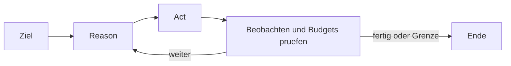

<!-- concept-source: d7e7e28cf7209b4369ad33467bb4fe781a178baa -->

# Agentische Bloecke mit Budgets

## Wofür taugt das?
Agentische Budgets begrenzen einen Block, der nicht nur einen festen Befehl ausführt, sondern in einer Reason-Act-Observe-Schleife arbeitet: Das Modell plant den nächsten Schritt, eine Aktion wird ausgeführt, das Ergebnis wird zurückgegeben, danach entscheidet die nächste Iteration über Fortsetzung oder Abschluss. Konfigurierbare Grenzen betreffen maximale Iterationen, Gesamt- und Iterationszeit, wiederholte gleiche Aktionen sowie ein kumuliertes Tokenbudget. Optional kann vor Aktionen eine Freigabe verlangt werden. Sinnvoll ist das für offene Aufgaben, bei denen der genaue Weg erst unterwegs sichtbar wird, etwa eine Fehlersuche mit mehreren Prüfkommandos und Auswertung der Ausgaben. Deterministische Arbeit bleibt besser in einfachen Shell-Blöcken.

## Vorteile
Der Mechanismus macht offene KI-Arbeit kontrollierbarer und nachvollziehbarer. Jede Iteration sammelt Begründung, Aktion, Ergebnis, Dauer, Token-Metadaten und am Ende Status, Stop-Grund und Zielerreichung. Ereignisse können den Fortschritt live anzeigen. Wiederholungsschutz verhindert einfache Endlosschleifen, Timeouts beenden hängende Schritte, und das Tokenbudget bricht ab, wenn der laufende Verbrauch den Grenzwert überschreitet. Dadurch lässt sich exploratives Vorgehen in Workflows einbauen, ohne vollständig auf manuelle Beobachtung angewiesen zu sein.

## Nachteile und Kosten
Das Budget ist keine Sandbox und keine harte Kostenobergrenze. Tokenwerte hängen vom Anbieter ab; fehlen echte Nutzungsdaten, wird geschätzt. Die Budgetprüfung erfolgt nach einem Aufruf, daher kann der Grenzwert überschritten werden. Bei mehreren blinden Iterationen ohne reale Usage-Daten wird abgebrochen, außer ein Anbieter arbeitet erwartbar mit Schätzungen.

## Im Code

- [AgenticBlockExecutor.java](../../ai-automation-backend/src/main/java/com/automation/executor/blocks/AgenticBlockExecutor.java)
- [AgenticStopRules.java](../../ai-automation-backend/src/main/java/com/automation/executor/blocks/AgenticStopRules.java)
- [AgenticTokenTracker.java](../../ai-automation-backend/src/main/java/com/automation/executor/blocks/AgenticTokenTracker.java)
