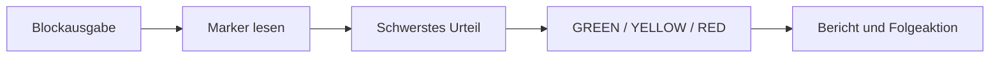

<!-- concept-facts-sha256: 47f72cd8883f6032a246606f7af297a20af1c83a1a13ed6078d019d53951318a -->
<!-- concept-source: d7e7e28cf7209b4369ad33467bb4fe781a178baa -->

# Gates: ein maschinenlesbares Urteil

## Wofür taugt das?

Gates sind ein maschinenlesbares Urteil am Ende eines Workflow-Runs. Einzelne Schritte können in ihrer Ausgabe Marker wie gate_status, gate_category und gate_description schreiben. Beim Abschluss werden alle nicht abgeleiteten Schritt-Ausgaben durchsucht; der schwerste gefundene Status gewinnt: GREEN, YELLOW oder RED. Zusätzlich werden die gefundenen Gates als Zusammenfassung mit Zählung und Schrittposition in den Run-Metadaten abgelegt. Fehlt ein gültiger Marker, kann der Status aus dem technischen Run-Ergebnis abgeleitet werden: fehlgeschlagen wird RED, abgeschlossen GREEN, mit tolerierten Prüffehlern abgeschlossen YELLOW. Pausierte oder abgebrochene Runs erzeugen dabei kein Gate-Urteil.

## Vorteile

Der Mechanismus trennt technische Ausführung von fachlicher Bewertung. Ein sinnvoller Einsatz ist ein Veröffentlichungs- oder Review-Workflow: Tests, Dateiprüfungen oder inhaltliche Checks laufen als Schritte, schreiben bei Befund ein Gate, und nachgelagerte Prozesse müssen nicht Freitext lesen, sondern nur Metadaten auswerten. Weil alle Gates gesammelt werden, bleibt neben dem höchsten Urteil auch sichtbar, ob mehrere Warnungen oder Fehler vorlagen. Die Auswertung ist deterministisch genug für Automatisierung: erlaubte Statuswerte sind begrenzt, ungültige Marker werden ignoriert, und kopierte abgeleitete Ausgaben werden nicht erneut gezählt.

## Nachteile und Kosten

Ein Gate beweist keine Qualität, sondern nur, dass ein Marker erkannt oder ein technischer Status abgeleitet wurde. Besonders wichtig: Ein COMPLETED-Run ohne Marker kann GREEN werden, obwohl keine fachliche Vollständigkeitsprüfung belegt ist. Es fehlen Daten zu kausalem Nutzen, Fehlerrate und Prüfungsabdeckung. Der Betriebsbefund zeigt lediglich Bestand und Nutzungsumfeld: 1235 gespeicherte Runs sind kein Lifetime-Wert, und 144 von 223 typisierten Schrittaufzeichnungen der letzten 30 Tage sind Shell-Blöcke, nicht Gate-Erfolge oder fachlicher Nutzen.

## Betriebsbeleg

Messung: **2026-09-19 (UTC)**, eine lokale Entwicklungsinstanz. Bestandszähler beziehen sich auf die über REST sichtbaren Datensätze; Schrittzahlen zählen gespeicherte Schritte mit Typ-Metadaten im 30-Tage-Fenster. Wrapper zählen einmal. Dies ist kein Wirksamkeitsnachweis.

| Messgröße | Anzahl / Bezugsgröße |
|---|---:|
| Shell-Schritte im 30-Tage-Fenster | 144 / 223 |
| Gespeicherte Runs (alle Zeiträume) | 1235 |

[Definitionen, Messgrenzen und Rohzähler](betriebsdaten.json) · [Messmethode und Wiederholung](README.md)

## Im Code

- [GateStatusResolver.java](../../ai-automation-backend/src/main/java/com/automation/service/todo/GateStatusResolver.java)
- [GateStatusOutputParser.java](../../ai-automation-backend/src/main/java/com/automation/service/runoutput/GateStatusOutputParser.java)
- [RunCompletionHandler.java](../../ai-automation-backend/src/main/java/com/automation/service/workflow/RunCompletionHandler.java)
