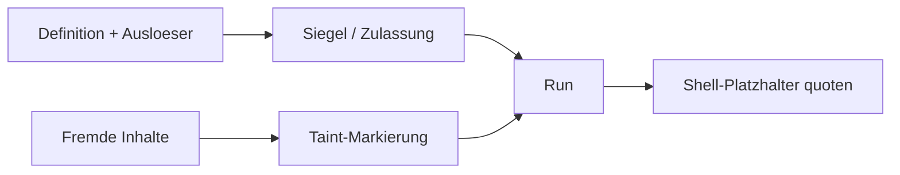

<!-- concept-source: d7e7e28cf7209b4369ad33467bb4fe781a178baa -->

# Haertung: Siegel, Zulassung und Taint

## Wofür taugt das?

Der Mechanismus härtet Workflow-Ausführungen an drei Stellen. Ein Siegel bindet eine vorhandene Definition an ihren Hash; vor jedem Lauf prüft die Zulassung, ob eine versiegelte Definition noch exakt passt. Bei Abweichung oder nicht berechenbarem Hash wird der Lauf verweigert, bevor ein Run-Datensatz entsteht. Optional kann für unbeaufsichtigte Starts verlangt werden, dass der Workflow versiegelt ist; dabei zählt auch die wirksame Herkunft bei Ketten- oder Unter-Workflows. Zusätzlich werden Herkunftsmetadaten, also Definitionshash und passende Version, am Lauf erfasst, sofern Provenance aktiv ist. Taint-Markierungen verfolgen untrusted Eingaben und daraus abgeleitete Blockausgaben über Fortsetzungen und Unter-Workflows hinweg, damit Platzhalter in Shell-Kommandos passend escaped werden.

## Vorteile

Sinnvoll ist das etwa für produktive Automationen, die zeitgesteuert, per Webhook oder als Folge anderer Workflows starten und Shell-Kommandos ausführen. Das Siegel macht stille Änderungen an einer freigegebenen Definition erkennbar. Die Zulassung erzwingt eine klare Grenze: ein beschädigtes Siegel startet nicht „best effort“, sondern fail-closed. Provenance erleichtert spätere Nachvollziehbarkeit, ohne den Lauf bei reinen Metadatenproblemen zwingend zu stoppen. Taint reduziert konkrete Shell-Quoting-Risiken, auch wenn Daten erst über Blockausgaben, AI-Prompts oder fortgesetzte Läufe wieder in Kommandos gelangen.

## Nachteile und Kosten

Die Härtung ist kein vollständiger Prompt-Injection-Schutz, keine Prozess-Sandbox und keine Vertrauensgarantie für importierte Definitionen. Mehr Schutz bedeutet Bedienaufwand: Workflows müssen bewusst versiegelt werden, und optionale Regeln können unbeaufsichtigte Läufe blockieren.

## Im Code

- [RunAdmission.java](../../ai-automation-backend/src/main/java/com/automation/service/workflow/RunAdmission.java)
- [OutputTaint.java](../../ai-automation-backend/src/main/java/com/automation/executor/OutputTaint.java)
- [ExecutionContextTaint.java](../../ai-automation-backend/src/main/java/com/automation/executor/ExecutionContextTaint.java)
