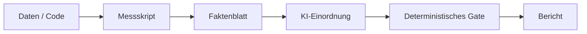

<!-- concept-facts-sha256: 47f72cd8883f6032a246606f7af297a20af1c83a1a13ed6078d019d53951318a -->
<!-- concept-source: d7e7e28cf7209b4369ad33467bb4fe781a178baa -->

# Deterministisch messen vor KI-Bewertung

## Wofür taugt das?

„Messen vor Bewerten“ trennt Datenerhebung, Einordnung und Prüfung. Zuerst sammelt ein deterministischer Schritt Fakten mit Shell-Befehlen, optional in einem Container. Der Schritt protokolliert Eingabe, Ausgabe, Laufzeit, Exit-Code und Ausführungsmodus; mit aktiviertem Prüfmodus wird der Befehl zusätzlich mit `set -e -o pipefail` ausgeführt. Erst danach bewertet ein KI-Schritt die vorliegenden Befunde statt frei zu raten. Abschließend kann ein Gate-Status aus der Ausgabe gelesen werden, etwa GREEN, YELLOW oder RED samt Kategorie und Beschreibung. Sinnvoll ist das zum Beispiel bei technischen Reviews: Tests, Dateistatistiken oder Sicherheitsprüfungen werden zuerst gemessen; die KI fasst anschließend Risiken und nächste Schritte zusammen.

## Vorteile

Der Mechanismus spart Modellarbeit dort, wo einfache Werkzeuge reichen. Messungen liefern konkrete Artefakte wie Exit-Codes, Dauer und Ausgaben, die später überprüfbar bleiben. Container-Ausführung kann die Umgebung klarer machen, ohne die Bewertung selbst zu vermischen. Gates schaffen eine knappe maschinenlesbare Entscheidungsschicht über längeren Ausgaben. Dadurch wird die KI stärker als Interpretin von Befunden genutzt, nicht als Quelle der Rohdaten.

## Nachteile und Kosten

Shell ist nicht kostenlos: Befehle brauchen Zeit, Ressourcen, Pflege und passende Werkzeuge. Ergebnisse sind nur so gut wie Messskripte, Datenqualität und aktuelle Umgebung; veränderte Daten können andere Resultate erzeugen. Ein Betriebsbefund zeigt vor allem Nutzung: In der 30-Tage-Stichprobe machen Shell-Schritte einen großen Anteil der typisierten Schrittaufzeichnungen aus, während für viele sichtbare Workflow-Definitionen kein Lauf mehr gespeichert ist. Das belegt keinen fachlichen Nutzen, keine Kosteneinsparung und keine Fehlerquote. Daten zu Verifikationsabdeckung und kausalem Nutzen fehlen.

## Betriebsbeleg

Messung: **2026-09-19 (UTC)**, eine lokale Entwicklungsinstanz. Bestandszähler beziehen sich auf die über REST sichtbaren Datensätze; Schrittzahlen zählen gespeicherte Schritte mit Typ-Metadaten im 30-Tage-Fenster. Wrapper zählen einmal. Dies ist kein Wirksamkeitsnachweis.

| Messgröße | Anzahl / Bezugsgröße |
|---|---:|
| Shell-Schritte im 30-Tage-Fenster | 144 / 223 |
| Simple-Schritte im 30-Tage-Fenster | 41 / 223 |
| Workflows ohne gespeicherten Run | 202 / 263 |

[Definitionen, Messgrenzen und Rohzähler](betriebsdaten.json) · [Messmethode und Wiederholung](README.md)

## Im Code

- [ShellBlockExecutor.java](../../ai-automation-backend/src/main/java/com/automation/executor/blocks/ShellBlockExecutor.java)
- [GateStatusOutputParser.java](../../ai-automation-backend/src/main/java/com/automation/service/runoutput/GateStatusOutputParser.java)
