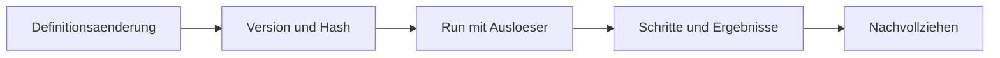

<!-- concept-source: d7e7e28cf7209b4369ad33467bb4fe781a178baa -->

# Persistenz und Herkunft

## Wofür taugt das?

Die Plattform speichert zu einer Workflow-Änderung einen Versionssnapshot, eine fortlaufende Versionsnummer, eine Änderungsquelle, eine Nachricht und einen Definitionshash. Vor einem Lauf passiert derselbe Workflow eine Zulassung: Ist Herkunftserfassung aktiv, wird die ausführbare Definition kanonisch gehasht und, wenn möglich, der passenden gespeicherten Version zugeordnet. Der Lauf kann dadurch später mit der damals bekannten Definition und seiner Auslöseart verglichen werden. Sinnvoll ist das etwa, wenn unbeaufsichtigte Automationen nachträglich erklärbar sein müssen: Man sieht nicht nur, dass ein Lauf stattfand, sondern welche Definition ausgeführt wurde und ob sie zu einer versionierten Änderung passt.

## Vorteile

Der Mechanismus trennt lesbare Metadaten von der ausführbaren Definition: Name, Beschreibung oder Tags verändern den Hash nicht, Blockreihenfolge und relevante Ausführungsparameter schon. Sortierte, kanonische JSON-Erzeugung macht gleiche Definitionen stabil vergleichbar. Bei versiegelten Workflows wird der Hash immer geprüft; passt er nicht, wird der Lauf verweigert. Optional kann zusätzlich verlangt werden, dass unbeaufsichtigte Läufe nur versiegelte Workflows starten. Damit entsteht kein vollständiger Audit-Beweis, aber eine praktische Rekonstruktionsspur für Änderungen, Läufe und Sicherheitsentscheidungen.

## Nachteile und Kosten

Herkunft ist abschaltbar; dann bleiben Hash und Versionsbezug leer. Altdaten können fehlen. Der Definitionshash beweist nicht die Herkunft einer importierten Datei und ist kein Snapshot von Umgebung, Eingabedaten oder externen Diensten. Retention begrenzt die Historie, Soft Deletion und geänderte Metadaten erschweren Zeitvergleiche. Eine ausgefüllte Session-ID an einem KI-TODO belegt kein fortsetzbares Transkript.

## Im Code

- [WorkflowVersionService.java](../../ai-automation-backend/src/main/java/com/automation/service/workflow/WorkflowVersionService.java)
- [WorkflowDefinitionHasher.java](../../ai-automation-backend/src/main/java/com/automation/service/workflow/WorkflowDefinitionHasher.java)
- [RunAdmission.java](../../ai-automation-backend/src/main/java/com/automation/service/workflow/RunAdmission.java)
