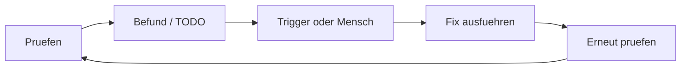

<!-- concept-facts-sha256: 47f72cd8883f6032a246606f7af297a20af1c83a1a13ed6078d019d53951318a -->
<!-- concept-source: d7e7e28cf7209b4369ad33467bb4fe781a178baa -->

# Der Selbstverbesserungs-Kreislauf

## Wofür taugt das?

Selbstverbesserung folgt hier einem geregelten Kreislauf: Ein Workflow oder Audit schreibt Befunde als Gate-Status oder TODO-Marker in die Run-Metadaten. TODO-Trigger prüfen offene TODOs nach Tags, Projekt, Quelle und Mindestpriorität. Passt ein Eintrag und sind Höchstversuche sowie laufende Fix-Runs unkritisch, startet ein konfigurierter Ziel-Workflow mit dem TODO-Kontext. Danach werden Versuchszähler, letzter Fix-Run und Trigger-Statistik aktualisiert. Eine erneute Prüfung bleibt ein eigener Schritt; ein technisch abgeschlossener Run ist noch kein fachlicher Wirksamkeitsnachweis.

Ein sinnvoller Einsatz ist die kontrollierte Nacharbeit wiederkehrender Qualitätsbefunde: etwa wenn ein Analyse-Workflow rote oder gelbe Gates erzeugt und daraus gezielte TODOs für begrenzte Fix-Workflows entstehen.

## Vorteile

Der Mechanismus trennt Erkennung, Arbeitsauftrag, Ausführung und Bewertung. Dadurch lassen sich automatische Reaktionen eng konfigurieren statt pauschal auf jeden Befund zu reagieren. Backlog-Verarbeitung verhindert, dass nur neu erzeugte TODOs berücksichtigt werden; pro Poll wird dennoch nur ein passender Kandidat gestartet. Pausenfenster, Maximalversuche und die Prüfung auf noch laufende Fix-Runs begrenzen Endlosschleifen. Gate-Zusammenfassungen in Metadaten erlauben späteren Vergleich, ohne alle Schritt-Ausgaben erneut auszuwerten.

## Nachteile und Kosten

Der Nutzen hängt stark von guten Trigger-Regeln, TODO-Qualität und nachgelagerter Verifikation ab. Aktuell sind acht aktive TODO-Trigger nur ein Bestandswert, kein Effektivitätsnachweis. Dass bei 2016 von 2018 TODOs kein optionaler resolutionState gesetzt ist, belegt keine unterbrochene Prüfkette, sondern fehlende Daten auf einem manuellen Resolve-Pfad. Kausaler Nutzen, Fehlerquote und Verifikationsabdeckung fehlen ausdrücklich.

## Betriebsbeleg

Messung: **2026-09-19 (UTC)**, eine lokale Entwicklungsinstanz. Bestandszähler beziehen sich auf die über REST sichtbaren Datensätze; Schrittzahlen zählen gespeicherte Schritte mit Typ-Metadaten im 30-Tage-Fenster. Wrapper zählen einmal. Dies ist kein Wirksamkeitsnachweis.

| Messgröße | Anzahl / Bezugsgröße |
|---|---:|
| TODOs ohne Zustand im optionalen Resolve-Pfad | 2016 / 2018 |
| Aktive TODO-Trigger | 8 |

[Definitionen, Messgrenzen und Rohzähler](betriebsdaten.json) · [Messmethode und Wiederholung](README.md)

## Im Code

- [RunCompletionHandler.java](../../ai-automation-backend/src/main/java/com/automation/service/workflow/RunCompletionHandler.java)
- [TodoTriggerService.java](../../ai-automation-backend/src/main/java/com/automation/service/trigger/TodoTriggerService.java)
- [GateStatusResolver.java](../../ai-automation-backend/src/main/java/com/automation/service/todo/GateStatusResolver.java)
