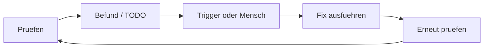

<!-- concept-source: d7e7e28cf7209b4369ad33467bb4fe781a178baa -->

# Der Selbstverbesserungs-Kreislauf

## Wofür taugt das?

Selbstverbesserung folgt hier einem geregelten Kreislauf: Ein Workflow oder Audit schreibt Befunde als Gate-Status oder TODO-Marker in die Run-Metadaten. TODO-Trigger prüfen offene TODOs nach Tags, Projekt, Quelle und Mindestpriorität. Passt ein Eintrag und sind Höchstversuche sowie laufende Fix-Runs unkritisch, startet ein konfigurierter Ziel-Workflow mit dem TODO-Kontext. Danach werden Versuchszähler, letzter Fix-Run und Trigger-Statistik aktualisiert. Eine erneute Prüfung bleibt ein eigener Schritt; ein technisch abgeschlossener Run ist noch kein fachlicher Wirksamkeitsnachweis.

Ein sinnvoller Einsatz ist die kontrollierte Nacharbeit wiederkehrender Qualitätsbefunde: etwa wenn ein Analyse-Workflow rote oder gelbe Gates erzeugt und daraus gezielte TODOs für begrenzte Fix-Workflows entstehen.

## Vorteile

Der Mechanismus trennt Erkennung, Arbeitsauftrag, Ausführung und Bewertung. Dadurch lassen sich automatische Reaktionen eng konfigurieren statt pauschal auf jeden Befund zu reagieren. Backlog-Verarbeitung verhindert, dass nur neu erzeugte TODOs berücksichtigt werden; pro Poll wird dennoch nur ein passender Kandidat gestartet. Gegen Endlosschleifen wirken drei Schichten: Ein vom Trigger gestarteter Fix-Run ist in den Run-Metadaten als solcher markiert und erzeugt selbst kein TODO, je TODO ist die Zahl der Fix-Versuche begrenzt, und solange ein Fix-Run läuft, startet kein zweiter; das Pausenfenster legt den Mechanismus zusätzlich befristet still. Gate-Zusammenfassungen in Metadaten erlauben späteren Vergleich, ohne alle Schritt-Ausgaben erneut auszuwerten.

## Nachteile und Kosten

Der Nutzen hängt stark von guten Trigger-Regeln, TODO-Qualität und nachgelagerter Verifikation ab. Belege für kausalen Nutzen, Fehlerquote und Verifikationsabdeckung fehlen.

## Im Code

- [RunCompletionHandler.java](../../ai-automation-backend/src/main/java/com/automation/service/workflow/RunCompletionHandler.java)
- [TodoTriggerService.java](../../ai-automation-backend/src/main/java/com/automation/service/trigger/TodoTriggerService.java)
- [GateStatusResolver.java](../../ai-automation-backend/src/main/java/com/automation/service/todo/GateStatusResolver.java)
