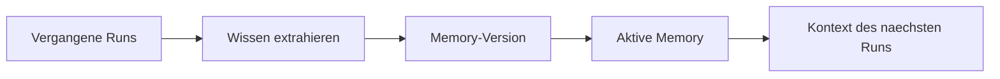

<!-- concept-source: d7e7e28cf7209b4369ad33467bb4fe781a178baa -->

# Workflow-Memory

## Wofür taugt das?

Workflow-Memory speichert verdichtete Erfahrungen aus früheren Workflow-Läufen als versionierte Erinnerung pro Workflow. Bei der Extraktion werden ausgewählte oder, ohne Auswahl, die bis zu zehn neuesten Läufe gelesen, ihre Schrittresultate vorverarbeitet und von einem KI-Summarizer zu Titel, Inhalt und Tags zusammengefasst. Die neue Erinnerung ist zunächst inaktiv; bei automatischer Extraktion nach erfolgreichen Läufen wird sie direkt aktiviert und ersetzt die bisher aktive Version. Vor einem späteren Lauf schreibt die Plattform genau die aktive Erinnerung als Kontextdatei in das Projekt, damit die gestarteten KI-CLI-Aufrufe sie mitlesen können. Ein sinnvoller Einsatz ist ein wiederkehrender Wartungsworkflow, der aus vergangenen Korrekturen lernt, welche Projektkonventionen, Prüfschritte oder typischen Stolperstellen zu beachten sind.

## Vorteile

Der Mechanismus macht implizites Laufwissen wiederverwendbar, ohne jeden Workflow dauerhaft im Prompt manuell zu pflegen. Da nur eine aktive Version gilt, bleibt kontrollierbar, welche Zusammenfassung in Folgeaufrufe gelangt; ältere Versionen können bestehen, ohne automatisch mitzuwirken. Lesen der Runs, KI-Zusammenfassung und Speichern sind bewusst in kurze Datenbankphasen und einen externen KI-Aufruf getrennt, damit ein langsamer Summarizer nicht unnötig Datenbankverbindungen blockiert. Fehlt eine aktive Erinnerung, wird eine alte Kontextdatei entfernt; dadurch werden veraltete Inhalte nicht absichtlich weitergereicht.

## Nachteile und Kosten

Die Erinnerung ist eine KI-Zusammenfassung, keine geprüfte Wahrheit. Fehler, Auslassungen oder veraltete Annahmen können sich in spätere Läufe fortpflanzen, besonders wenn automatische Aktivierung genutzt wird. Jede Extraktion und jedes Mitsenden erhöht Aufwand, Latenz und Promptumfang; lokale Speicherung bedeutet zudem nicht, dass die beteiligten KI-Aufrufe lokal bleiben.

## Im Code

- [WorkflowMemoryService.java](../../ai-automation-backend/src/main/java/com/automation/service/memory/WorkflowMemoryService.java)
- [ExecutionContextFactory.java](../../ai-automation-backend/src/main/java/com/automation/service/workflow/ExecutionContextFactory.java)
