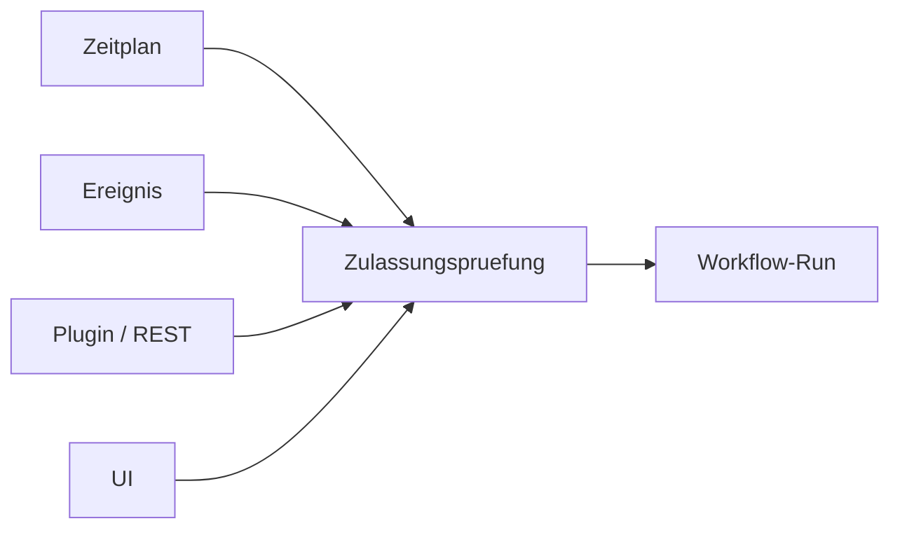

<!-- concept-facts-sha256: 47f72cd8883f6032a246606f7af297a20af1c83a1a13ed6078d019d53951318a -->
<!-- concept-source: d7e7e28cf7209b4369ad33467bb4fe781a178baa -->

# Zugaenge: Zeitplan, Ereignis, Plugin und UI

## Wofür taugt das?

Der Mechanismus bündelt mehrere Zugänge zu Workflow-Läufen: manuelle Starts aus Oberfläche oder REST, Wiederaufnahme und Wiederholung, geplante Starts, Webhooks, TODO- und Abschluss-Trigger sowie verkettete oder untergeordnete Workflows. Alle Wege landen vor dem eigentlichen Lauf an einer gemeinsamen Zulassung. Dort wird die Herkunft als Trigger-Quelle bewertet, bei Ketten aus dem Elternlauf abgeleitet und anschließend an den Executor weitergegeben. Ein externes Sitzungs-Plugin kann Läufe über REST anstoßen; daraus folgt aber kein allgemeines dynamisches Plugin-System.

Ein sinnvoller Einsatz ist ein lokales Einzelplatzsystem, in dem dieselbe Automatisierung sowohl ad hoc als auch nachts per Zeitplan laufen soll. Die Fachlogik bleibt identisch, während Startart, Nachvollziehbarkeit und Schutzregeln zentral entschieden werden.

## Vorteile

Der wichtigste Nutzen ist Vereinheitlichung: neue Startwege müssen nicht jeweils eigene Sicherheits- und Provenienzlogik nachbauen. Die Zulassung kann Hash und passende Version einer Workflow-Definition erfassen und versiegelte Definitionen vor dem Start prüfen. Optional dürfen unbeaufsichtigte Läufe nur versiegelte Workflows ausführen; unbekannte Herkunft wird dabei sicherheitshalber wie unbeaufsichtigt behandelt. Manuelle Starts bleiben unterscheidbar von automatischen Starts, und Ketten übernehmen die Herkunft ihres Elternlaufs statt sie zu verschleiern.

## Nachteile und Kosten

Die Lösung garantiert keine genau-einmalige Ausführung. Unbeaufsichtigte Starts hängen von Konfiguration und aktivierten Triggern ab, nicht allein vom Code. Außerdem ist der Betrieb auf einen API-Schlüssel und lokalen Einbenutzerbetrieb ausgelegt; Mandanten- oder Rechtekonzepte sind damit nicht belegt.

Der aktuelle Betriebsbefund ist nur ein Bestand: 24 von 48 Zeitplänen sind aktiv, aktive Webhooks fehlen, TODO-Trigger sind aktiv, Abschluss-Trigger nicht. Daraus lassen sich weder Nutzung, fachlicher Nutzen, Fehlerquote noch Prüfungsabdeckung ableiten; ältere Lebenszeitvergleiche fehlen wegen Aufbewahrung, Soft-Deletion und veränderlicher Metadaten.

## Betriebsbeleg

Messung: **2026-09-19 (UTC)**, eine lokale Entwicklungsinstanz. Bestandszähler beziehen sich auf die über REST sichtbaren Datensätze; Schrittzahlen zählen gespeicherte Schritte mit Typ-Metadaten im 30-Tage-Fenster. Wrapper zählen einmal. Dies ist kein Wirksamkeitsnachweis.

| Messgröße | Anzahl / Bezugsgröße |
|---|---:|
| Aktive Zeitpläne | 24 |
| Zeitpläne insgesamt | 48 |
| Aktive Webhooks | 0 |
| Aktive TODO-Trigger | 8 |
| Aktive Abschluss-Trigger | 0 |

[Definitionen, Messgrenzen und Rohzähler](betriebsdaten.json) · [Messmethode und Wiederholung](README.md)

## Im Code

- [TriggerSource.java](../../ai-automation-backend/src/main/java/com/automation/entity/TriggerSource.java)
- [RunAdmission.java](../../ai-automation-backend/src/main/java/com/automation/service/workflow/RunAdmission.java)
- [WorkflowController.java](../../ai-automation-backend/src/main/java/com/automation/controller/WorkflowController.java)
