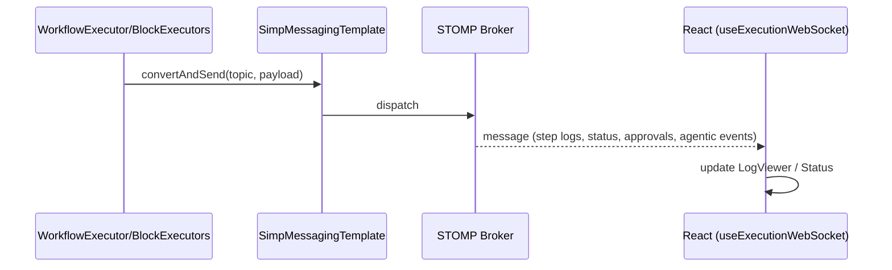
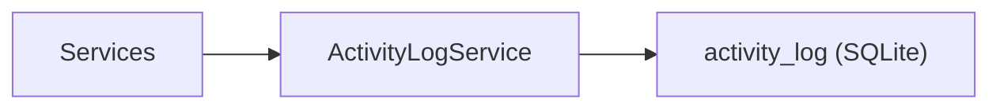

# MySuricates — Logging & Monitoring

WebSocket-Logs, ActivityLog, Health/Info, RateLimit Header

## WebSocket Log Pipeline — */topic/executions/{runId}/logs*

Payloads: StepResult (input/output/duration/status), Status-Events, approval_required/approval_resolved, agentic_* Events.

## ActivityLogService — *LogCategory*

| Kategorie | Beispiele |
|---|---|
| `EXECUTION` | Workflow start/complete/fail |
| `SCHEDULE` | Schedule triggered/failed |
| `SECURITY` | auth/rate-limit events |

## Health & Info — */api/v1/system*

### Health

`GET /api/v1/system/health`: Status OK

Offen (kein API-Key)

### Info

`GET /api/v1/system/info`: Version, Build Timestamp

Offen (kein API-Key)

## Rate Limit Header — *Filter*

Bei aktivem RateLimitFilter werden verbleibende Requests im Header geliefert.

| Header | Bedeutung |
|---|---|
| `X-RateLimit-Remaining` | Requests im aktuellen 1-Minuten-Fenster |
