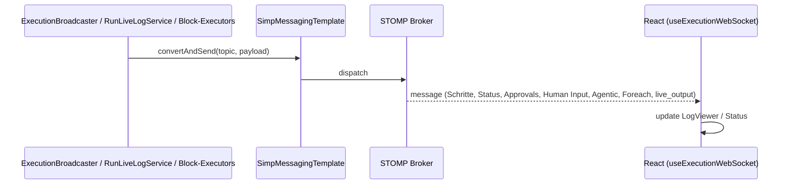
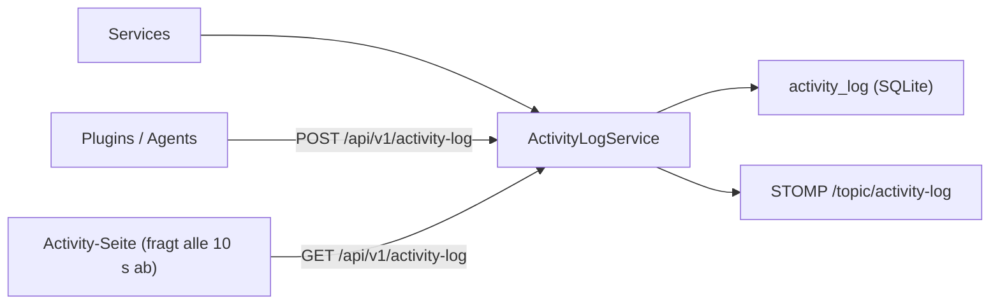

# MySuricates — Logging & Monitoring

WebSocket-Logs, ActivityLog, Health/Info, RateLimit Header

## WebSocket Log Pipeline — */topic/executions/{runId}/logs*

Nachrichten: Schritt-Ergebnis (`stepIndex`, `status`, `input`, `output`, `durationMs`, Blocktyp und -name), `status`, `approval_required`/`approval_resolved`, `human_input_required`/`human_input_resolved`, `agentic_*`, `foreach_*`, `container_*`, `command` und `live_output`.

`live_output` bündelt die Ausgabe laufender Blöcke. `RunLiveLogService` hält die letzten Zeilen nur im Speicher; `GET /api/v1/executions/{id}/live-log` liefert sie einem Client nach, der die Seite neu lädt oder später öffnet.

## ActivityLogService — *LogCategory*

| Kategorie | Beispiele |
|---|---|
| `EXECUTION` | Workflow gestartet, abgeschlossen, fehlgeschlagen; Aufräumen nach dem Start, Ghost-Run-Watchdog |
| `SCHEDULE` | Zeitplan ausgelöst, übersprungen, nachgeholt |
| `SECURITY` | falscher oder fehlender API-Key, abgelehnte Webhook-Signatur, Siegel gesetzt oder entfernt, abgewiesener Start |
| `SYSTEM` | Workflow angelegt, geändert, gelöscht |
| `WEBHOOK` | Webhook angelegt, ausgelöst, gelöscht |
| `CONTAINER` | Projekt-Container gestartet, gestoppt, im Leerlauf aufgeräumt |
| `PLUGIN` | Einträge von außen über `POST /api/v1/activity-log` |

## Health & Info — */api/v1/system*

### Health

`GET /api/v1/system/health`: `status` `UP`, `DEGRADED` (Docker eingerichtet, antwortet aber nicht) oder `DOWN` (Datenbank nicht erreichbar), dazu `components.database` und `components.docker`

Offen (kein API-Key)

### Info

`GET /api/v1/system/info`: Name, Version, Build-Typ und -Zeitpunkt, Java-Version, Laufzeitmodus, Tailscale-Status, Umgebung, Rate-Limit-Kennzahlen

Offen (kein API-Key)

### Weitere offene Sonden

`GET /api/v1/system/auth-status`, `GET /api/v1/system/jvm-memory` (drei Heap-Zahlen) und `/actuator/health`

Die übrigen `/actuator/**`-Endpunkte, etwa `/actuator/metrics`, brauchen den API-Key

## Rate Limit Header — *Filter*

Der `RateLimitFilter` ist standardmäßig an (120 Anfragen pro Minute und Client-IP, nur `/api/**`); jede durchgelassene Antwort nennt den Rest, ein 429 die Wartezeit.

| Header | Bedeutung |
|---|---|
| `X-RateLimit-Remaining` | Verbleibende Anfragen im aktuellen 1-Minuten-Fenster |
| `Retry-After` | Bei 429: Sekunden, bis das Fenster wieder frei ist |
