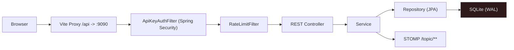
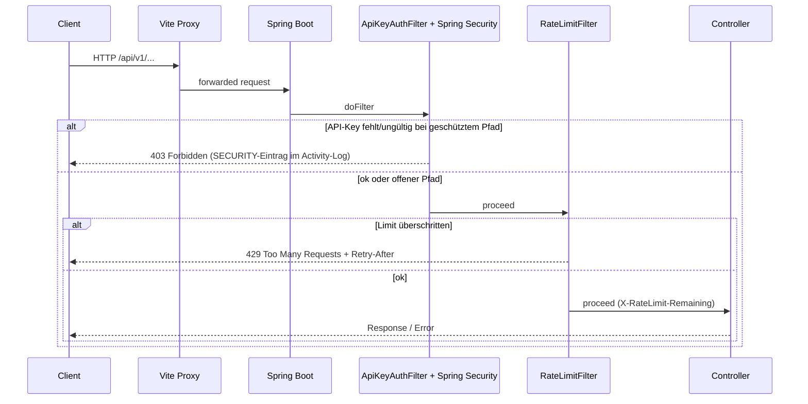
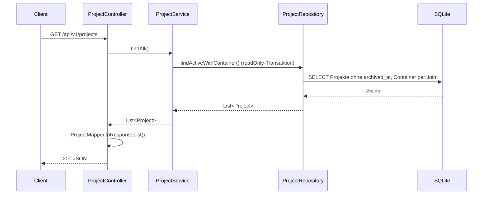

# MySuricates — Request Lifecycle & Security

Vom Browser bis zur Datenbank: Filter, Fehlerformat, Auth, Rate Limits

## Systemübersicht — *Request Path*

HTTP-Anfragen laufen über den Vite-Proxy (Dev) oder direkt zum Spring-Boot-Backend, passieren Spring Security mit dem `ApiKeyAuthFilter` und den `RateLimitFilter` und landen in den REST-Controllern. Live-Nachrichten schicken die Services per STOMP.

## Filterkette — *Vor den Controllern*

Reihenfolge: Spring Security mit `ApiKeyAuthFilter` → `RateLimitFilter` → Controller. Ohne gültigen Key weist Spring Security geschützte Pfade mit 403 ab, bevor Business-Logik startet; das Rate Limit zählt nur `/api/**`.

## Controller → Service → Repository — *Beispiel: /projects*

Controller sind schlank; Services kapseln Logik und Transaktionen, Repositories sprechen SQLite über eine einzige Verbindung (HikariCP `maximum-pool-size: 1`). Open Session in View ist aus: Lazy-Laden gehört in den Service, der Controller mappt mit MapStruct in DTOs.

## Fehlerformat — *GlobalExceptionHandler*

| Fall | Status | Body |
|---|---|---|
| Validierung | 400 | `{"code":"VALIDATION_FAILED","error":"Validation failed","timestamp":"…","fieldErrors":{...}}` |
| Ungültiges Argument | 400 | `{"code":"INVALID_ARGUMENT","error":"…","timestamp":"…"}` |
| Nicht gefunden | 404 | `{"code":"RESOURCE_NOT_FOUND","error":"…","timestamp":"…"}` |
| Zustandskonflikt | 409 | `{"code":"STATE_CONFLICT","error":"…","timestamp":"…"}` |
| Rate Limit (Filter, nicht Handler) | 429 | `{"error": "Rate limit exceeded", "retryAfterSeconds": N}` |
| Server | 500 | `{"code":"INTERNAL_ERROR","error":"Internal server error","timestamp":"…"}` |

## Security & Rate Limit — *Konfiguration*

### API-Key

`automation.security.enabled=true` (Standard)

Header: `X-API-Key`; ohne `automation.security.api-key` erzeugt das Backend beim ersten Start einen Schlüssel und legt ihn in `app_settings` ab

Constant-Time Vergleich (`MessageDigest.isEqual`)

### Rate Limit

`automation.security.rate-limit.enabled` (Standard `true`), `requests-per-minute` (Standard `120`)

Festes 1-Minuten-Fenster je Client-IP; `X-Forwarded-For` zählt nur hinter `trusted-proxies`

Header: `X-RateLimit-Remaining`, bei 429 `Retry-After`

## Offene Endpunkte — *ohne API-Key*

- `GET /api/v1/system/health`, `/info`, `/auth-status`, `/jvm-memory`
- `POST /api/v1/webhook/trigger/{token}` — mit gesetztem Secret nur mit gültiger HMAC-Signatur (`X-Signature`)
- `GET /api/v1/integrations/{providerId}/callback` (OAuth-Rückruf)
- `/ws/**` (SockJS/STOMP) — ohne Key-Header, der Handshake verlangt aber ein Einmal-Ticket aus `POST /api/v1/ws-ticket`
- `/actuator/health`; die übrigen `/actuator/**` nur mit Key
