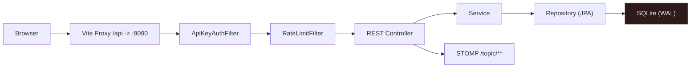
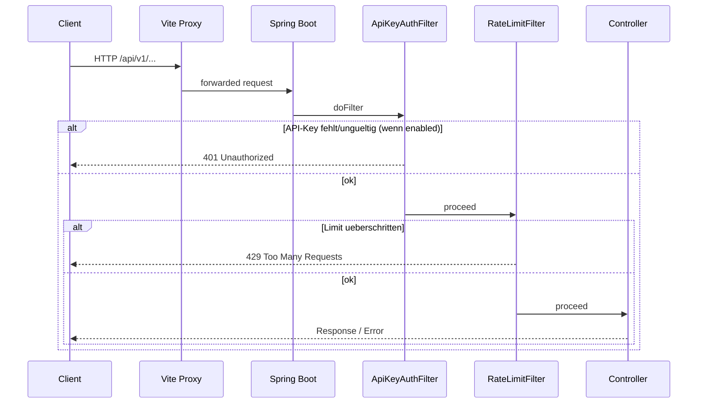
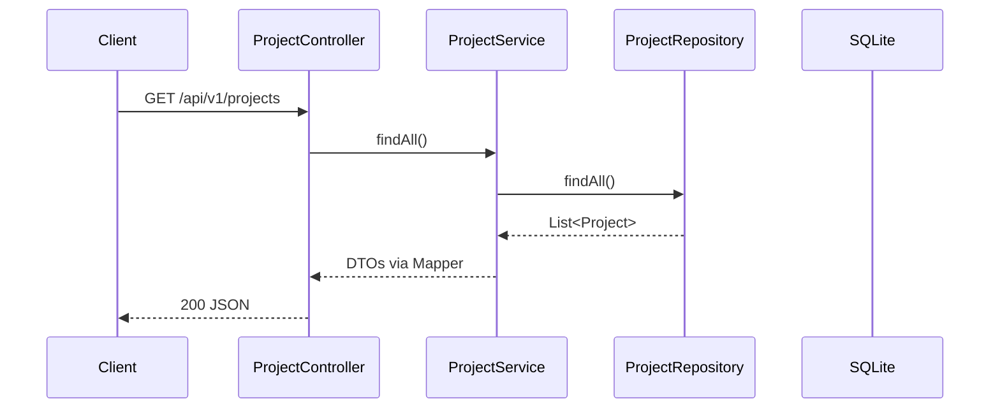

# AutoPilot — Request Lifecycle & Security

Vom Browser bis zur Datenbank: Filter, Fehlerformat, Auth, Rate Limits

## Systemuebersicht — *Request Path*

HTTP-Anfragen laufen ueber den Vite-Proxy (Dev) oder direkt zum Spring Boot Backend, passieren Security-Filter und landen in den REST-Controllern.

## Filterkette — *Vor den Controllern*

Reihenfolge: ApiKeyAuth → RateLimit → Controller. Bei Fehlkonfig oder fehlendem Key wird die Anfrage abgewiesen, bevor Business-Logik startet.

## Controller → Service → Repository — *Beispiel: /projects*

Controller sind schlank; Services kapseln Logik, Repositories sprechen SQLite.

## Fehlerformat — *GlobalExceptionHandler*

| Fall | Status | Body |
|---|---|---|
| Validation | 400 | `{"error":"Validation failed","fieldErrors":{...}}` |
| Not Found | 404 | `{"error":"Resource not found"}` |
| Rate Limit | 429 | `{"error":"Too many requests"}` |
| Server | 500 | `{"error":"Internal server error"}` |

## Security & Rate Limit — *Konfiguration*

### API-Key

`automation.security.enabled=true`

Header: `X-API-Key`

Constant-Time Vergleich (`MessageDigest.isEqual`)

### Rate Limit

`automation.security.rate-limit.enabled` (default false)

Sliding Window, 120 req/min pro Client-IP

Header: `X-RateLimit-Remaining`

## Offene Endpunkte — *ohne API-Key*

- `GET /api/v1/system/health`
- `GET /api/v1/system/info`
- `POST /api/v1/webhook/trigger/{token}`
- `/ws/**` (SockJS/STOMP)
- `/actuator/**`
