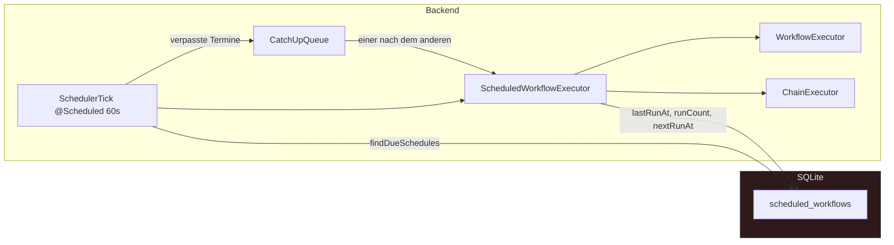
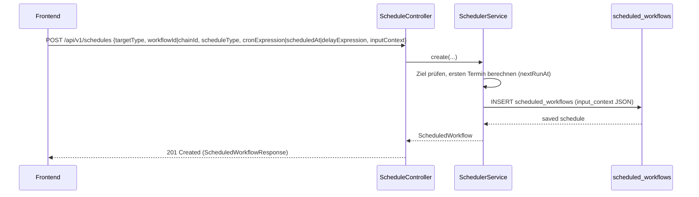
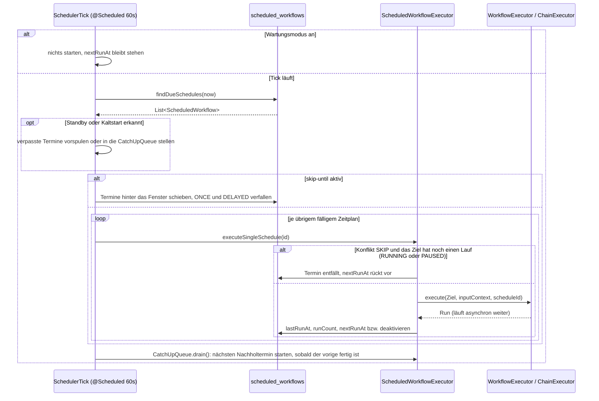

# MySuricates — Scheduler & Cron

Zeitpläne, InputContext, Auslösung und Ausführungspipeline

## Systemübersicht — *Scheduler-Tick*

Alle 60 Sekunden prüft `SchedulerTick` die fälligen Zeitpläne und startet ihr Ziel — einen Workflow oder eine Kette — mit dem gespeicherten `inputContext`. Termine, die in einer Lücke fällig wurden (Standby, Kaltstart), holt die `CatchUpQueue` nacheinander nach oder schiebt sie auf ihr nächstes Vorkommen.

## Anlegen von Zeitplänen — *API Flow*

### Typen

`scheduleType`: `CRON` (Standard), `ONCE` oder `DELAYED`

CRON braucht `cronExpression`, ONCE `scheduledAt`, DELAYED eine `delayExpression` wie `30s`, `10m`, `2h` oder `1d`

Ziel: `targetType` `WORKFLOW` (Standard, mit `workflowId`) oder `CHAIN` (mit `chainId`)

### InputContext

Beliebiges JSON-Objekt; `ScheduledWorkflowExecutor` übergibt es an `WorkflowExecutor.execute(…)` bzw. `ChainExecutor.execute(…)`.

Bei einem Workflow überschreiben seine Werte gleichnamige Einträge des `defaultContext` — Zeitpläne laufen so mit den gespeicherten Variablen.

## Ausführung — *Fällige Zeitpläne*

## Datenmodell — *scheduled_workflows*

| Spalte | Beschreibung |
|---|---|
| `target_type` | `WORKFLOW` \| `CHAIN` |
| `workflow_id`, `chain_id` | Ziel (FK → `workflows` bzw. `workflow_chains`) |
| `schedule_type` | `CRON` \| `ONCE` \| `DELAYED` |
| `cron_expression` | CRON-String (leer bei ONCE und DELAYED) |
| `scheduled_at` | Ausführungszeitpunkt für ONCE und DELAYED |
| `delay_expression` | Verzögerung für DELAYED, z. B. `2h` |
| `input_context` | JSON-Map (Parameter für den Run) |
| `enabled` | An/Aus |
| `last_run_at`, `next_run_at` | Letzter Start, nächster Termin |
| `end_date`, `max_runs`, `run_count` | Endbedingungen für CRON (`max_runs` = `0`: unbegrenzt) |
| `conflict_behavior` | `SKIP` (Standard) oder `OVERLAP` |
| `catch_up_on_resume` | Verpasste Termine dieses Zeitplans nachholen |

## Konfig & Verhalten — *wichtige Punkte*

### Validierung

CRON wird mit `CronExpression.isValidExpression` geprüft.

ONCE erfordert `scheduledAt`, DELAYED eine `delayExpression`.

### Takt & nextRunAt

Tick: `@Scheduled(fixedRate = 60_000)` in `SchedulerTick`.

Nach einem Start: CRON → nächster Termin, deaktiviert, sobald `maxRuns` oder `endDate` erreicht ist; ONCE und DELAYED → deaktiviert.

### Konflikt

`SKIP` (Standard): Hat das Ziel noch einen Lauf in `RUNNING` oder `PAUSED`, entfällt der Termin — CRON rückt zum nächsten vor, ONCE und DELAYED verfallen; `lastRunAt` und `runCount` bleiben unverändert.

`OVERLAP` startet einen zweiten Lauf daneben.

### Verpasste Termine

Erkannt als Tick-Lücke über `automation.scheduler.resume-grace-minutes` (Standard 5) oder als erster Tick nach dem Start.

Nachgeholt wird einzeln über die `CatchUpQueue` — für alle Zeitpläne, solange `scheduler-catch-up-on-resume` an ist (Standard), sonst nur mit `catchUpOnResume`. Alle übrigen springen auf ihren nächsten Termin.

### Pausen

Wartungsmodus (`POST /api/v1/schedules/maintenance`): Der Tick startet nichts, `nextRunAt` bleibt stehen.

`automation.scheduler.skip-until` (ISO-Zeitpunkt): Fällige Termine springen hinter das Fenster; es gewinnt auch gegen das Nachholen.
