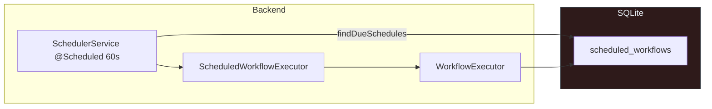
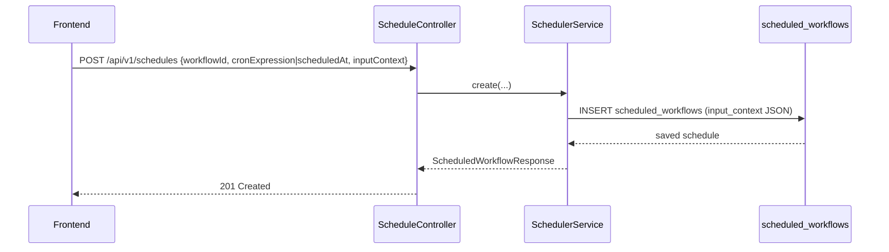
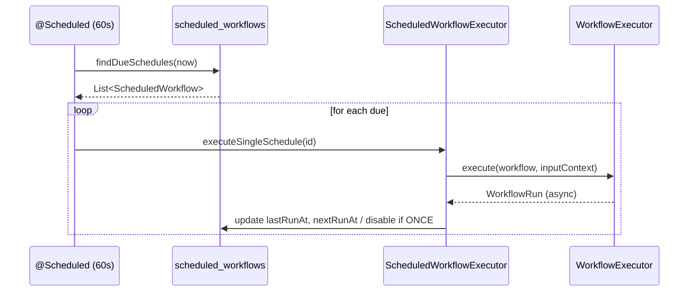

# AutoPilot — Scheduler & Cron

Schedules, InputContext, Ausloesung und Ausfuehrungspipeline

## Systemuebersicht — *Scheduler Loop*

Ein Minutentakt prueft faellige Schedules und startet Workflows mit gespeichertem `inputContext`.

## Anlegen von Zeitplaenen — *API Flow*

### Typen

`scheduleType`: `CRON` (default) oder `ONCE`

CRON braucht `cronExpression`; ONCE braucht `scheduledAt`

### InputContext

Beliebiges JSON; wird 1:1 an `workflowExecutor.execute(..., context)` weitergegeben.

Damit laufen Zeitplaene deterministisch mit den gespeicherten Variablen.

## Ausfuehrung — *Due Schedules*

## Datenmodell — *scheduled_workflows*

| Spalte | Beschreibung |
|---|---|
| `workflow_id` | FK → workflow |
| `cron_expression` | CRON-String (leer bei ONCE) |
| `schedule_type` | `CRON` \| `ONCE` |
| `scheduled_at` | Execution-Timestamp fuer ONCE |
| `input_context` | JSON Map (Parameter fuer Run) |
| `enabled` | Toggle |
| `last_run_at`, `next_run_at` | Tracking |

## Konfig & Verhalten — *wichtige Punkte*

### Validierung

CRON wird mit `CronExpression.isValidExpression` geprüft.

ONCE erfordert `scheduledAt`.

### Takt & NextRun

Check: jede Minute (`@Scheduled(fixedRate=60_000)`).

Nach Ausführung: CRON → nextRun neu berechnet, ONCE → disabled.
