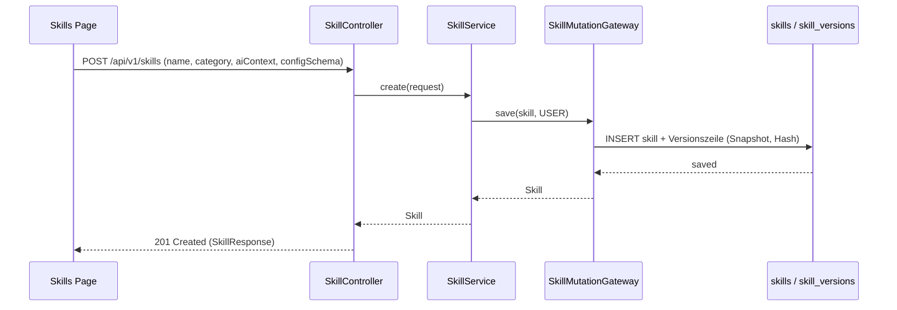
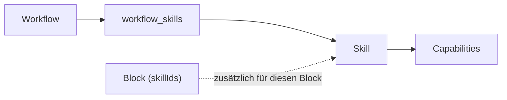
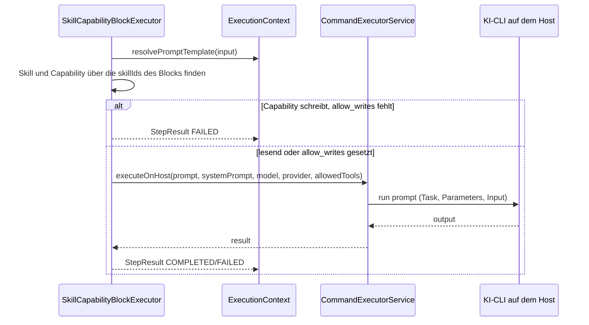

# MySuricates — Skills & Capabilities

Skill-Lebenszyklus, Aktivierung pro Workflow, Ausführung im Skill-Capability-Block

## Lifecycle — *CRUD*

Skills sind ein optionales Modul (`skills`, im Preset `full`). Jede Änderung läuft über `SkillMutationGateway`, das eine Versionszeile schreibt.

Capabilities entstehen nicht beim Anlegen: Sie kommen aus den Built-in-Skills (`skills/builtin/*.json`, beim Start eingespielt) oder aus einem Import (`POST /api/v1/skills/import`). Built-ins sind schreibgeschützt; einen Skill, den ein versiegelter Workflow nutzt, lehnt der Gateway mit 409 ab.

## Aktivierung pro Workflow — */workflows/{id}/skills*

`POST /api/v1/workflows/{id}/skills` aktiviert, `DELETE /api/v1/workflows/{id}/skills/{skillId}` deaktiviert.

Vor dem ersten Block schreibt der Run den `aiContext` der aktivierten Skills nach `.claude/rules/skills-context.md` im Projekt (`CommandExecutorService.writeSkillContextToProject`); ein Block mit eigenen `skillIds` ergänzt sie für seine Dauer. Die Claude-CLI liest `.claude/rules/` selbst, Codex und Pi bekommen die Datei an den System-Prompt gehängt.

## Ausführung einer Capability — *skill-capability Block*

### Prompt-Aufbau

`Task: <description>` + `Parameters: {…}` + `Input: …` — ohne Beschreibung steht dort der Name der Capability

System-Prompt = `aiContext` des Skills + Workflow-Anweisungen

### Rechte

Ohne `allow_writes` bekommt die CLI nur lesende Werkzeuge: `Read`, `Grep`, `Glob`, `WebFetch`, `WebSearch`, `Task`, `TodoWrite`.

Eine Capability mit `writes` verlangt `allow_writes: true`, sonst scheitert der Schritt.

### Kontext

`input` wird wie ein Prompt aufgelöst: `{{ previous_output }}`, `{{ block.<name>.output }}`, Kontextvariablen.

`params` gehen als Parameter in den Prompt.

## Datenmodell — *skills & capabilities*

| Tabelle | Wichtig |
|---|---|
| `skills` | name, description, icon, category, ai_context, config_schema, builtin, version |
| `capabilities` | skill_id, name, description, handler_class, input_schema, output_schema, async, writes |
| `workflow_skills` | workflow_id, skill_id (Aktivierung) |
| `skill_versions` | skill_id, version_number, operation, snapshot, content_hash, change_source |
