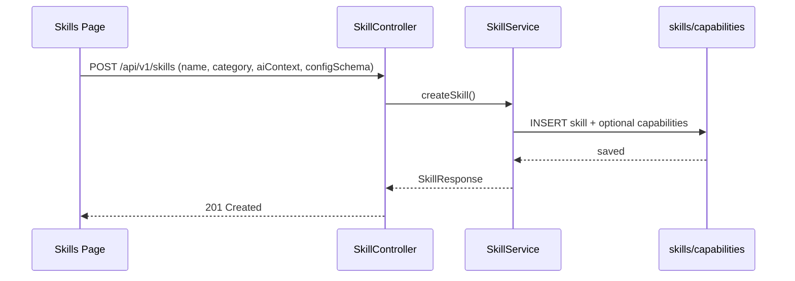
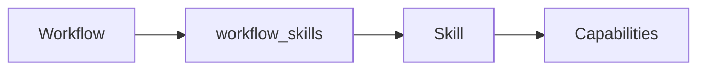
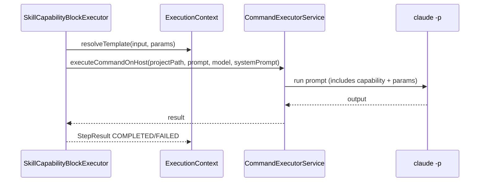

# AutoPilot — Skills & Capabilities

Skill-Lebenszyklus, Aktivierung pro Workflow, Ausfuehrung im Skill-Capability Block

## Lifecycle — *CRUD*

## Aktivierung pro Workflow — */workflows/{id}/skills*

Aktivierte Skills werden vor Ausfuehrung in das Projekt injiziert (`injectSkillContextOnHost`).

## Ausfuehrung einer Capability — *skill-capability Block*

### Prompt-Aufbau

`"Use your '<capability>' capability..."` + Params + Input

SystemPrompt = Workflow Instruction Prefix

### Kontext

Skill-Kontext (aiContext) zuvor injiziert in CLI-Session.

Template-Variablen: `{{ previous_output }}`, `{{ vars }}`

## Datenmodell — *skills & capabilities*

| Tabelle | Wichtig |
|---|---|
| `skills` | name, description, category, ai_context, config_schema, builtin, version |
| `capabilities` | skill_id, name, description, handler_class, input_schema, output_schema, async |
| `workflow_skills` | workflow_id, skill_id (Aktivierung) |
