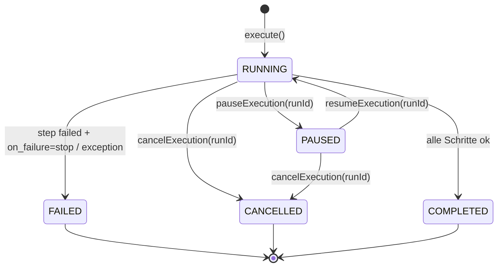
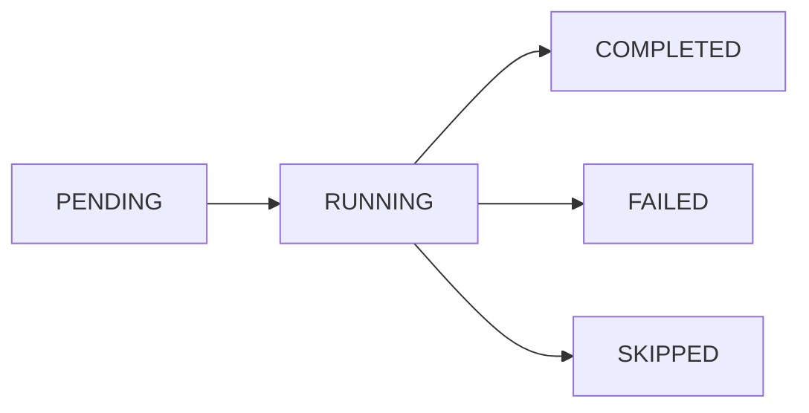
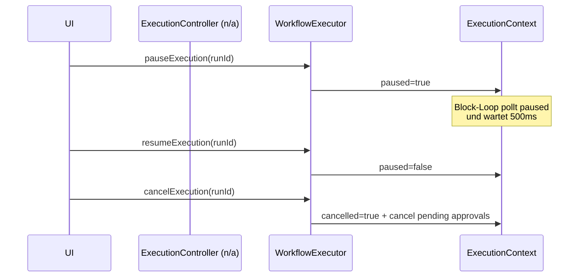
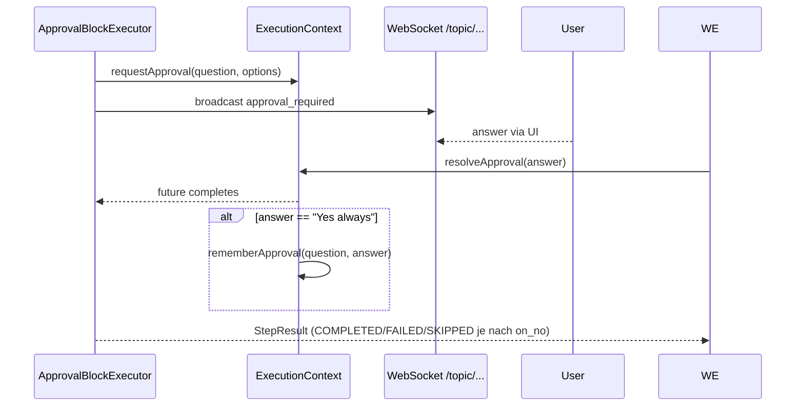

# MySuricates — Workflow Control & States

Status-Maschinen, Pause/Resume/Cancel, Approval & Fehlerpfade

## WorkflowRun State Machine — *RunStatus*

## StepResult Status — *StepStatus*

Setzen durch BlockExecutor: Shell/Claude Exit-Code -> COMPLETED/FAILED; Conditional ohne Branch -> SKIPPED.

## Pause / Cancel — *ExecutionContext*

## Approval Flow — *ApprovalBlock & Agentic*

## Fehlerpfade & Stop-on-Failure — *BlockDefinition.on_failure*

### Default Verhalten

`on_failure` fehlt → stoppt Run bei FAILED-Step.

Setzbar auf `"continue"` falls Folge-Schritte trotzdem laufen sollen.

### Agentic Speziell

Stop-Gründe: ITERATION_TIMEOUT, TOTAL_TIMEOUT, TOKEN_BUDGET_EXCEEDED, REPEATED_ACTIONS, GOAL_STATUS=IMPOSSIBLE.

Status: FAILED wenn Ziel nicht erreicht.
