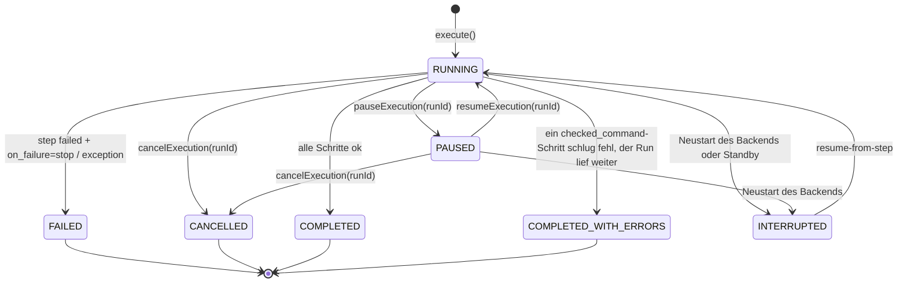
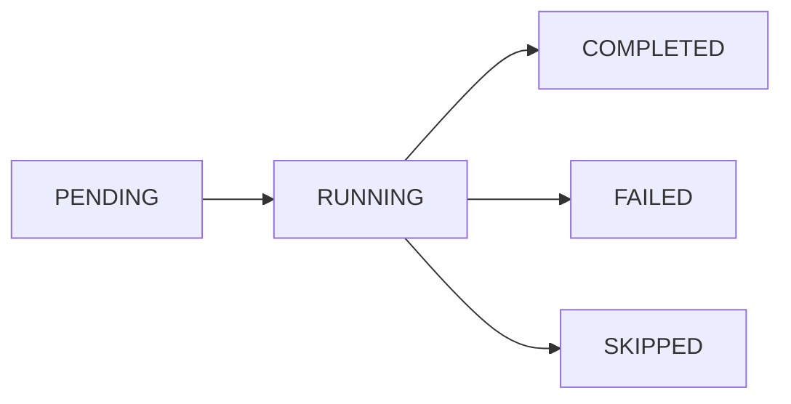
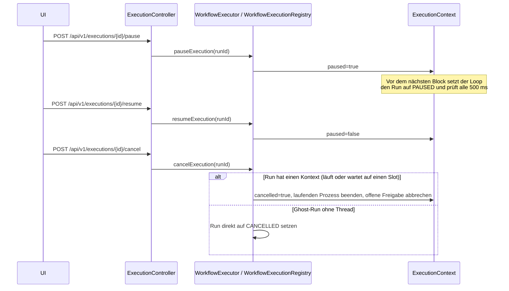
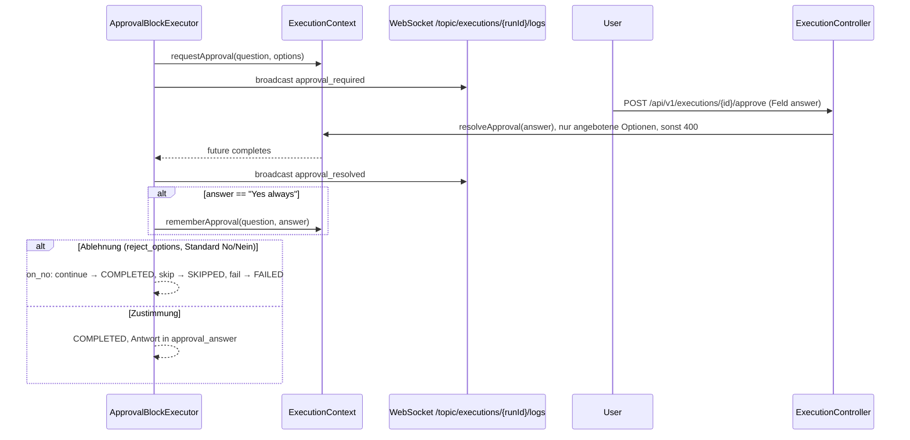

# MySuricates — Workflow Control & States

Status-Maschinen, Pause/Resume/Cancel, Approval & Fehlerpfade

## WorkflowRun State Machine — *RunStatus*

Ein Workflow-Run entsteht direkt als `RUNNING` (`PENDING` ist nur der Vorgabewert der Entität). Weist `RunAdmission` den Start ab — ein versiegelter Workflow passt nicht mehr zu seinem Siegel, oder ein unbeaufsichtigter Start trifft mit `require-sealed-for-unattended` auf einen unversiegelten Workflow —, entsteht gar kein Run.

Beim Start räumt das Backend Runs auf, die noch als `RUNNING` oder `PAUSED` gespeichert sind, und setzt sie auf `INTERRUPTED`. Einen Run ohne Ausführungs-Thread setzt der Watchdog nach `automation.execution.ghost-watchdog-stale-minutes` auf `FAILED` — oder auf `INTERRUPTED`, wenn kurz zuvor ein Standby erkannt wurde. `resume-from-step` setzt hinter dem letzten abgeschlossenen Schritt an; ohne abgeschlossenen Schritt startet ein neuer Run.

## StepResult Status — *StepStatus*

`BlockStepRunner` legt jeden Schritt gleich als `RUNNING` an (`PENDING` ist der Vorgabewert der Entität) und setzt dann das Ergebnis des BlockExecutors: Exit-Code der Shell bzw. der KI-CLI → COMPLETED/FAILED; Conditional ohne Befehl für den gewählten Zweig und abgelehntes Approval mit `on_no: skip` → SKIPPED.

## Pause / Cancel — *ExecutionContext*

## Approval Flow — *ApprovalBlock & Agentic*

Ohne Antwort nach `timeout_minutes` (Standard 30) oder beim Abbruch des Runs endet der Schritt `FAILED`. Wartende Freigaben listet `GET /api/v1/executions/pending-input` (Seite `/approvals`). Der Agentic-Block fragt mit `require_approval` über dieselbe Mechanik (`agentic_approval_required`); „No“ lässt dort die Iteration mit einem neuen Vorschlag wiederholen.

## Fehlerpfade & Stop-on-Failure — *BlockDefinition.on_failure*

### Default Verhalten

`on_failure` fehlt oder steht auf `"stop"` → ein FAILED-Schritt beendet den Run mit `FAILED`.

Mit `"continue"` laufen die Folge-Schritte trotzdem; scheitert dabei ein Schritt mit `checked_command`, endet der Run als `COMPLETED_WITH_ERRORS`.

### Agentic Speziell

Stop-Gründe: TOTAL_TIMEOUT, ITERATION_TIMEOUT, TOKEN_BUDGET_EXCEEDED, REPEATED_ACTIONS, TOKEN_TRACKING_FAILED; außerdem GOAL_STATUS=IMPOSSIBLE und das Erreichen von `max_iterations`.

Status: COMPLETED nur bei GOAL_STATUS=ACHIEVED, sonst FAILED.
